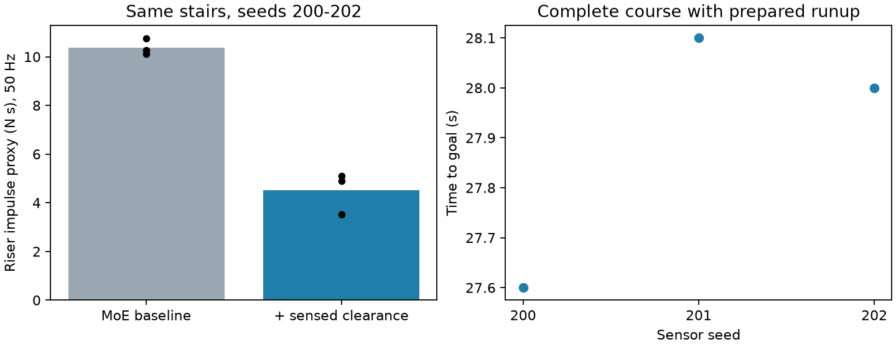

# 目标点感知越障评估

验证日期：2026-10-17。Ubuntu 24.04、L40 服务器；Python 3.11、MuJoCo 3.2.3、CPU 推理、EGL 视频。

## 实现与结论

本版把用户提供的二维目标、局部反应式绕障、感知摆腿间隙修正、NJU BBC 学习式跳跃及 MoE 恢复串联。
主要运行入口是 `go2_nav.active_run`，使用说明见 [ACTIVE_NAVIGATION.md](docs/ACTIVE_NAVIGATION.md)。
不需要预先地图或预设赛道路点，但使用理想仿真里程计、短时点云和最近走过的轨迹。
MoE 和 BBC 权重均来自固定上游，没有新训练视觉 RL 或运动网络。

| 测试 | 到达成功 / 回合 | 摔倒 | 成功平均用时 (s) |
|---|---:|---:|---:|
| 绕障→两级台阶→跳坑→目标 | 3/3 | 0 | 27.90 |
| 四级 8 cm 台阶，感知抬腿 | 3/3 | 0 | 15.07 |
| 相同台阶，关闭抬腿 | 3/3 | 0 | 15.23 |
| 绕障，目标 (8, 0.8) | 3/3 | 0 | 16.10 |
| NJU 跑动起跳，30 cm 宽深坑 | 3/3 | 0 | 11.80 |
| 70 cm 宽坑，预期停车 | 0/1 | 0 | — |
| 坑前目标 (1, 0)，无需跳跃 | 1/1 | 0 | 3.60 |
| 台阶，仅深度 | 1/1 | 0 | 15.70 |
| 台阶，仅雷达 | 1/1 | 0 | 15.30 |
| 连续任务，关闭后退蓄跑准备 | 1/3 | 2 | 21.50 |
| 连续任务，新目标 (13, 0.6)，seed 210 | 0/1 | 1 | — |

宽坑是负向检查：末位置 x=2.29 m，起跳 0 次，
摔倒=False，碰撞=False，结果不是到达成功。
默认坑起点 x=3 m；观察不足/超出已验证范围时应停止，不能把这条记录当成越过宽坑。

## 台阶是否提前抬腿

开启感知修正的三个回合均在首次足端立面接触之前发出修正，提前时间：
0.68, 0.64, 0.36 s。
关闭修正仍可通过台阶，说明原 MoE 已具有盲走越障能力；本次增加的是提前的摆腿修正。

50 Hz 接触力采样估算的立面冲量均值：基线 10.376，感知修正 4.511 N·s，
该组数据减少约 56.5%。这是采样代理指标，不能解释为精确的 500 Hz 接触积分，
也没有实现零碰撞。当前仅三种传感器噪声种子，场景几何没有随种子改变。



## 连续任务与蓄跑条件

`course` 包括实心障碍、两级 8 cm 台阶、平台上宽 30 cm / 深 80 cm 的坑、终点 (13, 0)。
使用 `configs/mission_runup.json` 和 `--jump-backend nju`。
感知到坑并确认对岸后，系统检查最近经过的平坦轨迹，后退、制动，
留出约 2.7 m 接近距离，以 BBC 建立跑动状态再起跳，稳定落地后交回 MoE。
因此这是有准备过程的目标导航，不是连续高速跑酷，也不保证任意环境有足够蓄跑空间。
没有安全的已走过路段时，当前方案仍可能无法完成跳跃。
关闭准备过程的原始对照见 [no_prepare](artifacts/active/no_prepare/summary.json)；
修改目标的单独检查见 [changed_goal](artifacts/active/changed_goal/summary.json)，不能据此宣称任意目标均已验证。

成功需进入目标 0.45 m 内且身体高于目标表面至少 0.20 m、姿态直立并至少两足支撑。
含坑且目标位于对岸时，另要求身体中心经过坑区时至少持续腾空 0.06 s。
躯干撞到地形、翻倒等判失败；控制中未施加外部基座力或修改机器人位姿。

独立 NJU 跳坑使用 `nju_runup`：先以 BBC 接近，跨坑后交回 MoE 到达目标。
它不能替代完整任务中的 MoE→BBC 交接评估。

## 原始证据与视频

- [连续任务视频](artifacts/active/course/episode_0.mp4) · [三回合原始指标](artifacts/active/course/summary.json)
- [台阶视频](artifacts/active/stairs/episode_0.mp4) · [感知抬腿数据](artifacts/active/stairs/summary.json) · [关闭抬腿对照](artifacts/active/blind/summary.json)
- [NJU 跳坑视频](artifacts/active/nju_gap/episode_0.mp4) · [指标](artifacts/active/nju_gap/summary.json)
- [指定目标绕障视频](artifacts/active/slalom/episode_0.mp4) · [指标](artifacts/active/slalom/summary.json)
- [宽坑停车视频](artifacts/active/wide_stop/episode_0.mp4) · [指标](artifacts/active/wide_stop/summary.json)
- `artifacts/active/exploration/` 保留无蓄跑连续任务失败、早期直接切换失败和参数标定记录；不是 RL 训练。
- `artifacts/active/tests.log` 保存测试输出，`source_sha256` 保存各回合启动时的 Python 源码摘要。

## 复现与边界

```bash
python -m go2_nav.active_run --scene course --goal 13 0 --jump-backend nju --config configs/mission_runup.json --episodes 3 --video --output outputs/course
python -m go2_nav.active_run --scene stairs --episodes 3 --video --output outputs/stairs
python -m go2_nav.active_run --scene stairs --episodes 3 --no-lift --output outputs/blind
```

深度与雷达是带噪声的理想射线模型，未复现真实传感器全部失效模式。
雷达扫描只近似 Mid-360 视场，近处地面主要依靠俯视深度图；单传感器仅做了一个种子的检查，不能据此推断统计优势。
相机和雷达用于几何感知，没有训练水体/材质语义识别。
定位是仿真真值，实机仍需同步、外参、里程计、传感器超时处理、负载辨识及有保护的运动验证。
本次没有向实机发送电机命令，没有证明任意未知场景或动态障碍下都能到达目标。

NJU 适配使用上游部署的 hip 缩放 0.3，并为 BBC 恢复其 Go2 URDF 的大腿关节范围；
其他物理资产来自 RoboGauge。因此不把本次适配结果称为复现 NJU 原论文的全部实验。
历史 `locomotion` 字段表示所加载的 MoE 基础策略，当前技能状态需结合 `nju_active`、`runup_stage` 和配置读取。
