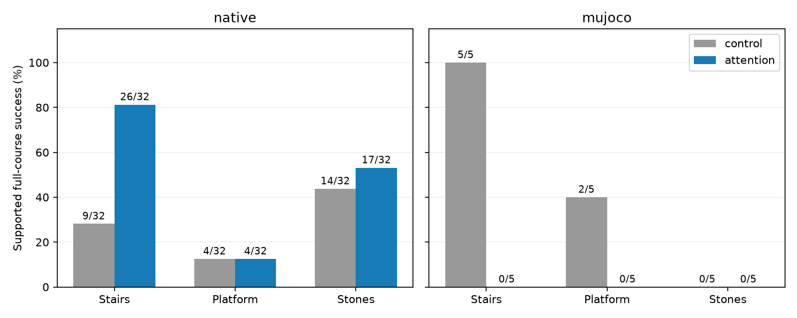
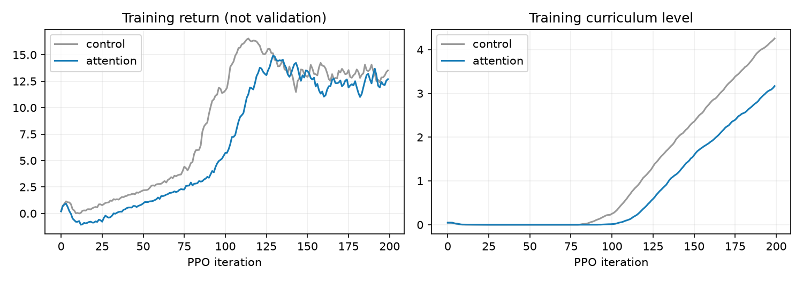
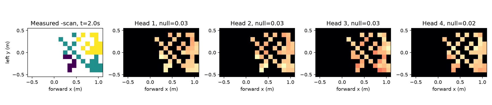

> 历史记录：运行状态属于记录当时，不是安装或当前任务状态。新用户先读[新手复现总览](docs/新手复现总览.md)；执行命令前按[环境准备](docs/环境准备与路径约定.md)设置变量。原始日志中的机器位置保留于归档，不直接用于新环境。

# Go2 地形注意力 PPO 增量实验

本次已实际训练原 MLP 对照与 AME 思路注意力策略，均使用模拟深度/雷达可见返回。它是对已有学生的架构增量试验，不是 AME 原论文复现，也不是 G1 权重迁移。

**本次增量训练未超过上一版稳定学生，不能替换现有模型。** 注意力仍值得用于稀疏落脚区的编码，但这次短预算、增量动作分支接法没有验证出可用收益。两组继训均发生部分遗忘，须同时阅读原学生历史成绩与同预算对照。

## 实验条件

两组从上一版发布的学生 checkpoint 初始化，同为 seed 44、512 环境、200 轮 × 24 步，即每组额外 **2,457,600** 次交互。全部 actor 与 critic 参数参与 PPO，使用同一传感器模型、课程、奖励和动力学设置；增加的参数与算力不相等。相同种子不保证不同网络消耗随机数的顺序相同，不能视为严格逐轨迹配对。

注意力组保留原 MLP，并加入 CNN、xy 坐标及本体状态查询的四头地形注意力动作分支。零初始化末层使训练前行为与原学生完全一致。输入仍为 419 维，未知区域保留掩码；没有用理想地形替代学生传感器。

第一次注意力尝试因新编码器的网格行列解释错误，在早期被停止，修正后从相同发布权重重新开始完整 200 轮；诊断日志与旧源码保存在 `artifacts/ame/diagnostics`，不计作已完成训练预算。两轮冒烟训练也不纳入正式成绩。

## 完整通过率

固定难度 0.5：台阶单级 10.25 cm，高台 21.5 cm；梅花桩支撑面约 46×41 cm、间隙 8.75 cm。Isaac 为 32 个初始状态（seed 801），MuJoCo 为 seeds 801–805 共 5 回合。通过要求完成包括下障碍的整条通道，并在终点保持直立及至少两足支撑。

| 模型 | 仿真器 | 台阶 | 高台 | 梅花桩 |
|---|---|---|---|---|
| control | native | 9/32 | 4/32 | 14/32 |
| control | mujoco | 5/5 | 2/5 | 0/5 |
| attention | native | 26/32 | 4/32 | 17/32 |
| attention | mujoco | 0/5 | 0/5 | 0/5 |

作为历史参考，上一版学生在相同任务上的 Isaac 成绩为 32/32、32/32、28/32，MuJoCo 为 4/5、5/5、2/5。历史权重没有本次额外训练量，所以架构比较应优先看上表两组。

当前评估入口重跑上一版学生，Isaac 台阶为 **32/32**，证据见 `artifacts/ame/baseline_recheck`。

最终注意力网络只移除新增分支、保留最终基础 MLP 参数时，Isaac 梅花桩为 **22/32**。这是同一最终权重的推理消融，不是重新训练的独立基线。

## 注意力检查

图取首回合距 2 秒最近的采样；左侧为有效格上的负高度扫描值，属于相对高度表示。其余为地形 token 权重，各头独立归一化，标题列出 null token 权重。注意力图不能直接视为足端落点或安全约束。

## 完整视频与原始证据

所有视频均为 seed 801 的完整首回合，失败保留；不从测试中挑选成功回合替换。

- [control / stairs，seed 801 完整首回合](artifacts/ame/control_eval/mujoco_stairs/episode_0.mp4)
- [control / platform，seed 801 完整首回合](artifacts/ame/control_eval/mujoco_platform/episode_0.mp4)
- [control / stones，seed 801 完整首回合](artifacts/ame/control_eval/mujoco_stones/episode_0.mp4)
- [attention / stairs，seed 801 完整首回合](artifacts/ame/attention_eval/mujoco_stairs/episode_0.mp4)
- [attention / platform，seed 801 完整首回合](artifacts/ame/attention_eval/mujoco_platform/episode_0.mp4)
- [attention / stones，seed 801 完整首回合](artifacts/ame/attention_eval/mujoco_stones/episode_0.mp4)

`artifacts/ame/manifest.json` 记录权重 SHA256、训练预算与全部评估计数；每组保留训练源文件快照、配置、完整日志、TensorBoard、最终 checkpoint、导出 actor、评估命令/退出码、轨迹和接触指标。`scripts/verify_ame.py` 校验源码字节、权重及视频帧数。

## 能力边界

单训练种子和每项 5 回合 MuJoCo 只支持初步比较，不能据此宣称稳定超过某篇论文。固定地形模板的多个初始状态不等于未见地形泛化；两种物理引擎表现也须分别报告。

本次采用重置优化器后的 PPO 继训、较少并行环境和较短预算。没有逐项隔离这些因素，不能将退化全部归因于注意力机制。若继续采用 AME 思路，更合理的下一项试验是从理想地形教师阶段训练编码器，再用传感器输入做动作蒸馏，最后以更小更新幅度微调，并加入未见地形与观测漂移验证。这是后续实验建议，未在本次执行。

这里仍是速度命令驱动的直行运动技能，尚未接入任意目标导航；没有新增宽深坑跳跃技能、真实 D435i/Mid360 驱动或实机测试。感知使用简化射线、理想位姿与一秒可见点记忆，传感器标定、时延、里程计漂移和真实雷达扫描仍需验证。

方法来源、Go2 适配及复现命令见 [AME 参考说明](docs/AME方法参考.md)。
