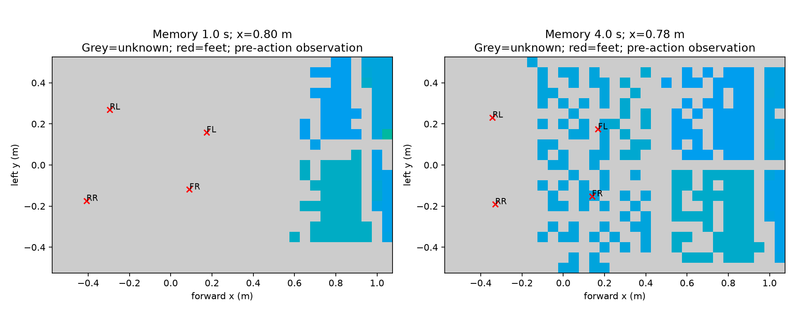

> 历史记录：运行状态属于记录当时，不是安装或当前任务状态。新用户先读[新手复现总览](docs/新手复现总览.md)；执行命令前按[环境准备](docs/环境准备与路径约定.md)设置变量。原始日志中的机器位置保留于归档，不直接用于新环境。

# 预训练 MoE 感知融合：首轮完整评估

**首轮 1000 轮训练及 9 项同条件评估已完成。平地、楼梯、高台均为 32/32；两类桩在三个难度下均为 0/32，尚未实现窄桩通过。** 归档保留完整失败记录与视频，不将奖励上升当作技能成功。

## 已验证的改造

1. 使用原 RoboGauge 137k 文件中的所有 actor 和历史编码器参数，未重新训练基础步态或替换成随机网络。4 路 64 步、两次局部重置对照通过；服务器最大动作差约 `1.04e-5`。
2. 新感知分支为零时，重建策略与基础策略逐值相同。原 MoE 在新 Isaac Lab 控制接口下，平地探针完成 16/16 首回合，零融合动作差为 0。
3. 可见地图只使用模拟相机/雷达实际返回，保留未知掩码和年龄。重投影、过期、重置、重复观测更新时间测试通过。
4. 实际 4 轮原生短训练验证四阶段：value 阶段基础权重不变，后续新地形 CNN、原 actor 的 8 个张量、MoE 编码器的 14 个张量发生更新；冻结参考网络保持原值。这验证了训练与解冻链路，不代表学到了技能。

检查原始记录见 [模型等价](artifacts/moe_perceptive/checks/model_check.json)、[短训练张量检查](artifacts/moe_perceptive/checks/smoke_tensor_check.json)。

## 原 MoE 同条件基线

每项 32 环境的首回合；固定布局、seed 801、XY ±3 cm、yaw ±0.04 rad。目标是沿 +x 行进 3.5 m，然后稳定停住至少 0.3 秒，无失败终止。固定布局上的 32 个初始状态不能当作 32 种地形。

| 地形 | difficulty | 完整通过 | 失败终止 | 平均终态前进距离 m |
|---|---:|---:|---:|---:|
| 平地 | 0 | 32/32 | 0/32 | 3.541 |
| 台阶 | 0.5 | 32/32 | 0/32 | 3.538 |
| 高台 | 0.5 | 31/32 | 0/32 | 3.541 |
| 双列桩 | 0 | 0/32 | 4/32 | 1.333 |
| 双列桩 | 0.5 | 0/32 | 22/32 | 1.168 |
| 双列桩 | 1 | 0/32 | 15/32 | 1.134 |
| 交错桩 | 0 | 0/32 | 29/32 | 1.329 |
| 交错桩 | 0.5 | 0/32 | 29/32 | 1.245 |
| 交错桩 | 1 | 0/32 | 8/32 | 1.067 |

高台中全部到达位移目标，其中一个回合没有满足最终稳定条件，不能称为跌倒。桩上既有实际失败，也有停在平台边缘超时；六组桩测试均没有终态到达 3.5 m，不能将零失败或站着不倒当作通过。

最窄场景使用 20 cm 支撑面及原 AME 排列/量化间距。双列/交错桩分别保留完整首回合视频及数值轨迹：

- [双列桩基线](artifacts/moe_perceptive/baseline/ame_stakes_1.00/summary.json)、[视频](artifacts/moe_perceptive/baseline/ame_stakes_1.00/episode_0.mp4)。早期多环境共享原点有视觉叠加，作为失败诊断，不用于证明动作质量。
- [交错桩基线](artifacts/moe_perceptive/baseline/ame_alternate_1.00/summary.json)、[视频](artifacts/moe_perceptive/baseline/ame_alternate_1.00/episode_0.mp4)。该次录制仅显示机器人 0，其他环境仍正常参与统计。

## 首轮新策略结果

训练为 512 环境、1000 轮，共 12,288,000 次新环境交互；使用 `model_999.pt`。评估协议与上述原 MoE 基线相同。

| 地形 | difficulty | 原 MoE 完整通过 | 新策略完整通过 | 新策略失败终止 | 新策略平均终态前进 m |
|---|---:|---:|---:|---:|---:|
| 平地 | 0 | 32/32 | 32/32 | 0/32 | 3.607 |
| 台阶 | 0.5 | 32/32 | 32/32 | 0/32 | 3.630 |
| 高台 | 0.5 | 31/32 | 32/32 | 0/32 | 3.628 |
| 双列桩 | 0 | 0/32 | 0/32 | 5/32 | 1.153 |
| 双列桩 | 0.5 | 0/32 | 0/32 | 11/32 | 1.071 |
| 双列桩 | 1 | 0/32 | 0/32 | 26/32 | 1.165 |
| 交错桩 | 0 | 0/32 | 0/32 | 3/32 | 1.044 |
| 交错桩 | 0.5 | 0/32 | 0/32 | 17/32 | 1.115 |
| 交错桩 | 1 | 0/32 | 0/32 | 27/32 | 1.202 |

高台 31→32 仅相差一个初始状态，不能据此声称显著增强。最窄双列桩失败由 15→26，交错桩由 8→27；部分较易桩的跌倒数减少但前进距离降低，存在停滞超时，不能称为改善。当前不将新权重替换为主控制器。

- [新策略双列窄桩视频](artifacts/moe_perceptive/trained/ame_stakes_1.00/episode_0.mp4)、[统计](artifacts/moe_perceptive/trained/ame_stakes_1.00/summary.json)。
- [新策略交错窄桩视频](artifacts/moe_perceptive/trained/ame_alternate_1.00/episode_0.mp4)、[统计](artifacts/moe_perceptive/trained/ame_alternate_1.00/summary.json)。
- [最终权重](artifacts/moe_perceptive/training/visible_moe_v1_seed42/model_999.pt)、[导出 actor](artifacts/moe_perceptive/export/actor.pt)、[训练完成记录](artifacts/moe_perceptive/training/visible_moe_v1_seed42/completed.json)。

## 归档与下一步

前 50 轮适配 critic，随后训练感知分支，再逐步开放原 actor 与 MoE 编码器。具体参数见 [方案和运行说明](docs/MoE感知分支训练说明.md)。这不是 AME 从零训练，也不混入此前 MLP 教师初始化对照。

[归档清单](artifacts/moe_perceptive/manifest.json) 保存快照时间、checkpoint 和文件 SHA256；`run_completed=true` 只表示训练命令完成，完整通过率以上表为准。训练日志与启动时源文件快照均保留。初始限位元数据曾按资产顺序记录，已转换为声明的模型顺序，原数组及修正记录保留；没有改变运行中的物理状态或动作。

接下来先诊断桩边落脚和实际可见地形记忆覆盖，再决定训练修改；不直接将失败实验延长作为解决方案。诊断中的感知参数消融必须与原协议区分，不能混入上表。

当前验证限于 Isaac Lab 与简化传感器射线。没有新策略的 MuJoCo、真实 D435i/Mid360 或实机成绩。

## 感知覆盖诊断与第二轮

同一 `model_999.pt`、双列桩 difficulty=0、32 环境、seed 801：仅把可见观测记忆从 1 秒改为 4 秒，两组均为 **0/32**。失败终止分别为 **5/32、23/32**；平均终态前进为 **1.153、1.366 m**。4 秒是输入分布改变后的零样本消融，不能作为改进成功。

机器人 0 在平台边缘区间（机身 x=0.5–1.5 m）的足端周围 3×3 格已知比例，按 FL/FR/RL/RR：1 秒为 **3.2%/0%/0%/0%**，4 秒为 **33.9%/34.4%/16.9%/15.3%**。采样数分别 181/21，终止时间不同；只是单机器人覆盖诊断，不证明总体成功率，也不能单独确定失败原因。结果提示近身盲区与记忆寿命值得处理，但延长记忆必须重新训练适应。

[诊断统计](artifacts/moe_memory_diagnostic/coverage_diagnostic/summary.json)、[1 秒完整记录](artifacts/moe_memory_diagnostic/diagnostic_v1_memory1/summary.json)、[4 秒完整记录](artifacts/moe_memory_diagnostic/diagnostic_v1_memory4/summary.json)、[校验清单](artifacts/moe_memory_diagnostic/manifest.json)。

第二轮另存为 `visible_moe_memory4_v2_seed42`：从首轮最终 policy 与 critic 初始化，使用 4 秒可见观测记忆；新 Adam、新课程与回合，从第 0 轮开始 joint 训练 1000 轮。它不是原运行的精确续训，也不是单变量同预算从头对照。运行前先做 32 环境两轮原生短训练，失败则不启动正式训练；完成后自动执行相同 9 项评估及窄桩录像。[启动参数](artifacts/moe_memory_diagnostic/launch_memory4_v2.json)。第二轮已完成，结果见下节。

第二轮原生两轮短训练已通过，下列链接保留启动时状态；正式训练现已完成。[短训练完成记录](artifacts/moe_memory_v2_start/visible_moe_memory4_v2_seed42_smoke/completed.json)、[新实验精确源码和配置](artifacts/moe_memory_v2_start/visible_moe_memory4_v2_seed42/manifest.json)。该目录仅是启动快照，不是最终权重或评估。

## 第二轮完整结果（4 秒记忆适配）

512 环境、额外1000轮已完成；固定种子/布局、32个首回合，同一严格完成条件。

| 地形 | difficulty | 完整通过 | 失败终止 | 平均终态前进 m |
|---|---:|---:|---:|---:|
| 平地 | 0 | 32/32 | 0/32 | 3.571 |
| 台阶 | 0.5 | 32/32 | 0/32 | 3.566 |
| 高台 | 0.5 | 32/32 | 0/32 | 3.571 |
| 双列桩 | 0 | 0/32 | 4/32 | 1.199 |
| 双列桩 | 0.5 | 0/32 | 2/32 | 0.653 |
| 双列桩 | 1 | 0/32 | 1/32 | 0.435 |
| 交错桩 | 0 | 0/32 | 0/32 | 0.827 |
| 交错桩 | 0.5 | 0/32 | 0/32 | 0.546 |
| 交错桩 | 1 | 0/32 | 1/32 | 0.433 |

窄桩跌倒减少但主要停在起始平台超时，不能当作过桩能力提高。全部桩场景仍为0/32，当前策略不替换主控制器。

[第二轮双列窄桩完整视频](artifacts/moe_memory_v2_end/trained/ame_stakes_1.00/episode_0.mp4)、[交错窄桩完整视频](artifacts/moe_memory_v2_end/trained/ame_alternate_1.00/episode_0.mp4)、[最终权重与校验清单](artifacts/moe_memory_v2_end/manifest.json)。

## 第三轮：文献驱动的教师/感知分离

第三轮不直接延长第二轮。增加明确目标输入、目标奖励、停滞终止和浅坑起步课程，先训练完整地图教师，再安排可见感知学生。第三轮原生四轮短训练已通过，1024 环境已启动，每1000轮在原始深坑/桩面评估。尚无第三轮过桩成绩。

见 [论文、开源核对、安装候选、信息缺口与持续迭代说明](传感器研究记录.md)。[第三轮启动](artifacts/sensor_research_v3/launch_nav_teacher_v3.json)、[原生短训练完成记录](artifacts/sensor_research_v3/nav_teacher_v3_smoke_v2/completed.json)。
