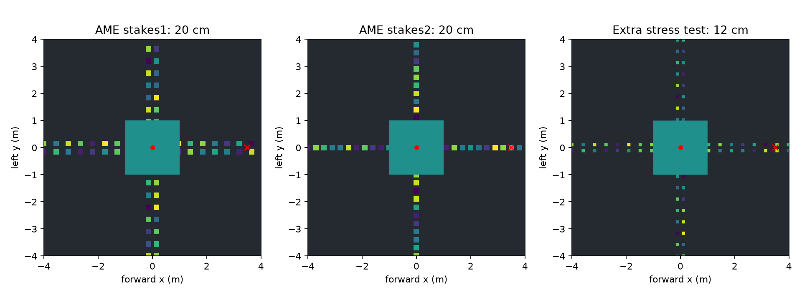

# AME 窄梅花桩场景与现有学生检查

已加入完整 8×8 m、中心 2×2 m 出生平台、十字方向延伸的窄支撑场景。Isaac 与 MuJoCo 使用同一高度场生成的方柱碰撞几何，出生在中心，沿 +x 前进 3.5 m；至少两足支撑且直立才算到达。旧 `stones` 宽桩及历史成绩保留，不与新场景混算。

## 参数来源

参考 SII-FUSC/AME_Locomotion 的 `finetune_terrain_cfg.py` 中 `stakes1` / `stakes2`，版本 `1d3519ee946c846c1c89dd660539a224f99972b5`：

- `ame_stakes`：桩边长 40→20 cm，纵向净间隙 10→30 cm，双列横向净间隙 10 cm。
- `ame_alternate`：桩边长 40→20 cm，纵向净间隙 5→15 cm，横向偏移参数 20→0 cm；后者是原生成器交替中心偏移参数，不等于两列净间隙。
- 两类均为最高 ±3 cm 高差、2 m 深坑底、5 cm 栅格；评估使用 difficulty=1，20×20 cm 方桩。严格保留上游浮点插值及 int 截断行为，因此最难级纵向实际栅格间隙为双列 25 cm、交替 10 cm，不能将配置的连续参数直接当成网格实测值。
- 对上游两种生成器在 difficulty=0、0.5、1 分别执行支持区域逐格比对，6 项均完全一致，见 `artifacts/narrow/layout_equivalence.json`。桩高随机数固定为 seed 42，原双列生成器采用无种子 RNG，因此不声称随机桩高逐点一致。独立实现，不复制上游源码。
- `ame_stakes12`：12×12 cm 方桩、1 cm 栅格，沿用双列布局的额外压力测试。AME 论文描述最窄 12 cm 的 grid stones，但本场景没有复刻论文的随机网格分布；只对应最窄支撑尺寸，不称为原论文场景复现。

[复现配置来源](https://github.com/SII-FUSC/AME_Locomotion/blob/1d3519ee946c846c1c89dd660539a224f99972b5/source/ame_locomotion/ame_locomotion/tasks/manager_based/ame_locomotion/terrains/finetune_terrain_cfg.py) · [论文补充材料](https://arxiv.org/html/2506.09588v1)



## 现有稳定感知学生，未重训

使用已发布 `artifacts/perceptive/checkpoints/student.pt` 对应的 actor。Isaac 每类 32 初始状态，seed 801；MuJoCo 每类 5 回合，seeds 801–805。不同回合共享固定的地形布局，不是不同地形随机种子的泛化评估。

| 场景 | Isaac | MuJoCo |
|---|---|---|
| ame_stakes | 0/32 | 0/5 |
| ame_alternate | 0/32 | 0/5 |
| ame_stakes12 | 0/32 | 0/5 |

本次完成场景实现、碰撞/栅格一致性测试和现有策略评估，未训练新的窄桩权重；旧宽桩通过率不能作为本场景能力证明。

## 使用

```bash
# 默认训练地形已改为 ame_stakes；难度课程由 40 cm 逐步缩小至 20 cm。
/root/isaacsim/python.sh -m perceptive_rl.train --headless --fused   --kind ame_stakes --num-envs 512 --iterations 3000 --output outputs/narrow_train

MUJOCO_GL=egl python -m perceptive_rl.mujoco_compare --backend learned   --actor artifacts/perceptive/student_native/stairs_0.50/actor.pt   --io artifacts/perceptive/student_native/stairs_0.50/summary.json   --kind ame_stakes --difficulty 1 --episodes 5 --video --output outputs/narrow_replay
```

3000 轮只是训练命令示例，未在本次执行，也不保证收敛。将 kind 改为 `ame_alternate` 或 `ame_stakes12` 可使用另两类场景。10 cm 的学生感知网格对 12 cm 支撑面的解析能力有限，尚需后续独立验证更高分辨率输入。

## 完整首回合视频

- [ame_stakes，seed 801](artifacts/narrow/mujoco/ame_stakes_1.00/episode_0.mp4)
- [ame_alternate，seed 801](artifacts/narrow/mujoco/ame_alternate_1.00/episode_0.mp4)
- [ame_stakes12，seed 801](artifacts/narrow/mujoco/ame_stakes12_1.00/episode_0.mp4)
