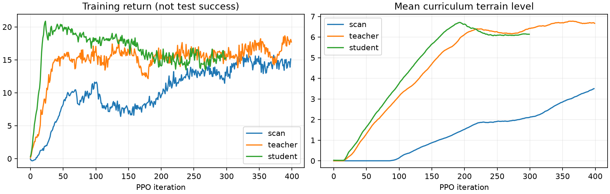
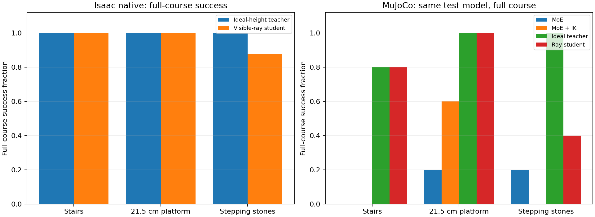

# 感知运动 RL 训练与对照报告

验证日期：2026-10-17。训练服务器：单 NVIDIA L40，Isaac Lab 2.3.2 / PhysX GPU；迁移测试：MuJoCo 3.2.3。

## 当前结论

本轮统一 MuJoCo 测试，感知学生完整通过 11/15；冻结 MoE 为 2/15，MoE + IK 为 3/15。小样本仅描述这组场景；不能据此宣称普遍优越。

理想地形教师与可见传感器学生分开报告。教师使用完整局部高度及真实机体速度；它的高成功率不是相机/雷达部署成功率。
本实验确实训练新权重，运行时直接输出关节目标，不调用 MoE、NJU BBC 或抬脚 IK。
目前仍是运动技能实验，没有把新权重替换进旧版 `active_run` 任意目标导航，也没有实机部署。

## 训练过程

1. 从零 PPO 尝试约 1,956 万采样步后终止，保留第 300 轮检查点。第 200 轮的中等难度原生探索测试三个场景均 0/32；没有把它称为收敛策略。
2. 使用 NVIDIA 官方 Go2 rough 检查点（外部第 1499 轮）初始化全部 actor/critic 权重，再执行 **400 轮 PPO，19,660,800 新采样步**。这是新越障课程微调，不是把官方文件改名。
3. 用教师在学生访问状态上的动作作标签，执行 **1,500 步 × 1,024 环境 = 1,536,000 次交互** 的混合教师/学生 roll-in 蒸馏。该阶段是模仿学习。
4. 可见深度/雷达学生再执行 **300 轮 PPO，7,372,800 新采样步**；读取保存的完成标记及检查点确认结束。

源字节快照、完整训练日志、TensorBoard 原始事件及检查点 SHA-256 见 [证据目录](artifacts/perceptive/) 与 [manifest](artifacts/perceptive/manifest.json)。
两轮 PPO 的模型参数均发生了更新，逐张量差异见 [参数更新校验](artifacts/perceptive/parameter_updates.json)。
检查点保存接口和显式 PD 参数导出中的调试失败保留为探索记录，未计作策略性能结果。

## 独立原生测试

每场景 32 个初始状态，seed 801；固定难度 0.5：每级台阶 10.25 cm、高台 21.5 cm、梅花桩面 46×41 cm / 纵向空隙 8.75 cm / 坑底 -55 cm。
测试随机初始化与训练种子不同，但地形仍是相同模板族，不是未见几何分布的泛化测试。

| 策略 | 场景 | 完整通过 | 曾上台支撑 | 本体接触终止 | 越界/掉坑终止 | 超时 |
|---|---|---:|---:|---:|---:|---:|
| 理想地形教师（特权输入） | 楼梯（上楼、平台、下楼） | 32/32 | 32 | 0 | 0 | 0 |
| 理想地形教师（特权输入） | 21.5 cm 高台（含走下） | 32/32 | 32 | 0 | 0 | 0 |
| 理想地形教师（特权输入） | 交错矩形梅花桩 | 32/32 | — | 0 | 0 | 0 |
| 可见传感器学生（仅蒸馏） | 楼梯（上楼、平台、下楼） | 32/32 | 32 | 0 | 0 | 0 |
| 可见传感器学生（仅蒸馏） | 21.5 cm 高台（含走下） | 28/32 | 30 | 2 | 2 | 0 |
| 可见传感器学生（仅蒸馏） | 交错矩形梅花桩 | 16/32 | — | 9 | 0 | 7 |
| 可见深度/雷达学生（PPO 后） | 楼梯（上楼、平台、下楼） | 32/32 | 32 | 0 | 0 | 0 |
| 可见深度/雷达学生（PPO 后） | 21.5 cm 高台（含走下） | 32/32 | 32 | 0 | 0 | 0 |
| 可见深度/雷达学生（PPO 后） | 交错矩形梅花桩 | 28/32 | — | 3 | 0 | 1 |

同一 PPO 学生在梅花桩的输入消融：正常观测 28/32，高度与有效掩码全置零后 14/32。这是输入依赖检查，不是重新训练的盲策略，也不代表雷达独立增益。

“曾上台支撑”指到达平台内部时，机体高度、朝向及至少两脚接触曾同时满足条件，不等于持续站稳或完成下台与终点任务。
完整通过要求到达约 7.5 m 终点、躯干朝上并至少两脚支撑；走出横向 ±0.85 m 区域或跌倒均不算通过。

## 同一 MuJoCo 模型对照

所有策略使用相同几何、相同种子 801–805、Go2 URDF 大腿范围、足端摩擦 0.8、关节力矩预算 ±23.5 N·m。
各策略使用自己的 PD 参数；训练策略导出的是显式电机的 25/0.5 增益，不能读取已禁用的 PhysX 关节驱动增益。
指令为固定前进速度 0.7 m/s 与航向反馈；这是受控运动技能测试，不是任意目标导航成功率。

| 策略 | 楼梯完整通过 | 高台完整通过 | 梅花桩完整通过 |
|---|---:|---:|---:|
| 冻结 MoE | 0/5 | 1/5 | 1/5 |
| MoE + 抬脚 IK | 0/5 | 3/5 | 0/5 |
| 理想地形教师（特权输入） | 4/5 | 5/5 | 5/5 |
| 可见深度/雷达学生（PPO 后） | 4/5 | 5/5 | 2/5 |

两个引擎的资产与接触/电机细节仍有差异。原生成功、MuJoCo 失败时，应记为迁移未通过，不能直接部署实机。
探索阶段原始 RoboGauge XML 的不同关节/摩擦/力矩条件结果位于 exploration，未混入最终对照。
旧版 24 cm 高台单项成绩也不能与本表交叉排名：本轮包括走下平台与到达终点，接近距离、摩擦及力矩预算均不同。

## 录像

以下是完整仿真回合，不是拼接成功片段；`episode_0` 固定展示该组第一个种子，可能是失败回合。看视频时请同时核对相应 summary.json。
`student_success_replay` 是从主测试已成功的 seed 802 选取的楼梯和梅花桩完整成功回放，不另计入成功率；主测试 seed 801 的失败录像同时保留。

- [final_ik/platform_0.50 / episode_0.mp4](artifacts/perceptive/final_ik/platform_0.50/episode_0.mp4)
- [final_ik/stairs_0.50 / episode_0.mp4](artifacts/perceptive/final_ik/stairs_0.50/episode_0.mp4)
- [final_ik/stones_0.50 / episode_0.mp4](artifacts/perceptive/final_ik/stones_0.50/episode_0.mp4)
- [final_moe/platform_0.50 / episode_0.mp4](artifacts/perceptive/final_moe/platform_0.50/episode_0.mp4)
- [final_moe/stairs_0.50 / episode_0.mp4](artifacts/perceptive/final_moe/stairs_0.50/episode_0.mp4)
- [final_moe/stones_0.50 / episode_0.mp4](artifacts/perceptive/final_moe/stones_0.50/episode_0.mp4)
- [student_mujoco/platform_0.50 / episode_0.mp4](artifacts/perceptive/student_mujoco/platform_0.50/episode_0.mp4)
- [student_mujoco/stairs_0.50 / episode_0.mp4](artifacts/perceptive/student_mujoco/stairs_0.50/episode_0.mp4)
- [student_mujoco/stones_0.50 / episode_0.mp4](artifacts/perceptive/student_mujoco/stones_0.50/episode_0.mp4)
- [student_native_video / episode_0.mp4](artifacts/perceptive/student_native_video/episode_0.mp4)
- [student_success_replay/stairs_0.50 / episode_0.mp4](artifacts/perceptive/student_success_replay/stairs_0.50/episode_0.mp4)
- [student_success_replay/stones_0.50 / episode_0.mp4](artifacts/perceptive/student_success_replay/stones_0.50/episode_0.mp4)
- [teacher_mujoco/platform_0.50 / episode_0.mp4](artifacts/perceptive/teacher_mujoco/platform_0.50/episode_0.mp4)
- [teacher_mujoco/stairs_0.50 / episode_0.mp4](artifacts/perceptive/teacher_mujoco/stairs_0.50/episode_0.mp4)
- [teacher_mujoco/stones_0.50 / episode_0.mp4](artifacts/perceptive/teacher_mujoco/stones_0.50/episode_0.mp4)
- [teacher_native_video / episode_0.mp4](artifacts/perceptive/teacher_native_video/episode_0.mp4)

## 能力边界与下一步

- 学生输入是可见射线构成的局部高度及掩码，不是原始 RGB/depth CNN；最多 1 秒已见点记忆使用理想仿真里程计。未知格没有用地形真值补全。
- 水平安装 Mid-360 对近处地面覆盖有限，当前近身高度主要依赖下倾深度相机；本轮未证明雷达独立增益。
- 相机和雷达是简化仿真传感器；尚无实机驱动、时间同步、标定误差、电机时延、载荷辨识及实机验证。
- 本轮奖励含非足端接触惩罚，仍没有整条小腿的硬避碰约束，不能保证零撞腿。
- 感知 RL 能联合调整落脚和全身动作，但是否比 MoE + IK 更好，需要同时通过感知退化、不同地形、不同种子和迁移测试；教师成功不足以作出这个结论。

参考 [Extreme Parkour](https://github.com/chengxuxin/extreme-parkour)、[Robot Parkour Learning](https://github.com/ZiwenZhuang/parkour) 和 [Vision Locomotion](https://vision-locomotion.github.io/)。本实验借鉴教师/学生与地形课程思路，未声称复现这些工作的完整方法或论文成绩。
复现入口、观测维度、地形参数见 [使用说明](docs/PERCEPTIVE_RL.md)。
