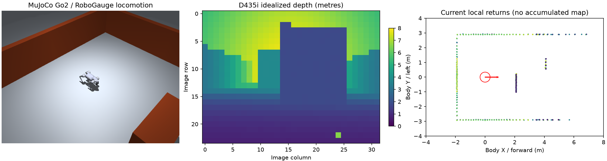

# Rob2Nav

**Unitree Go2 无地图导航仿真：D435i 深度 + Mid-360 局部点云，基于 RoboGauge 本体运动控制。**

本项目在 MuJoCo 中运行带真实关节与接触动力学的 Go2。导航层根据当前传感器观测和相对目标生成机体系速度指令，底层复用 [RoboGauge](https://github.com/wty-yy/RoboGauge) 的 Go2 预训练运动策略、观测构造、关节映射及 PD 控制接口。

当前可用的是**反应式无地图导航基线**。同时提供 Gymnasium 环境、PPO 上层导航训练/评估入口和初始 checkpoint；初始 PPO 尚未达到可靠导航水平。

## 视频与传感器预览

**[查看 / 下载交错障碍仿真视频（MP4）](artifacts/outputs/slalom_final/episode_0.mp4)** · [直接下载视频](https://raw.githubusercontent.com/YuTaoV5/Rob2Nav/main/artifacts/outputs/slalom_final/episode_0.mp4)

视频对应 `reactive` 导航、交错障碍场景、seed 0；该回合约 19.4 秒到达目标。视频来自仿真执行，不是实机测试。



## 系统结构

```text
D435i 理想化深度 ─┐
                 ├─ 当前局部观测 + 相对目标 ─ 导航层 ─ [vx, vy, yaw_rate]
Mid-360 理想射线 ─┘                              │
                         反应式规划 / PPO         ▼
                                      RoboGauge Go2 TorchScript
                                                 │ 50 Hz
                                                 ▼
                                         12 关节目标 + PD
                                                 │ 500 Hz
                                                 ▼
                                       MuJoCo 物理与接触动力学
```

- 不累积占据地图，不构建 ESDF，不向导航控制器输入障碍物真值。
- 场景几何仅用于物理、射线传感仿真和碰撞评估。
- 目标相对方向、本体姿态和速度来自理想仿真状态，因此这里的“无地图”**不等于免定位**。
- 导航周期为 10 Hz，底层运动策略为 50 Hz，物理步进为 500 Hz。

## 已完成的验证

验证日期：2026-10-17。环境：Ubuntu 24.04、NVIDIA L40、独立 Python 3.11 环境、MuJoCo 3.2.3。运动策略、MuJoCo 和小规模 PPO 训练使用 CPU，视频通过 EGL 渲染。

| 导航方法 | 场景 | 成功 | 碰撞 | 摔倒 | 平均成功用时 |
|---|---|---:|---:|---:|---:|
| Reactive | 空场 | 1/1 | 0 | 0 | 17.40 s |
| Reactive | 交错障碍 | 3/3 | 0 | 0 | 19.93 s |
| Reactive | 随机障碍，seed 100–109 | 10/10 | 0 | 0 | 24.85 s |
| Reactive | 完全封闭障碍 | 0/1，超时 | 0 | 0 | — |
| PPO 初始模型 | 随机障碍，seed 200–202 | 0/3 | 3 | 0 | — |

封闭障碍没有可行通路，超时是该检查的预期结果。以上仅代表这些场景和种子的结果，不表示任意环境下都能到达目标。

PPO 初始模型训练了 32,768 个环境步，使用 4 个并行环境、训练 seed 42；它可用于继续训练和调试，不作为可靠避障策略。

完整证据：[评估报告](VALIDATION.md) · [测试日志](artifacts/tests_final.log) · [训练日志](artifacts/train_initial.log) · [随机场景原始指标](artifacts/outputs/random_final/summary.json) · [PPO 独立评估](artifacts/outputs/ppo_initial_eval/summary.json)。另已执行 Gymnasium API 检查和 checkpoint 重新加载检查。

## 安装

建议 Linux + Python 3.11。仓库已包含 RoboGauge 固定版本源码、Go2 资产和预训练运动模型，**无需额外初始化 Git submodule**。

```bash
git clone https://github.com/YuTaoV5/Rob2Nav.git
cd Rob2Nav
python3.11 -m venv .venv
export GO2_PYTHON="$PWD/.venv/bin/python"
export MUJOCO_GL=egl

# 小批量运动策略和本版 PPO 使用 CPU；不需要再下载 CUDA 版 PyTorch。
"$GO2_PYTHON" -m pip install torch --index-url https://download.pytorch.org/whl/cpu
bash setup.sh
```

MuJoCo 固定为 **3.2.3**，遵守 RoboGauge 对 `<3.3.0` 接触动力学版本的要求。无可用 EGL 上下文时可尝试 `MUJOCO_GL=osmesa`，但需系统提供 OSMesa；不生成视频的物理/导航评估无需创建渲染器。

依赖安装使用 [requirements.txt](requirements.txt)。[environment.lock.txt](environment.lock.txt) 是原服务器 `pip freeze` 的原始环境记录，包含平台专用构建信息，不是可跨平台直接安装的锁文件。

## 运行导航仿真

以下命令均在仓库根目录执行；新开终端时重新设置 `GO2_PYTHON` 和 `MUJOCO_GL`。

```bash
# 三个交错障碍回合，保存视频、轨迹与评估指标
bash run.sh -m go2_nav.run --scene slalom --episodes 3 --video --output outputs/slalom

# 固定的独立随机种子评估
bash run.sh -m go2_nav.run --scene random --seed 100 --episodes 10 --output outputs/random_eval

# 仿真 / 深度 / 当前局部点云三联图
bash run.sh -m go2_nav.snapshot

# 运行仿真检查
bash run.sh -m unittest discover -s tests -v
```

支持的场景：`empty`、`slalom`、`random`、`blocked`。支持的控制器：`reactive`、`straight`、`ppo`。

输出内容：`summary.json`、`trajectory_N.json`、`sensors_N.npz`；添加 `--video` 后生成 `episode_N.mp4`。`success`、`collision`、`fallen`、`timeout` 分别记录。历史评估保存在 `artifacts/`，新实验写入被 Git 忽略的 `outputs/`。

## 训练上层 PPO

下层 RoboGauge 运动模型保持冻结，PPO 学习三维速度指令。默认观测为 72 个雷达距离扇区、12×16 深度、相对目标方向/距离、本体速度和上一速度指令，共 273 维。当前使用 MLP 处理降采样深度，不是原始 RGB/CNN 训练。

```bash
bash run.sh -m go2_nav.train --steps 100000 --envs 4 --scene random --output outputs/ppo

# 使用独立种子评估新模型
bash run.sh -m go2_nav.run --policy ppo --checkpoint outputs/ppo/navigation.zip \
  --scene random --seed 200 --episodes 10 --video --output outputs/ppo_eval

# 从已发布的初始模型继续训练
bash run.sh -m go2_nav.train --resume artifacts/outputs/ppo_initial/navigation.zip \
  --steps 100000 --envs 4 --scene random --output outputs/ppo_resume
```

可用 `--sensors depth`、`--sensors lidar` 或 `--sensors both` 做输入消融，训练和评估必须保持一致。消融仅屏蔽对应控制器输入，底层仍计算两路传感数据，不能用来比较单传感器计算耗时。

## 传感器配置与边界

参数在 [config.json](config.json)，位置单位为米、角度单位为度，机体系 +X 前、+Y 左、+Z 上。

- **D435i**：针孔深度模型，默认 32×24，输出光轴深度；不复现双目匹配、材质失效、运动模糊和真实 IMU 偏置。
- **Mid-360**：360° 方位、多仰角理想射线；未复现 Livox 的非重复扫描时序。
- 两种传感器加入距离噪声和随机丢点，安装位置是初始假设，需要替换为实机测量外参。
- 默认额外载荷为 0 kg；可配置质量扰动，但它不是传感器及支架的完整惯量模型。
- 反应式控制器可能陷入局部困境，不提供任意迷宫的全局完备性保证。
- 本项目目前实现服务器仿真，没有 ROS2 实机控制通路；未向实机发送运动命令。

## 目录

```text
go2_nav/                 环境、传感仿真、导航、训练与评估入口
tests/                   传感契约、行走与避障回归检查
vendor/RoboGauge/        固定版本上游源码、Go2 资产和运动模型
vendor/robogauge_snapshot.json  上游版本和文件哈希
scripts/                 上游快照完整性检查
artifacts/               已验证视频、预览、模型、原始指标和日志
docs/USAGE.md            原服务器使用说明
research/                两个研究方向的论文与开源清单
VALIDATION.md            已执行的评估结果
config.json              仿真与传感参数
requirements.txt         安装依赖
environment.lock.txt     原服务器环境记录
setup.sh / run.sh        安装和运行脚本
```

## RoboGauge 来源与许可

本项目固定使用 [wty-yy/RoboGauge](https://github.com/wty-yy/RoboGauge) 的 `add2c7ee0185ea8fd93d242f86e1c8cac6e9913b` 版本，保留完整上游许可与署名。上游以源码快照形式随仓库提供，不包含嵌套 `.git`。

本项目的场景装配会显式为 actuator 设置上游 `go2` / `knee` 默认类，以获得有效扭矩范围；不修改上游运动策略和观测实现。

原创代码采用 [MIT License](LICENSE)。第三方代码和资产的来源见 [THIRD_PARTY_NOTICES.md](THIRD_PARTY_NOTICES.md)；RoboGauge 原始许可见 [vendor/RoboGauge/LICENSE](vendor/RoboGauge/LICENSE)。
