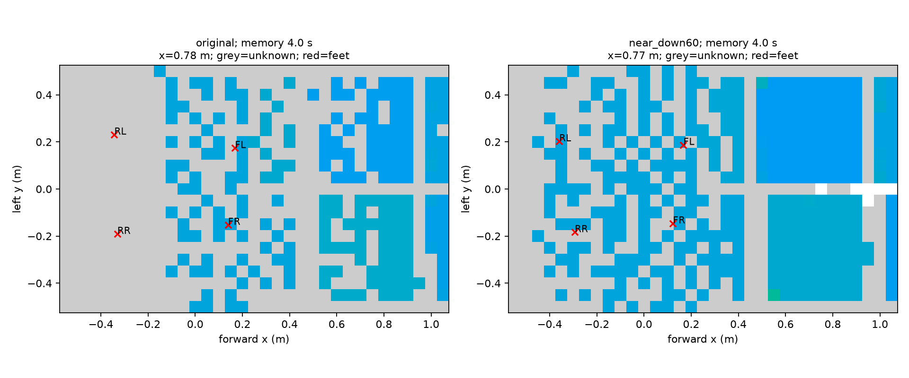

# Go2 感知越障：文献、安装与第三轮实验

更新：2026-10-18。目标是无预建地图的仿真感知越障与 AME 原尺寸窄桩，不是实机验收。

## 已核对的论文与开源实现

使用本机 `deepxiv-cli` 技能，实际执行 `deepxiv search "quadruped perceptive locomotion sparse stepping stones terrain attention teacher student" --limit 6 --format json`，并通过 `deepxiv paper ID --section ...` 阅读方法，使用作者仓库交叉核对。检索与方法文本保存在忽略的 `.research/perceptive_v3/`，不转载论文全文。

| 工作 | 一手资料 | 与本任务直接相关的做法 | 代码可用边界 |
|---|---|---|---|
| AME, 2025 | [arXiv:2506.09588](https://arxiv.org/abs/2506.09588)；读取 `--section Method` | 用本体状态查询保留空间坐标的地形 token，强调稀疏支撑课程 | [SII](https://github.com/SII-FUSC/AME_Locomotion) 与 [criticaldamped](https://github.com/criticaldamped/AME_Locomotion) 是复现；G1 权重不能作为 Go2 权重 |
| AME-2, 2026 | [arXiv:2601.08485](https://arxiv.org/abs/2601.08485)；读取 `--section "IV Locomotion Control"` | 完整地形教师、传感器学生，目标到达与停滞终止；表示地形不确定性 | [官方 ame2_minimal](https://github.com/leggedrobotics/ame2_minimal)，核对版本 `8beb9a688d67882828019583f7d5a78e3517f233`。当前公开 G1 教师；README 明确神经建图模型和学生链路尚未完整发布，不能声称可直接下载 Go2 窄桩模型 |
| Learning Agile Locomotion on Risky Terrains | [arXiv:2311.10484](https://arxiv.org/abs/2311.10484)；读取 `--section Method` | 先学较易稀疏落脚，再微调专家；到达目标替代固定速度约束；减轻失败即降级造成的课程反复，结合探索增强 | 本次未验证到作者完整独立训练仓库；方法由论文与后续官方 AME 指南交叉支持 |
| Extreme Parkour | [arXiv:2309.14341](https://arxiv.org/abs/2309.14341)；读取 `--head` | 先训练地形策略，再蒸馏前视深度与历史；对相机更新、噪声、执行时序建模 | [作者源码](https://github.com/chengxuxin/extreme-parkour)；README 推荐基础训练至少 15k、深度蒸馏至少 5k 轮，不能用本项目 1000 轮试验预算推断必然收敛 |
| Robot Parkour Learning | [arXiv:2309.05665](https://arxiv.org/abs/2309.05665)；读取 `--brief` | 通过降低起步探索难度学习技能，再恢复严格动力学与视觉输入 | [作者代码](https://github.com/ZiwenZhuang/parkour) 有 Go2 示例，作者明确示例不保证论文同等效果；软约束训练不是最终通过证据 |
| Egocentric Vision | [arXiv:2211.07638](https://arxiv.org/abs/2211.07638)；读取 `--brief` | 前视深度、时间记忆与代理地形教师说明单前视相机可用，但不意味着每一时刻能直接看到后脚下 | [作者项目页](https://vision-locomotion.github.io/)；本次不将项目页误当作已验证可运行的 Go2 开源权重 |

AME 作者 [调参指南](https://github.com/zita-ch/techblogs/blob/main/2026-03-28-AME%20Tuning%20Guide.md) 明确提醒：注意力结构不自动解决探索和迁移；缺少有效稀疏地形课程时，可能只学会楼梯等稠密地形。

我们参考论文原理独立实现本轮实验，未复制 GPL 官方 AME-2 算法文件进本项目。官方源码仅在忽略的研究目录只读核对，已有 RoboGauge/Isaac Lab 等依赖仍遵循各自声明。

## 传感器究竟能看到什么

一手参数：[D435 系列调优文档](https://dev.realsenseai.com/docs/tuning-depth-cameras-for-best-performance/)、[D435i 视场与规格](https://www.realsenseai.com/compare-depth-cameras/)、[Livox Mid360 规格](https://www.livoxtech.com/mid-360/specs)。D435i 深度视场约 87×58 度；采用 848×480 类配置时，本文把光轴最小 Z=0.195 m 作为假设，并下采样模拟，不把 64×32 射线说成真实相机输出模式。Mid360 正装垂直视场 −7～52 度、水平 360 度，0.1～0.2 m 测距仅供参考，本轮采用 0.2 m 可靠近距阈值。

若 Mid360 离地 0.50 m、水平正装，在平地上最向下的光束约到 0.50/tan(7°)=4.07 m 外才打到地面。旧 1.6×1.0 m 局部图会舍弃这些远点。因此，旧桩场景不能笼统说雷达已提供近脚下地形信息；主要依赖前视深度和短时记忆。

倒装可将垂直视场翻成约 −52～7 度，但不自动消除机身遮挡。把倒装雷达低装在机背正中，向下光线可能先打到机身。必须检查光学中心、支架、前后腿和运动中的遮挡，而不只是改一个俯角。官方 AME-2 G1 的雷达代码也包含倒装旋转；其机器人、位姿不应直接照搬到 Go2。

已实现 `python -m moe_perceptive.mount_audit --output ...`：17 个安装候选 × 4 个场景 × 2 个记忆寿命，共 136 组可见性探针；使用原桩几何、最小测距及保守机身包围盒遮挡。沿一条给定的水平前进轨迹测量，不是动态过桩成功回放。没有腿、支架、真实扫描密度或里程计漂移模型，不能据此宣布实机最优。

### 当前优先验证的安装候选

坐标系：base 的 x 向前、y 向左、z 向上；下述是光学/雷达中心位置，不是外壳边缘。

| 部件 | 候选安装 | 目的与限制 |
|---|---|---|
| D435i | 相对 base `(0.30, 0, 0.06) m`，俯视 60°，正对前方 | 镜头在机身前沿外，扩大下一落脚区域覆盖；base 高约 0.34 m 时镜头约高 0.40 m。仍不能瞬时看到全部后脚，须有时间记忆与可信运动估计。60° 是当前覆盖候选，尚不是完成动态任务后的最终推荐 |
| Mid360，导航优先候选 | 相对 base `(0, 0, 0.16) m`，水平正装 | 保持上方/周围障碍感知，不能代替近脚下深度；需避开上装、支架遮挡 |
| Mid360，落脚优先备选 | 相对 base `(0.30, 0, 0.12) m`，绕前向轴倒装 180° | 把向下视场移到机身前外侧，需校准新的外参和 IMU 朝向；后方可能被机身挡住，保留为对比候选，不直接建议实机照装 |

扫描的 4 秒记忆、给定水平运动轨迹下，原配置近场支撑格平均正确覆盖约 82.3%，60°前伸相机约 90.8%；起步时分别只有 0% 和 7.1%。这些数值是几何探针，不能与真实停滞回合的脚下覆盖率混算。起步盲区仍说明：安装改变加上时序估计是必要验证项，不能单靠长记忆宣称信息充分。

最窄 20 cm 桩需要辨认边界、估计足端相对落点、在后脚落地前保留观测。5 cm 地图、量化误差、机身运动、点云外参、遮挡、延迟均会侵蚀落脚余量。相机/雷达融合需要共同时间戳、base 外参以及里程计；“不提前建图”允许在线局部地图，不意味着没有状态估计或时间记忆。当前使用理想里程计，实机可观测性与误差预算尚未证明。

## 第三轮做什么

1. 先验证完整地形教师，分离“感知看不见”和“控制没学会”。沿用实际 RoboGauge actor/历史编码器，增加零初始化目标适配器，保持旧接口可复现。
2. 移除持续给站着不动奖励的速度/零转速跟踪项，改用到目标运动、目标接近、完成奖励和停滞终止；仍保留关节与本体物理约束。
3. 训练中显式使用浅坑起步课程：坑深从 `0.02 + 1.98*difficulty²` m 变化，其余桩面布局按原 AME 参数生成；最高难度 2 m。只在训练启用，评估始终回到原 2 m 坑，禁止用浅坑替代目标结果。
4. 教师每 1000 轮在原始 9 项测试上评估。首轮预算最多 5×1000 轮、1024 环境；若稀疏课程连续两块停在最低级则暂停该配置并诊断，不继续烧相同实验。任务整体继续由持续迭代检查推进。
5. 教师通过后才训练传感器学生：使用实际可见射线、最小测距、机身遮挡和短时记忆，进行动作/表示蒸馏与 PPO；再做独立种子、MuJoCo 和目标任务验证。当前尚未完成学生蒸馏，不把教师权重称为可部署感知模型。

原生四轮短训练已通过，验证新增目标观测、旧权重迁移、critic 输入扩展和教师 PPO 可运行；它不是窄桩能力证据。一次启动中发现 RSL ActorCritic 的 `load_state_dict` 返回 bool，已改用 PyTorch 基类检查键；失败启动与修复后的成功记录均保留。

先前第二轮 1000 轮已完整结束：平地、楼梯、高台各32/32，所有桩0/32，主要表现为起始平台停滞。详见 `MOE_PERCEPTIVE_VALIDATION.md` 及第二轮归档，不继续把其标记成运行中。

## 持续迭代与验收

每 30 分钟在本聊天自动检查实际状态，有可操作变化时继续诊断、训练、评估与归档；状态不变时保持安静。没有事先承诺某次训练必定收敛。此前 1～2 小时仅是单轮运行时长，不是可靠窄桩技能交付时间；文献中的训练规模显著更大。

验收须至少包含原尺寸双列/交错桩的完整到达与稳定停住、多独立重置种子、视频和原始失败统计，并分别报告教师/可见感知学生及 Isaac/MuJoCo。内部推进门槛为各项≥90%，单一布局达标仍不代表多布局泛化或实机可靠。未满足这些条件前任务不标记完成。

## 本轮证据与原生安装探针

[安装扫描原始记录](artifacts/sensor_research_v3/mount_audit_v3_expanded/summary.json)、[原生安装对比](artifacts/sensor_research_v3/rig_native_comparison/summary.json)、[源文件与哈希](artifacts/sensor_research_v3/archive_manifest.json)。

原生32环境探针中，将首轮旧权重直接切换为 `near_down60` + 4秒记忆仍为 **0/32**，失败19/32、平均终态前进1.544m。相比旧安装4秒记忆消融0/32、失败23/32、1.366m，不能据此宣布成功或显著改善；传感器输入分布变化且遮挡/近距过滤也改变。

机器人0在平台边缘区间的足边3×3格已知率，旧安装约34%/34%/17%/15%，新候选约49%/46%/42%/45%（FL/FR/RL/RR）。样本数和回合终止时间不同，不能作为多机器人总体统计。该结果仅支持继续验证此安装候选与训练适配，未证明信息完全充分。

