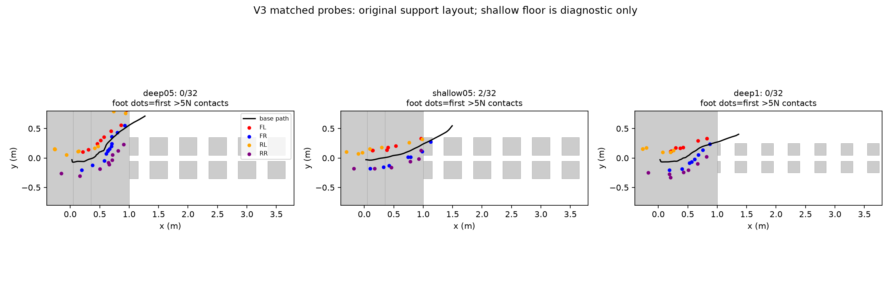

# V4：真实深坑课程与失效诊断

2026-10-18。用户已批准停止平台期方案并执行新方案。**本页没有新的窄桩成功结论；V4仍在训练完整地图教师。**

## 已执行的停止与保全

旧 `nav_teacher_v3` 控制器及其训练进程组已通过 SIGINT 停止，不再自动启动后续块。最后一个完整原子检查点 `model_3500.pt` 经ZIP完整性检查后，复制到 `/root/gpufree-data/MoE-runs/nav_teacher_v3_stopped/`，保留源码、配置和SHA256。检查点后的未保存更新没有声称已保存。

[停止记录](artifacts/v4_redesign/v3_stop_for_redesign.json)、[保留权重](artifacts/v4_redesign/nav_teacher_v3_stopped/model_3500.pt)。第三轮前3000轮的三个完整gate均保留在 [v3_gates](artifacts/v4_redesign/v3_gates)。全部六组原桩始终为0/32；3000轮时平地/楼梯/高台各32/32。第四块未完成，不标记成完成4000轮。

## 先诊断，而非把猜测写成原因

固定第三轮 `model_2999.pt`，同一seed801、32环境、双列布局；本次新增执行前航向、足力和地图记录：

| 测试 | 完整通过 | 失败终止 | robot0平台边缘前航向偏差 | robot0低于平台0.1m的接触样本 |
|---|---:|---:|---:|---:|
| 原深坑，difficulty0.5 | 0/32 | 32/32 | 约63.1° | 0 |
| 浅坑诊断，difficulty0.5 | 2/32 | 30/32 | 约27.1° | 0 |
| 原深坑，difficulty1 | 0/32 | 32/32 | 约40.1° | 0 |

航向采样取robot0首次机身x>0.75m的诊断帧，不能作为所有32环境的统计。接触计数同样只来自robot0，不证明其他回合没有坑底支撑。**现有结果不支持简单断言“所有失败就是依赖坑底”**；浅坑本身也多数失败。可以确认旧策略存在较明显的航向与横向偏移，且深浅地形输入会改变行为。



[完整诊断统计](artifacts/v4_redesign/v4_failure_analysis/summary.json)、[原始回合/动作前地图](artifacts/v4_redesign/v4_diagnosis)。浅坑2/32不能计为原场景成功。

原生地图检查将robot0初始姿态的高度扫描XY与预期33×21网格逐点比较，再与解析原AME高度场比较；排除距碰撞盒边界2mm以内的格。两组各632个高度样本全部正确，最大XY误差约3.8微米，最大高度误差约2.6–3.8微米。**此次初始姿态检查未发现转置或偏移错误**，不代表已覆盖所有运动姿态和传感器误差。

[中等难度对齐记录](artifacts/v4_redesign/v4_diagnosis/deep05/map_alignment.json)、[最终难度对齐记录](artifacts/v4_redesign/v4_diagnosis/deep1/map_alignment.json)。

## 新课程的实际实现

- `moe_perceptive/sparse_course.py`新增 `wide_deep`：所有等级坑底始终−2m，支撑面从1.0m逐步缩到0.2m，起始间隙约5cm，保留5cm网格量化。
- 中间布局明确是训练前置任务。difficulty=1直接调用原AME生成器；测试已验证高度场逐格相同、碰撞盒列表相同。
- 原严格suite默认仍是original，不带wide_deep，绝不将宽桩成绩混为20cm原桩成绩。
- 每个环境在当前等级重新累计成功EMA与尝试数，完整到达后才晋级；晋级要求至少5次尝试且成功EMA>0.75，切换等级后清零，避免沿用易级成绩快速跳级。
- 针对诊断的偏航与横移：增加 `1-cos(yaw)` 惩罚（权重−2），通道中心惩罚从−0.5改为−2。没有在线修改关节动作或加入IK。
- 从第一轮MoE感知权重初始化，使用新的优化器与课程；不沿用第三轮已偏航/失效的策略。仍保留冻结的原MoE参考和明确物理限制。

四轮32环境原生短训练已完成，验证配置、PPO、课程更新与检查点可运行；两个几何测试已通过，确认每级真实坑及最终原几何一致。这些是接口和几何检查，不是越障技能证据。

[原生短训练完成记录](artifacts/v4_redesign/wide_deep_v4_smoke/completed.json)。

## 当前运行与自动评估

控制器 `moe_perceptive/deep_trial.py`；输出 `outputs/moe_perceptive/wide_deep_v4`；训练前缀 `/root/gpufree-data/MoE-runs/wide_deep_v4_chunkN`。

512环境，500轮一块，初始最多5块。每块结束：

1. 对原始九项场景完整评估，录制20cm双列/交错桩视频；仍是完整地图教师成绩。
2. 另测宽桩起始课程的双列/交错完整通过率，并做原生地图对齐检查，明确标为precursor。
3. 记录严格通过数、课程等级和precursor成绩；若连续两个gate均无实质改善，即使停在较高级也转入诊断，不再只判断是否卡在level0。

[启动记录](artifacts/v4_redesign/launch_wide_deep_v4.json)、[启动时源码/参数](artifacts/v4_redesign/wide_deep_v4_chunk1/manifest.json)。当前公开目录仅包含V4启动快照，不是最终权重或最终评估。

```bash
python3 -m moe_perceptive.deep_trial \
  --moe vendor/RoboGauge/resources/models/go2/go2_moe_cts_137k_0.6739.pt \
  --initializer /root/gpufree-data/MoE-runs/visible_moe_v1_seed42/model_999.pt \
  --smoke /root/gpufree-data/MoE-runs/wide_deep_v4_smoke \
  --output outputs/moe_perceptive/wide_deep_v4 \
  --run-prefix /root/gpufree-data/MoE-runs/wide_deep_v4 \
  --chunks 5 --chunk-iterations 500 --num-envs 512
```

以上是已启动命令，接手后先检查进程，不重复运行。所有输出必须使用未存在的新目录。

## 后续仍未完成

教师真实深坑通过后，才继续可见D435i/Mid360学生蒸馏和PPO、安装/记忆误差验证、独立种子、MuJoCo以及目标点导航整合。当前阶段没有新增实机或学生成功结论。

归档包含旧三次完整gate、停止权重、匹配诊断、V4原生短训练及启动元数据。见 [文件校验清单](artifacts/v4_redesign/archive_manifest.json)。
