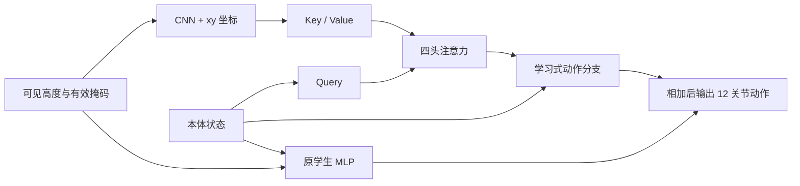

# AME 对 Go2 感知越障的参考与实验

> 文档类型：研究记录。新环境先阅读[环境准备与路径约定](环境准备与路径约定.md)，从当前仓库根目录设置变量。历史报告中的成绩、模型编号和运行状态属于记录当时；当前是否可执行、是否通过，以对应技能中文手册及实际模型/评估文件为准。原始配置和日志仍保留在归档中，不能原样执行其中的机器路径。


## 判断

AME 值得参考，最直接对应梅花桩、窄支撑面的落脚选择。它不是全局导航器；局部高程表示也不等于预先建好的全局地图。目标点规划、绕障与不可跨越区域判断仍需导航层完成。

- [AME 原论文](https://arxiv.org/abs/2506.09588)：CNN 编码局部地形，以本体状态产生多头注意力查询，再输出运动动作；先用理想感知训练基础地形，再加入复杂地形和感知误差。论文机器人为 ANYmal-D 与 GR-1。
- [用户提供的第三方复现](https://github.com/SII-FUSC/AME_Locomotion)，检查版本 `1d3519ee946c846c1c89dd660539a224f99972b5`：Isaac Lab + G1 29 自由度，提供 33×21 高程输入模型；`ame1.pt` 和带全局上下文的 `ame2.pt` 均不能直接作为 Go2 权重。复现对原网络做了 xyz 输入、CNN 下采样等调整。
- [作者 AME-2 官方实现](https://github.com/leggedrobotics/ame2_minimal)：平台版本与本服务器接近；截至本次检查，Mid360 神经建图模型和依赖它的学生训练未公开。因此不能声称获得了完整雷达到运动的现成方案。

第三方仓库根目录未发现明确授权文件；本项目不复制其编码器，也不分发其 G1 权重。以下代码是根据论文思路独立实现的 Go2 实验，不宣称原论文复现。

## 本次改动

保持已有传感器观测：45 维本体状态 + 187 个可见高度 + 187 个有效掩码，总计 419 维。没有改用理想全地图替代学生输入。

`perceptive_rl/attention.py` 提供：

1. 高度与有效掩码组成 17×11 两通道网格，CNN 提取局部特征。
2. 保留全部 187 个地形 token，附加机器人坐标系 xy；避免下采样先丢失小支撑面。
3. 本体状态作为 query，四个注意力头读取地形 key/value；未知格不参与注意力，始终可用的 null token 处理整幅未知观测。
4. 地形上下文与本体状态经 MLP 产生学习式动作分支，与已有学生 MLP 相加。新分支末层零初始化，确保训练前与已发布学生完全一致；PPO 更新全部网络，不冻结基础 MLP。

这里仍是端到端的学习式关节动作控制，没有加入手工抬脚轨迹。保留原 MLP 是为了进行稳定的增量架构实验；它与原 AME 的单编码器架构不同，也没有复刻共享 actor/critic 编码器。

不覆盖服务器安装的 RSL-RL，只在训练进程注册策略类。导出为 TorchScript 后，现有 MuJoCo 评估器可以直接运行。



## 对照约定

两组均从已发布 `student/model_299.pt` 初始化，使用相同的融合感知、混合地形、随机种子 44、512 个并行环境与 200 轮 PPO，每组额外 2,457,600 次交互。

- `control`：原 MLP 继续训练。
- `attention`：加入上述地形注意力分支后训练。

这能区分“多训练了一段”和“增加注意力结构”带来的变化；单次种子的小规模实验不能证明架构普遍优越。先看固定难度 0.5 的 Isaac 和 MuJoCo 完整通过率，再考虑加大训练量。测试保留失败案例，视频不计作额外独立成功样本。

```bash
"$ISAAC_PY" -m perceptive_rl.train --headless --fused --kind mixed \
  --attention --bootstrap artifacts/perceptive/checkpoints/student.pt \
  --num-envs 512 --iterations 200 --seed 44 --output outputs/ame/attention
# 对照：去掉 --attention，输出改为 outputs/ame/control。
```

训练完成后执行 `python scripts/ame_benchmark.py --label attention`（对照组改为 `control`）。
发布的模型可直接在 MuJoCo 回放：

```bash
MUJOCO_GL=egl python -m perceptive_rl.mujoco_compare --backend learned \
  --actor artifacts/ame/attention_eval/native_stairs/actor.pt \
  --io artifacts/ame/attention_eval/native_stairs/summary.json \
  --kind stones --difficulty .5 --seed 801 --episodes 5 --video \
  --output outputs/ame_replay
```

结果见 [AME 实验报告](../AME验证记录.md)。注意力强度仅是网络内部权重，不能直接当作足端落点或安全保证。
