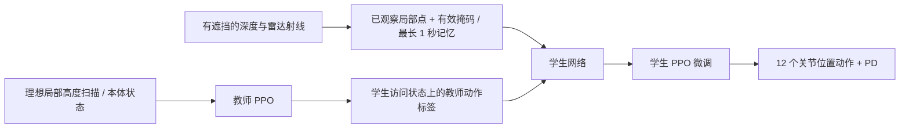

# Go2 感知运动策略训练实验

本实验比较「冻结 RoboGauge MoE + 感知抬脚 IK」与「地形感知网络直接输出关节动作」。
新训练入口是 `perceptive_rl`，不调用 MoE、NJU BBC 或手写跳跃轨迹。
**训练了一个新网络不代表它已经优于原控制器；以 PERCEPTIVE_VALIDATION.md 的独立评估为准。**

## 参考与取舍

| 开源工作 | 本实验参考的内容 | 本实验没有声称复现的内容 |
|---|---|---|
| [Extreme Parkour](https://github.com/chengxuxin/extreme-parkour) / [论文项目页](https://extreme-parkour.github.io/) | 地形扫描教师、感知学生、课程式越障训练 | 原始视觉编码器、ROA、论文越障高度及实机表现 |
| [Robot Parkour Learning](https://github.com/ZiwenZhuang/parkour) | 对高台等难技能分课程训练，再训练感知策略；有 Go2 配置与部署示例 | 原始虚拟障碍课程、多专家技能与实机模型 |
| [Vision Locomotion](https://vision-locomotion.github.io/) | 梅花桩需要保留已观察地形，供后腿落脚使用 | 该工作的原始视觉记忆网络 |
| [Isaac Lab](https://github.com/isaac-sim/IsaacLab/tree/v2.3.2/source/isaaclab_tasks/isaaclab_tasks/manager_based/locomotion/velocity/config/go2) | Go2 模型、DC 电机、速度奖励、RSL-RL PPO | 直接将通用 rough 权重称为本项目训练成果 |

原始 Extreme Parkour 的公开训练说明分别要求基础策略约 8–10 小时、视觉蒸馏约 5–10 小时（其作者的 3090 配置）。
本实验是单 L40 上的有限训练尝试，不能将它等同于这些论文的完整复现。

## 两类方案各自解决什么

- MoE + IK：保留已有步态，按可见台阶增加摆动脚净空；容易调试，但不能充分改变落脚位置、支撑顺序或全身发力。
- 感知 RL：训练网络根据地形联合改变 12 个关节动作，理论上能学习落脚、躯干姿态、抬腿时机和攀爬动作；效果取决于训练是否充分、观察是否可靠及动力学是否匹配。
- 梅花桩尤其需要前后、左右落脚位置与观测记忆。只把原有脚轨迹向上移动，不能解决脚落进空隙的问题。

## 训练路线与观测边界



| 模式 | actor 输入 | 用途与限制 |
|---|---|---|
| `--blind` | 45 维：角速度、重力、速度命令、关节位置/速度、上一动作 | 无外感知对照 |
| 默认 | 45 + 187 = 232 维 | 从零训练；187 个理想向下射线高度可穿过相机遮挡，只是地形教师 |
| `--teacher-velocity` | 3 + 45 + 187 = 235 维 | 教师额外使用仿真真实机体速度；支持官方 rough 权重初始化 |
| `--fused` | 45 + 187 高度 + 187 有效掩码 = 419 维 | 学生只利用模拟深度/雷达可见返回；不输入真实机体速度或障碍参数 |

critic 使用理想高度和真实机体速度，属于非对称训练。部署学生时不需要 critic。
actor 为 ELU MLP：输入 → 512 → 256 → 128 → 12。动作是相对默认关节角的偏移，缩放 0.25 rad，再由 PD 执行。
Isaac Lab 关节顺序为先四个 hip、再四个 thigh、再四个 calf，**与 RoboGauge 按腿排列的顺序不同**；导出 JSON 记录显式映射。

学生的深度射线为 32×20，水平/垂直视场 87°/58°，向下 20°，量程 4 m；雷达为 96×12 简化扫描，垂直 -7°～52°，量程 8 m。
传感器 10 Hz，控制 50 Hz，PhysX 步长 5 ms。射线仅与静态地形求交，有遮挡和缺失返回；不是彩色相机、真实 D435i 噪声模型或 Mid-360 非重复扫描。
水平安装的 Mid-360 最低垂直角约 -7°，对近处地面覆盖有限；当前近身高度主要来自下倾深度相机。本轮没有用消融证明雷达的独立增益，不能把双传感器输入等同于双传感器均有效改善了落脚。
短时记忆仅保存实际看到的点，最多 1 秒；使用仿真真实位姿作为理想里程计，不用障碍场景参数填补未知区域。
这属于局部感知表示，不需要预先建图，但还没有接入实机驱动、外参和里程计。

## 地形与奖励

`geometry.py` 定义同一组物理盒体，供 Isaac Lab 训练和 MuJoCo 对照使用。目标是沿通道前进约 7.5 m，不能绕到通道外通过。

| 地形 | 难度 0 → 1 | 难度 0.5 |
|---|---|---|
| 高台（含走下平台） | 3 → 40 cm | 21.5 cm |
| 四级上楼、平台、四级下楼 | 每级 2.5 → 18 cm，踏面 40 cm | 每级 10.25 cm |
| 双列交错矩形梅花桩 | 桩面长 58 → 34 cm，宽 52 → 30 cm；纵向空隙 1.5 → 16 cm | 桩面 46×41 cm，空隙 8.75 cm |
| 梅花桩下方 | 坑底 -55 cm；桩顶有交错高差 | 不是在平地上画标记 |

训练混合比例为平地 15%、楼梯 30%、高台 25%、梅花桩 30%。从最易地形开始，完成后升级，早期失败降级。
奖励包括速度/转向跟踪、向前进度、到达、横向偏离、关节力矩/加速度/动作变化、小腿/大腿接触及关节限位。
没有在运行时注入脚部轨迹或直接修改机体位置/速度；重置时可以设置初始状态。
训练随机化包括摩擦、本体质量、初始位置朝向、本体观测噪声和感知噪声。尚未覆盖真实电机时延与完整标定误差。

## 运行

在安装 Isaac Lab 2.3.2、Isaac Sim 5.1 和 RSL-RL 3.1.2 的 Python 中运行，避免用 MuJoCo 的轻量环境启动 Isaac Lab。
下面服务器路径只是当前已验证环境示例。历史宽桩实验显式使用 `--kind mixed`；当前训练默认值已改为 AME 窄桩，不能省略该参数来复现实验。

```bash
cd /root/gpufree-data/Rob2Nav
# 从零训练，理想地形扫描教师
/root/isaacsim/python.sh -m perceptive_rl.train --headless --kind mixed \
  --num-envs 2048 --iterations 1800 --output outputs/perceptive/scan

# 另一条路线：以外部 rough 检查点初始化，新建 PPO 优化器与越障课程
/root/isaacsim/python.sh -m perceptive_rl.train --headless --teacher-velocity --kind mixed \
  --bootstrap /path/to/official_rough_checkpoint.pt --num-envs 2048 \
  --iterations 400 --output outputs/perceptive/teacher

# 蒸馏不是 RL；随后再执行学生 PPO 微调
/root/isaacsim/python.sh -m perceptive_rl.distill --headless \
  --teacher outputs/perceptive/teacher/model_399.pt --num-envs 1024 \
  --steps 1500 --output outputs/perceptive/distill
/root/isaacsim/python.sh -m perceptive_rl.train --headless --fused --kind mixed \
  --resume outputs/perceptive/distill/student.pt --num-envs 1024 \
  --iterations 300 --output outputs/perceptive/student
```

实际发布权重、完成迭代数和运行命令以评估报告及每个运行的 manifest 为准，上述是训练入口示例。
原始 NVIDIA 检查点从 Isaac Lab 官方资源地址下载，只作为外部初始化来源；不把它算作新训练成果。

新权重不能直接替换 `go2_moe_cts_137k_0.6739.pt`：观测维度、观测缩放、关节排列和 PD 参数均不同。
请通过本目录的导出和 MuJoCo 适配器运行。训练命令主要覆盖向前速度跟踪与直线越障，尚未验证任意转弯、横移和整条导航路线。

## 评估与复现

```bash
# 固定难度、独立初始状态；导出 actor.pt 和带关节映射的 summary.json
/root/isaacsim/python.sh -m perceptive_rl.evaluate --headless \
  --checkpoint /path/to/model.pt --kind stones --difficulty .5 \
  --num-envs 32 --output outputs/native_stones
# 感知学生加 --fused；理想地形教师不加。

# 相同几何的 MuJoCo 验证
/root/gpufree-data/envs/go2-mapless/bin/python -m perceptive_rl.mujoco_compare \
  --backend learned --actor outputs/native_stones/actor.pt \
  --io outputs/native_stones/summary.json --kind stones --difficulty .5 \
  --episodes 5 --video --output outputs/mujoco_stones
# --backend moe 或 --backend ik 可运行两种冻结 MoE 基线。
```

`scripts/perceptive_suite.py` 可批量测试多个难度和场景，并逐项保存完整命令、返回码和结果。
完整通过要求到达终点并至少两脚支撑；跌倒或走出测试区域不能算通过。
MuJoCo 评估还记录全轨迹，能区分“已爬上但下楼失败”与“没有爬上”。
小腿接触指标是控制频率采样的法向力积分代理，不是精确接触冲量。
新策略首先看 Isaac 原生表现，再看 MuJoCo 迁移；两个物理引擎的结果不能混在同一成功率中。

最终 MuJoCo 对照统一使用 Go2 原始 URDF 的大腿关节范围、0.8 足端摩擦、每关节 ±23.5 N·m 力矩预算。
三个控制器使用各自的 PD 参数；学习策略采用其 Isaac Lab 训练参数。
这与 RoboGauge 原始评估 XML 中收窄的大腿范围、0.4 足端优先摩擦及小腿更高力矩限幅不同。
探索阶段的原始 XML 测试保留在报告中，不能与统一模型后的最终测试混算。

本次实验没有执行实机电机命令。
