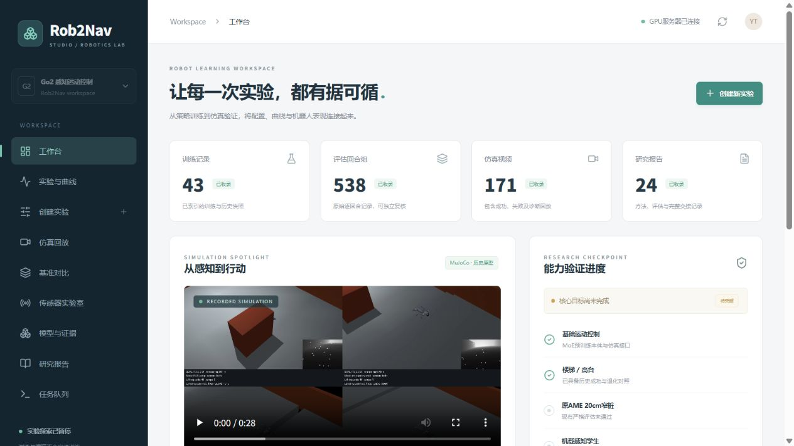

# Rob2Nav Studio 首版验收记录

2026-10-18。此页记录网页工程验证，不是机器人策略成功报告。

## 已交付

React/TypeScript网页、FastAPI接口、持久SQLite队列、独立Linux worker、MoE训练参数桥接、MuJoCo/NJU仿真任务入口、历史数据导入、曲线/奖励、视频与地图回放、对比、模型下载、报告和传感器几何预览。

服务器部署目录 `/root/gpufree-data/Rob2Nav`；Web虚拟环境 `/root/gpufree-data/envs/rob2nav-studio`；API仅监听服务器`127.0.0.1:8765`。本机通过SSH隧道`127.0.0.1:8766`访问。不保存SSH密码，不开放公网训练控制端口。

## 自动检查

- 13项后端测试通过：读取历史证据/JSONL半行、教师标签、配置与路径限制、默认不执行、同源修改要求、队列重复提交、unknown阻断、完成标记及最终检查点、奖励/PPO覆盖、旧MuJoCo格式、仿真命令、带假模拟器的完整worker流程、实际TensorBoard事件格式。
- TypeScript和生产构建通过。图表按模块引入并独立分包；图表chunk仍超过500kB，构建会提示体积，后续可继续按路由懒加载。
- npm安装审计0已知漏洞；使用修复XSS问题后的ECharts 6.1系列。未使用强制破坏式audit fix。
- `moe_perceptive/train.py`和新增覆盖模块语法检查通过。未为网站验收启动真实策略训练。

## 网页交互验收

- 本地真实索引、页面刷新与资源数据显示正常。
- 配置器将route_bonus从默认500勾选覆盖为250，预检正确识别本地无Isaac解释器；保存草稿后状态为draft，提交关闭，取消后为canceled。
- 训练页实际绘制历史1000轮曲线和课程分布。
- 服务器TensorBoard读取实际36类标量，`Train/mean_reward`取得995个真实点，包含分项奖励。没有以虚构点补齐缺失记录。
- 视频接口Range读取返回206及`Content-Range: bytes 0-1023/...`。

## 真实MuJoCo任务验收

通过网页保存并明确提交任务`aa321ff6b4ab43f9`：空场地、原MoE行走、禁止跳跃、2秒上限、单回合，不训练。

任务从queued到执行完成，独立worker创建MP4、summary和轨迹。实际仿真约2.1s、行进约1.36m、没有碰撞/跌倒，因时限未到8m目标，成功数0/1。执行完成不能标成导航任务通过。

从队列“回放结果”进入对应视频页，正确显示该回合0/1、约2.1s时间轴与已有机身位置。没有给未记录的直立度、动作前地图或接触力补造数据。

## 数据索引

服务器验证时索引538条评估、43条训练记录、171段视频、70个模型文件和24份报告（含2秒验收任务）。目录含历史归档与原始运行的重复副本，这些是索引条目数量，不能当作独立实验/独立种子数量。

## 明确未完成的范围

- AME完整原训练控制适配器、独立RoboGauge评估提交、多用户权限、高帧率直播、完整关节三维回放和自动超参数搜索尚未开放。
- NJU入口是已有冻结BBC技能的MuJoCo组合仿真，不是完整原训练复现。
- 网页传感器页面是理想平地几何，不包含完整硬件光学、动态遮挡或真实标定。
- 新增MoE边界保存停止、完整GPU训练/恢复链路尚未通过真实训练回合验收；已有覆盖及worker测试使用安全临时样例。原探索暂停状态保持不变。
- 单机worker重启遇到在途任务会保守置unknown并阻断新任务，需管理员核对进程，而非假装已恢复。

运行和扩展说明见 [studio/README.md](../studio/README.md)，长期方案见 [ROB2NAV_STUDIO_PLAN.md](ROB2NAV_STUDIO_PLAN.md)。
