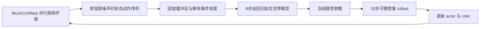

# SuperMimic 原理与代码说明

## 1. 三层实现分别是什么

原论文 [SuperMimic](https://arxiv.org/abs/2610.28480) 用可微世界模型帮助优化机器人控制策略。[第三方 Go2 仓库](https://github.com/Zhengtianjin/go2-supermimic) 将这一思路用于四足追逐、避障和地形任务。本仓库新增无外感知的速度指令任务：给定前进、侧移、转向速度，Go2 依靠本体观测行走。

当前不是把空翻 PPO 权重换一个加载器，也不是通过给定关节轨迹播放动画。训练收集真实刚体仿真的接触和动力学数据；策略在学习到的可微模型内优化，最后仍要回到独立物理仿真验收。

## 2. 每轮训练的三个阶段

### 2.1 收集数据

Actor 根据观测输出 12 个关节动作。部分环境加入较大的 OU 探索噪声，其余环境使用较小噪声，拓宽世界模型看到的状态范围。缓冲区保存实际执行的动作和状态，包含探索噪声，不能用无噪声动作替代已经执行的动作。

世界模型可以读取训练时可获得的特权状态和仿真上下文，例如摩擦及质心偏移。它学习状态变化和水平位姿变化，既不要求 MuJoCo 可微，也不直接对刚体求解器求导。

### 2.2 拟合世界模型

采用 8 步自回归窗口：预测下一状态，再把预测状态作为下一步输入。这样约束多步误差，而不只优化一步回归。跨 reset 的无效片段需要掩码；接触变化、腾空和跌倒等稀有事件有优先采样和档案机制。

归一化用于控制不同物理量尺度。世界模型学习无噪声状态转移，已知观测噪声在模型外采样，避免把随机噪声当成确定性动力学去拟合。

### 2.3 在模型中优化策略

冻结世界模型的参数，**保留模型对状态和动作的梯度**。Actor 连续生成 32 步动作，世界模型生成预测状态，奖励函数生成回报，critic 提供末端价值估计。误差沿这 32 步反向传播到 actor。

可以将目标概括为：

`J = E[Σ(t=0..H−1) γ^t c_t r_t + γ^H c_H V(s_H)]`

其中 `H=32`，`c_(t+1)=c_t(1−d_t)` 为存活权重，`d_t` 为软终止概率。Critic 用 TD(λ) 目标训练，actor、critic、世界模型分别优化。它依靠模型的状态/动作导数改进策略，不能解释为 PPO 的概率比率目标。

模型可能被策略“利用”：策略找到模型预测很好、实际物理失败的动作。因此训练损失低、想象回报高，都不能代替刚体仿真的独立测试。

## 3. 当前速度任务的观测与控制合约

Actor 输入为 350 维，即每项 5 帧历史，总计 `(3+3+12+12+12+28)×5`。历史按上游 observation term 的布局组织，不要自行改成另一种时间/通道交错方式。

| 项目 | 每帧维度 | 说明 |
| --- | ---: | --- |
| 机身角速度 | 3 | 本体观测 |
| 机身坐标系重力方向 | 3 | 姿态观测 |
| 相对默认站姿关节角 | 12 | 按实际 action target names 顺序 |
| 关节速度 | 12 | 与关节角顺序一致 |
| 前一动作 | 12 | 原策略动作历史 |
| 命令 | 28 | 前 3 维 vx、vy、wz，后 25 维必须为零 |

Actor 没有雷达、高度图、球位置、障碍物真值或基座线速度真值。世界模型与 critic 可以有特权状态。这种不对称设计允许将来盲走地形，但**本次尚未实现盲楼梯训练和验收**。

`target` 和 `chase_vel` 是为兼容上游保留的代码名称；在速度任务中它们只存速度命令。`VelocityImagination` 移除了原有 ball advance 和 oracle observation 路径，不能仅修改任务名称后继续使用追球想象过程。

控制周期 0.02 秒（50Hz），物理周期 0.005 秒（200Hz），每控制周期 4 个物理子步。目标关节角为：

`q_target = q_default + action × action_scale`

`action_scale` 是逐关节尺度，来自执行器参数（上游使用 `0.25 × effort / stiffness`），不是统一的 0.5。髋/大腿最大速度 30.1rad/s、最大力矩 23.7Nm；小腿为 20.07rad/s、45.43Nm。执行器存在延迟链。关节顺序必须读取 `joint_pos` action term 的 `_target_names`，不能直接套用旧部署框架的 SDK 顺序。

## 4. 真实和想象奖励

`rob2nav_velocity.py` 的共享函数用于真实环境与想象环境：水平速度跟踪权重 2，转向跟踪 1，直立 1，竖直速度平方 −0.5，横滚/俯仰角速度平方 −0.05，动作变化平方 −0.05，软关节限位超出 −5，站立运动惩罚 −2。实际配置以 `evidence/config/velocity_contract.json` 为准。

真实奖励按控制 dt 缩放。想象使用相同任务奖励，但终止部分仍有近似：真实倾倒硬终止，想象为软存活与终止惩罚。因此末态审计 `reward_max_error=0` 证明该快照的任务奖励一致，不能证明整个预测轨迹或终止机制完全等价。

## 5. 代码地图

上游路径均相对于固定提交的独立源码目录：

| 文件 | 负责什么 |
| --- | --- |
| `go2_supermimic/supermimic/train.py` | 配置、真实采样、回放、模型与策略更新、完整检查点和恢复 |
| `go2_supermimic/supermimic/state.py` | 状态切片、物理状态和动作尺度 |
| `go2_supermimic/supermimic/imagine.py` | 上游想象 rollout，任务适配时需核对命令与观测 |
| `go2_supermimic/env/env_cfg.py` | 物理环境、事件与任务配置 |

本仓库 overlay 安装到独立源码目录：

| 文件 | 负责什么 |
| --- | --- |
| `rob2nav_velocity.py` | 速度命令、共享奖励、无外感知 actor、定制想象过程 |
| `rob2nav_reset_targets.py` | reset 时初始化控制目标为当前关节角，修复零目标进入延迟链 |
| `rob2nav_contact_audit.py` | 只读 Warp 接触缓冲，分类非足机器人几何与地面接触 |
| `scripts/train_velocity.py` | 替换当前进程中的 Imagination/Trainer，写实际合约和末态审计 |
| `scripts/eval_velocity.py` | 八阶段固定命令；每物理子步检查关节位置/速度/力矩和接触 |
| `scripts/diagnose_velocity_entry.py` | 相同初态下 policy 与零动作初始化对照 |
| `scripts/video_velocity_latest.py` | 冻结模型原速录像，不参与训练 |

原始服务器训练脚本另存于 `evidence/source_snapshot`；可安装版本的可移植 CLI 改动不回写历史证据。`CONTRACT` 中早期 `draft/training_ready=false` 是历史设计标记，不是执行开关；实际训练是否运行，以 checkpoint、实际配置、日志和审计为准。

## 6. 初始化修复为什么必要

原框架 reset 清零位置目标，随后 `scene.write_data_to_sim` 将零目标送进执行器延迟链。即使第一帧策略动作正确，前两个物理子步也可能执行旧的零角度控制，导致小腿超速。

同 seed、同初始 qpos/qvel 的 policy 和零动作对照均出现 22.64048rad/s；加入 reset hold 后，初始 qpos/qvel 和首动作不变，速度峰显著降低。修复只设置控制目标，不修改物理位置、速度、接触、求解器或阈值，也不删除入口样本。

**历史 12000 轮训练没有使用该修复。** 当前视频与 hold 评估是在冻结历史模型上显式启用新控制初始化合约，不是新训练权重。新训练若启用修复，必须记录标志和源码哈希，与旧训练区别开。
