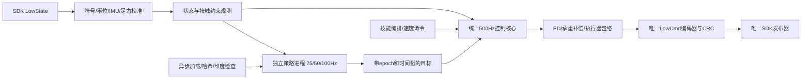
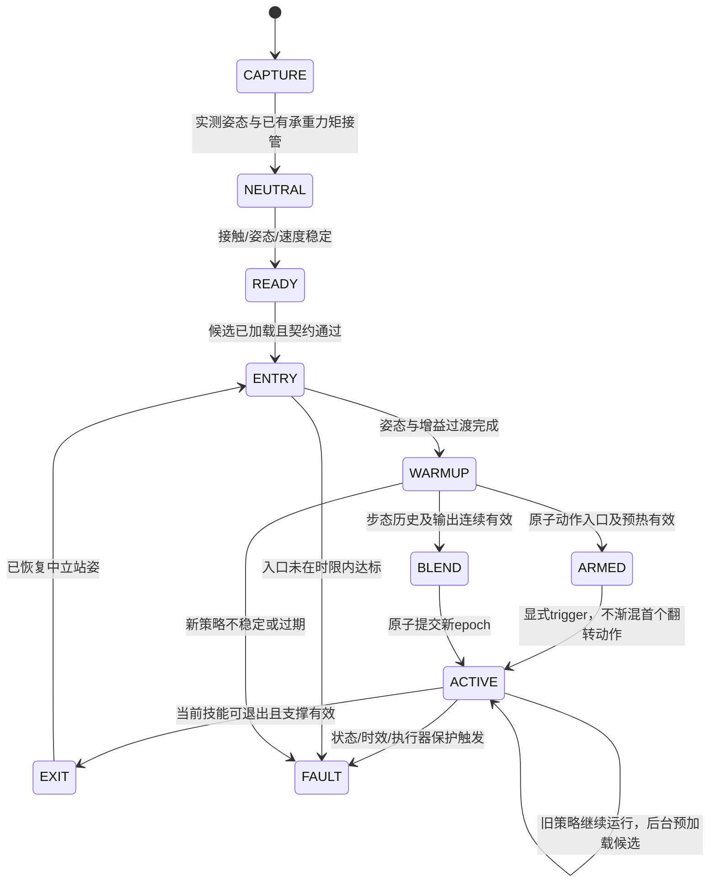

# Go2 统一部署与权重热切换

实现位于 `rob2nav/deployment/`，配置位于 `deployment/skills/`。目标是同一个低层发送器完成步态切换，以及“步态 → 单次 flip → 落地恢复 → 步态”，避免分别启动多个部署程序争抢电机。当前只执行离线和 MuJoCo 验证；**没有初始化真实机器人DDS，没有发送实机电机指令。所有随仓库发布的配置均为 `hardware_qualified=false`。**

完整资源索引见 `artifacts/release_20261021/`，历史任务与权重状态见 `handover.md`。通过加载或编码检查不等于策略通过实机验收。侧翻选定模型的动作验证为8/8，但速度门限仍失败；后空翻和直立行走也不能直接放行实机。

## 1. 一个电机控制所有者



SDK电机顺序固定为FR、FL、RR、RL，每腿hip/thigh/calf。所有模型输入输出按关节**名称**重排，必须是12个关节的完整双射。关节符号、机械零位与SDK原始量的变换由设备校准文件处理，不假定所有导出器顺序相同。

`LowCmdCodec`使用固定SDK提交 `814556d15970dd2ecf1c9984e845ca02ab07e206` 的真实IDL及CRC。会话固定选择torque或hybrid_pd模式，不在热切换中变更。torque发送端 `kp=kd=0`；hybrid_pd发送原生目标/增益与扣除PD后的残余前馈，避免重复计算PD。原生策略保留原来的内环增益与频率契约。协议20个槽中只给Go2的前12个电机施加目标力矩，其余槽保持停止值和零力矩。

SDK运动服务与低层策略不能同时拥有控制。发送前检查 `MotionSwitcherClient.CheckMode`，有其他服务时拒绝；不会自动调用StandDown/ReleaseMode。主机文件锁只防止本框架的多个写入者，不能证明网络上不存在其他发布器；现场仍须完成运动服务及其他控制端的独占仲裁。

## 2. 热切换事务



1. **准备**：后台验证权重SHA256、关节顺序、输入契约、缩放、默认姿态、参考数据与频率，再在独立进程加载。执行一次丢弃的推理探针，然后重置模型内部历史。失败不替换当前策略。
2. **旧技能退出**：步态的速度目标按加速度上限逐渐归零。静止判据不只看指令为零，还看实测姿态、角速度、关节速度与接触。部分策略零速时仍踏步，步态允许经过验证的低速三足支撑窗口；必须有有效的速度估计与质心投影余量。没有这些量时不采用该回退条件。
3. **姿态和PD桥接**：捕获实际关节和当前力矩，先过渡到统一中立站姿，再进入新技能入口。使用五次时间曲线、目标速度/加速度限制、增益斜率限制及承重补偿。不能只把新默认角度与新PD一次写入。
4. **承重连续性**：捕获/匹配前一周期的输出力矩；站姿阶段利用接触和固定动力学模型估计支撑力矩，并采用有界、仅在有效支撑时更新的校正。新学习策略渐入时逐步退出额外承重偏置，避免把站姿积分器叠加到原策略之上。
5. **历史预热**：步态上一动作按当前实际施加的目标在新模型默认姿态/缩放下重新表示；原子动作按源训练重置契约清零逻辑动作历史，预热后进入ARMED，显式trigger才开始相位；不沿用另一个策略的裸12维动作。新策略在当前真实观测下预热，切换时不重置机器人根状态。ONNX/TorchScript各自使用对应观测适配器。
6. **提交**：只在渐入完成后更新当前策略。旧epoch或迟到响应被拒绝。保留有限的非活动模型缓存，便于flip后回到步态；缓存复用前仍重置并重新预热，清理进程在控制循环外完成。

切换阶段的默认限值为：目标参考速度2rad/s、加速度20rad/s²；Kp变化15/s、Kd变化2/s；力矩变化150N·m/s，即500Hz时每周期最多0.30N·m。这些是当前仿真桥接配置，不是对任意Go2或任意特技的通用认证参数。

**学习策略正式执行后保留其原生PD语义。** 不把为切换设计的低通滤波器永久套在所有步态/flip动作上，否则会改变训练分布甚至消除步态。原生动作阶段仍受执行器包络约束，但动态动作自己的快速力矩变化与“切换瞬间的冲击”分别统计。新策略激活边界额外保留短暂力矩连续性保护。

## 3. flip后恢复步态

flip标记为atomic。步态返回请求可以提前预加载、排队，但不会因为收到新权重就中断腾空动作，也不会在空中把两个网络输出简单插值。

参考相位只在真正激活后前进。到达动作末尾后继续由该策略恢复和站稳；只有动作时长/恢复窗结束且实际四足接触、姿态和速度全部合格，才进入EXIT。随后捕获落地后的实测姿态和力矩，通过中立姿态、步态入口、历史预热和渐入恢复步态。落地失败、姿态倒置或迟迟不能恢复时保持故障/拒绝切换，不能强行插值到“站立角度”。

侧翻的入口来自固定参考的第一帧，**不是**把训练默认角度当成参考起始姿态。参考姿态、相位、yaw对齐、数据哈希与网络权重必须配套。当前侧翻使用native_pd研究路径进行连续编排试验；它不解除速度约束失败带来的实机隔离。

直立双足行走的退出需要独立验证的降身/四足恢复控制器。当前没有通过验证的退出器，因此明确拒绝该技能进入SDK热切换，不对倾斜的机器人直接插值四足站姿。

## 4. 观测与策略契约

| 适配器 | 输入与状态 | 部署状态 |
|---|---|---|
| robogauge45 | gyro×0.25、重力、缩放速度、相对默认q、dq×0.05、上一动作；模型自身历史 | MLP/MoE仿真热切换 |
| backflip60 | gyro、重力、q/dq、两步动作历史、6维相位编码 | 可离线加载；严格动作/电机验收失败，默认隔离 |
| mimic69 | 参考q/dq、锚点方向、gyro、q/dq、动作历史 | 固定参考和SHA必需；默认隔离，可显式仿真研究 |
| upright48 | **机身坐标COM线速度**、gyro、重力、指令、q/dq、上一动作 | 不能用零向量冒充LowState未提供的线速度；退出控制器未验证 |
| stand | 显式站姿、PD及支撑补偿 | 用于接管/中立桥/停步 |

Isaac感知地形检查点还包含专用感知/记忆/融合契约，不能当成45维TorchScript直接加载。它们已归档，训练与仿真手册保留；在补齐并验证适配器前不接入SDK执行器。导航/SCAN输出的是有时效的速度意图，由当前步态执行，不再创建另一个LowCmd发布器。托爪控制也须经同一个执行器所有权接口接入，其接触控制不等价于一个可替换的普通12维网络。

## 5. 状态估计、保护与设备准入

`KinematicObserver`使用实测q/dq、IMU与足端力，通过固定Go2模型的FK/Jacobian得到接触约束速度和静态支撑多边形余量。多个接触足给出的速度不一致时拒绝估计；不虚构全局位置。共同滑移无法仅凭这些量观测出来，因此低摩擦、坡面、足力标定和载荷/COM变化必须单独验证。模型和校准SHA是设备准入的一部分。

默认保护包括状态年龄30ms、策略响应年龄60ms、控制间隔超过10ms、重复SDK tick、非有限值、关节/速度包络、入口和预热超时、参考/权重SHA错误及旧epoch。电压、温度、电机丢包及恢复阻尼采用设备资格文件中的已验参数，示例数值不代表已经标定。

实机发送必须同时满足：

- 设备序列号、固件、SDK固定提交一致；机械符号/零位、IMU与足力校准已经核对。
- 整份技能契约获准，包括权重、默认姿态、PD、观测、缩放、相位与执行方式；只有权重SHA相同不够。
- 固定运动学/COM模型和控制代码bundle哈希一致，准入未过期。
- 独立机器人端看门狗、恢复阻尼和独占控制已在实际设备验证。

资格文件是受控运维记录，不是密码学认证。所有仓库示例都故意不可启用实机。故障时优先保留有界本地控制；状态丢失或主机/网络彻底失效时，Python进程本身无法保证电机行为，必须依赖已验证的设备端保护。

Python/普通Linux与DDS不能据本项目测试宣称硬实时500Hz。策略进程、加载、日志与网页被移出控制核心；但实际设备仍须完成CPU隔离、调度、通信与尾延迟验收。离线CRC耗时和MuJoCo渲染循环的耗时分别记录，不用平均帧率代替最大延迟。

## 6. 离线使用和验证

```bash
cd /root/gpufree-data/Rob2Nav
PY=/root/gpufree-data/envs/go2-mapless/bin/python
$PY scripts/verify_release_resources.py
$PY -m rob2nav.deployment profiles
$PY -m rob2nav.deployment plan --from walk_moe --to sideflip69
$PY -m unittest discover -s tests -p test_deployment_core.py -v
$PY -m rob2nav.deployment.verify_mujoco --output outputs/unified_switch_new --seed 9401 --video
```

侧翻研究编排要求按[侧翻训练手册](../skills/sideflip/TRAINING.md)从固定源生成参考，把经核对的reference.npz放入 `deployment/reference/sideflip.npz`。SHA必须为 `12877865c884becf477077a750fe1db3cdb01270c34a09ab35661d36ec375981`。该外部参考不混入SDK，也不改变真实机器人姿态。

```bash
$PY -m rob2nav.deployment.verify_mujoco --asset source --atomic-cycle \
 --output outputs/unified_atomic_new --seed 9402 --video
```

SDK独立环境使用Python3.11、NumPy1.26.4、CycloneDDS0.10.2及上述SDK提交。CycloneDDS C库0.10.2安装在独立前缀，避免覆盖ROS环境。真实IDL/CRC离线检查：

```bash
CYCLONEDDS_HOME=/root/gpufree-data/tools/cyclonedds-0.10.2 \
LD_LIBRARY_PATH=/root/gpufree-data/tools/cyclonedds-0.10.2/lib \
 /root/gpufree-data/envs/go2-sdk-check/bin/python scripts/verify_sdk_codec.py \
 --sdk-root /root/gpufree-data/Rob2Nav-upstreams/unitree_sdk2_python \
 --output outputs/sdk_codec_new.json
```

`deployment/calibration.example.json` 与 `qualification.example.json`仅说明字段。CLI `run`默认只给出未启用状态；只有显式 `--enable-motors` 且整个设备资格链有效才会进入连接流程。当前配置会在连接前拒绝，不提供绕过资格的force开关。速度命令超过250ms未续期则归零。侧翻入口使用记录的预策略实测关节姿态与重力方向，不能把默认姿态或参考首帧混为实际入口。接触力采用8N接通/5N断开的迟滞，仍须设备标定。现场资格齐备后，服务使用标准输入JSON接受 `{"switch":"walk_moe"}`、`{"velocity":[0.2,0,0]}`、`{"stop":true}`、`{"trigger":true}`，网页不直接承担实时电机控制。

## 7. 验证证据

验证结果、逐周期数据与失败对照归档在 [统一部署证据](../artifacts/unified_deployment_20261021/README.md)。v9源模型seed9304完整循环通过，但速度包络仍失败；同版本RoboGauge seed9209入口超时。一次成功不等于鲁棒或实机通过，当前源码后续增量未自动继承v9物理验证。核心9项、工作台62项及前端生产构建通过；状态以其中摘要和后续handover为准。源码与资格记录必须对应同一版本，不把旧控制器结果自动归给改动后的控制器。

官方接口依据：[固定SDK低层示例](https://github.com/unitreerobotics/unitree_sdk2_python/blob/814556d15970dd2ecf1c9984e845ca02ab07e206/example/go2/low_level/go2_stand_example.py)。本实现复用了其协议接口，未执行该示例或其运动服务接管动作。
