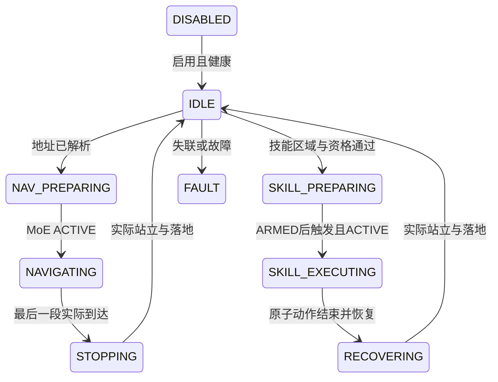

# 语音、地图和统一技能调度

实现位于 voice_agent；集成到 Rob2Nav 的分支为 `codex/voice-agent-capabilities`。它共用 Rob2Nav 原来的技能合同、观测、动作缩放、PD 和资格检查，不把不同权重的动作向量混合，也不重新归一化已训练的观测。统一的是任务入口和切换协议。

## 数据流与能力边界

按住说话 → PCM16 → 常驻 SenseVoice int8 → 严格中文意图 → 状态机 → ROS1 SCAN / Rob2Nav UnifiedRuntime → 实际反馈 → 中文 TTS。不使用 LLM 生成控制代码。地图地址按别名精确匹配，歧义、否定、复合命令均拒绝。停止、禁用和地图编辑使旧 ASR 结果失效；ASR/TTS 独立线程锁，不阻塞停止请求。

`demo` 用合成反馈演示完整任务；不会加载运动权重、DDS 或物理引擎。`live` 必须单独配置进程桥。已接入后空翻 backflip60、侧空翻 sideflip69、倒立 upright48，以及 walk_moe 和 stand；**能解析命令不代表对应权重已通过设备资格**。尤其倒立存在上游退出控制器/验证限制，不能修改标志来解锁。



普通停止将速度清零并请求原始运行时安全返回 stand；原子翻腾中不能用计时器硬切站立。急停使用底层故障锁存/阻尼，它不保证在空中恢复姿态；硬件独立急停仍按原部署合同验收。FAULT 不自动恢复，需检查并重启运行时。

## 本地语音与页面

推荐先用轻量 CPU ONNX 分离服务，避免与 MoE/训练争抢 GPU。5090 并不能替代端点、缓冲和网络延迟测量。Python 3.11 的语音环境与 ROS Noetic Python 3.8 分离。

```bash
bash scripts/install_voice.sh
.voice-venv/bin/python -m voice_agent --mode demo \
  --places data/voice/demo-new.json --speech-config configs/speech.local.json
```

浏览器打开 localhost:8096；若在服务器，使用 SSH 端口转发到本机 localhost，麦克风需要安全上下文。不要直接把未鉴权控制页暴露到公网。远程监听必须设置 VOICE_AGENT_TOKEN；Studio 代理在服务器读取该变量，不把它写进页面。PTT 默认最长 15 秒；HTTP 配置最大 2 MiB。

```bash
.voice-venv/bin/python scripts/benchmark_voice.py --config configs/speech.local.json \
  --wav data/models/voice/asr/test_wavs/zh.wav
# 上述服务必须是新启动且 DISABLED 的 demo；真实模型完成声音往返，控制反馈仍为合成。
.voice-venv/bin/python scripts/smoke_voice.py
```

benchmark 分别记录识别、完整短 WAV 合成和缓存命中；不将其称为流式首包或扬声器延迟。服务启动预热并缓存常用短回复。通过开关禁用 TTS 可独立测导航响应。新增地址不用重启模型。

## 地图标注

原始 bag 不预旋转。先用经过标定和重力对齐的 LIO 建图，导出世界系 PCD；bag 转 PCD 是界面预览/持久地图格式需求，不是倾角校正。已对齐地图不能再补安装角。完整规则见 [03](https://github.com/YuTaoV5/scan-sim2real/blob/main/docs/03-bag-pcd.md)。

```bash
.voice-venv/bin/python scripts/init_voice_map.py --pcd /absolute/map.pcd \
  --places data/voice/places.json --frame nav_odom --navigation-frame nav_odom
```

若离线地图 frame 与当前 nav_odom 不同，必须提供实测 `--transform T_navigation_map.json`，不能靠改 frame_id 假装配准。每次 LIO 重启若原点改变，重新定位/配准。PCD 哈希绑定标注；支持 ASCII/binary，压缩 PCD 先用 PCL 正规转换。

在页面点击 XY，填写地点、别名、楼层、**机身参考点 z** 与朝向，再连明确通行边。仅浏览层按 z 切片，floor 是显示元数据，寻路靠三维节点和显式边。保留入口、四阶前沿、顶部平台、坡顶、坡底、出口节点；不能把悬空捷径连为可通行边。技能只允许在标为该技能区域的地点半径内执行。

上楼总高 0.64 m。每级踏面 0.30 m 小于上游约 0.5 m 路径抽稀，必须审查 SCAN 对关键节点的保留，见 [06](https://github.com/YuTaoV5/scan-sim2real/blob/main/docs/06-missions.md)。本实现不自动标定楼梯，也没有证明 MoE 能越过该接缝。坡长、平台长度、机身高度、外参必须实测。

## ROS 与 RViz 到统一运行时

先按 [04](https://github.com/YuTaoV5/scan-sim2real/blob/main/docs/04-lio-scan.md) 生成并启动真实 LIO、坐标适配、SCAN。跨高度采用 `prepare.py --navi-mode 3`。RViz Fixed Frame=nav_odom；显示真实世界点云、机身位姿、规划轨迹。语音/页面任务给 SCAN 发布 /initial_path，内部 z 加 body_height，因此桥仅减一次实测机身高度。模式1只适合同高度局部目标。

桥输入 /rob2nav/body_pose、/rob2nav/cloud_world、/planning/bspline 和 /rob2nav/cmd_vel_raw。必须是实时数据，拒绝 use_sim_time；定位、点云与运行时反馈 0.5 秒过期；只接受一个速度发布者，等新目标对应的新 Bspline 后才消费速度。限速 vx=±0.2、vy=±0.1 m/s、wz=±0.3 rad/s；新场景仍需现场验收。到达检查 XY、Z、yaw 和实际驻留，不能凭发布目标宣称成功。

RViz 2D Nav Goal 可用于模式1规划观察；实际执行任务须从本状态机入口提交，避免独立 RViz 指令与语音任务争控制权。当前没有把任意 RViz 点直接转为已审核通行路线。

复制 configs/voice.runtime.example.json 与 voice.bridge.example.json 到 data/voice，逐项替换路径、SDK网卡、真实 map_id。runtime Python 使用**原来已安装 Torch/SDK 的 Rob2Nav 运行环境**；ROS 桥使用 Noetic Python，语音使用独立 venv。三个进程都要能 import voice_agent（从仓库根目录启动或设置 PYTHONPATH）。ROS 桥的环境须 source 相同 ROS overlay。

只有现场确认当前地图与定位配准后，才在 bridge argv 添加 `--map-aligned`。机器人 SDK 标定/qualification 与雷达安装标定是不同文件。原始资格须包括批准合同、SDK/运行时摘要、有效期、独立 watchdog；本项目不生成假的资格记录。

```bash
# 在已 source ROS overlay 的终端，从包含 voice_agent 的仓库根目录运行。
.voice-venv/bin/python -m voice_agent --mode live --places data/voice/places.json \
  --pcd /absolute/map.pcd --speech-config configs/speech.local.json \
  --bridge-command data/voice/bridge-command.json
```

只有 worker 打开 DDS writer；不另起 SportClient 或第二个 MoE 控制进程。父进程失联1秒、worker心跳0.5秒触发锁存停止；这些是软件机制，需要拔网线/杀进程的现场验收。客户端声音不直接驱动电机。没有机器人、实测标定和资格文件时，live 拒绝启动是预期结果。

## 多楼层

可以在同一重力世界系内以不同 z 的节点连通楼梯和坡；Dijkstra 只找人工连接的路线，不评估地形物理可达性。不同楼层独立地图必须先统一配准，再建立入口/出口拓扑节点；当前不自动切换 LIO 地图、调用电梯或检测悬崖。多层现场落地需补充定位重定位、楼梯边缘约束、动态障碍/跌落检测和楼层切换验收。

## 官方语音来源

本地采用 [Sherpa SenseVoice API](https://k2-fsa.github.io/sherpa/onnx/sense-voice/python-api.html)、[SenseVoice ONNX 权重](https://huggingface.co/csukuangfj/sherpa-onnx-sense-voice-zh-en-ja-ko-yue-2024-07-17)、[Melo 中文英文模型](https://huggingface.co/csukuangfj/vits-melo-tts-zh_en)。发行资产 ID、大小和 SHA 在 locks/voice-models.json；保留原模型许可证，项目 MIT 不覆盖第三方权重。

[SGLang-Omni](https://github.com/sgl-project/sglang-omni) 作为可选服务器，通过 configs/speech.sglang.json 兼容音频接口；必须按锁定提交的 cookbook 配置 ASR/TTS 两服务并核对模型、voice 和版本。此适配只做协议单测，尚未在 5090 启动其模型。先测轻量默认方案，按实测再换 GPU 服务。

运行时 argv 的 --output 必须是新的日志目录，保留50Hz实测 q/dq、输出PD/力矩和phase/epoch。日志是现场验收资料，不能把它替换成demo事件。

中文TTS加载模型自带 dict 进行分词，默认正常语速1.0；启动预热前10个地点和常用技能回复。推荐说完整口令“开始控制”“请你来个后空翻”“来个侧翻”“表演一个倒立动作”。短词和同音误识别必须拒绝，不将“道理/测空翻/使用控制”等猜成动作。实际麦克风准确率仍需现场数据验收。

复现实验使用 noise_scale=0、noise_scale_w=0 的确定性TTS采样，避免随机发音改变回环识别。smoke_voice.py 用“表演一个后空翻动作”“表演一个侧空翻动作”“表演一个倒立动作”；这是合成声音验证，不代表真实人声/噪声鲁棒性。首次及词典调整阶段的误识别记录保留在服务器运行目录。

MID360原厂支架与SCAN作者头部套件的外参/视场差异、参数修改入口和实机接线，见 [安装源码审计](mid360-mounting-audit.md)。
