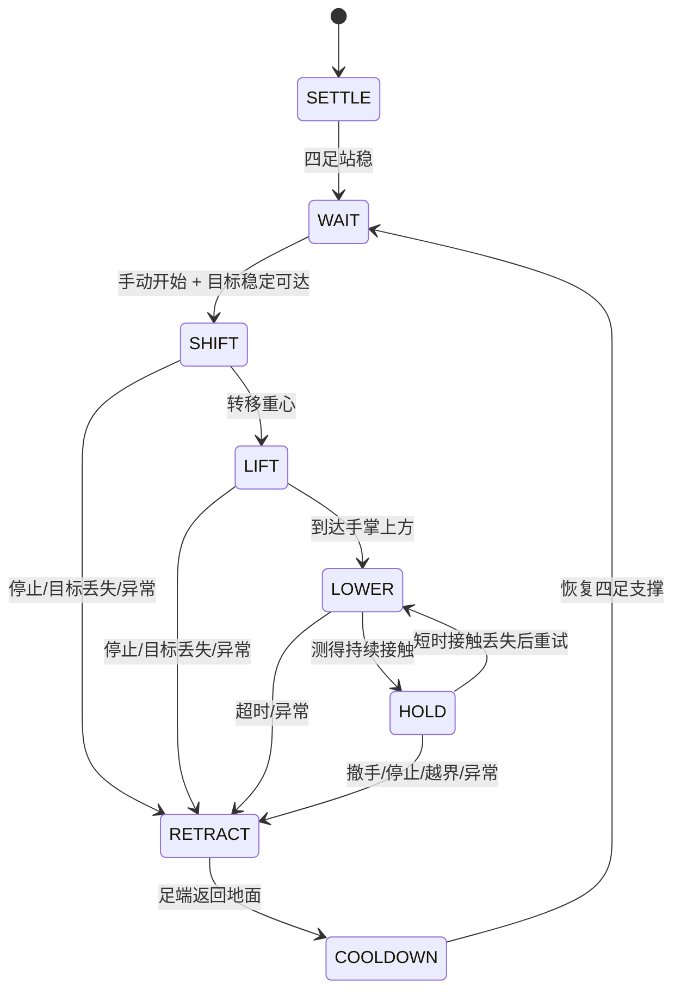
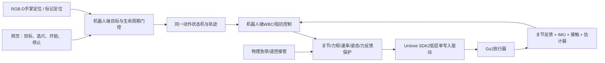

# Go2 伸手托爪：网页仿真与实机部署方案

## 当前交付与边界

已实现网页 MuJoCo 实时交互：拖拽虚拟手掌、滚轮/滑块调高度、选择左/右前爪、点击开始、接触保持、撤手、停止收爪、轻推测试及重置。工作台侧栏已有「握手互动」入口，独立地址为 http://127.0.0.1:8766/handshake 。

机器人使用 RoboGauge 仓库中 Go2 网格、质量、惯量、关节和电机限制。机身是自由关节，机器人没有固定约束，足端没有吸附或绑定手掌，也没有在运行中直接修改机器人 qpos。只有代表人手的 mocap 刚体由外部驱动；足端是否接触、接触力及机器人支撑均由 MuJoCo 计算。

这次交付已运行仿真和浏览器测试；**实机部分是可执行的工程部署与验收方案，未连接真实 Go2，未实现或启用向实机发送电机指令的驱动**。不能把仿真通过等同于实机通过。现有机器人型号、固件、低层权限、传感器安装和急停方式须在接机阶段登记。

## 一、使用与服务维护

1. 打开页面，等待「等待开始」。手掌圆环代表可拖动目标。
2. 选左前爪或右前爪；手掌会镜像到对应一侧。拖动圆环改变水平位置，滚轮或高度滑块改变高度。
3. 蓝色状态提示可达后点击「开始托爪」。机器人先调整支撑，再抬爪、接近、缓慢降低；只有测得接触才进入保持。
4. 保持后可缓慢拖动手掌，观察接触力和支撑足数量。过快/越界、接触异常或姿态异常会触发收爪，需重新点击开始。
5. 「撤回手掌」同时移动物理手掌并请求收爪；「停止并收爪」保留手掌位置但停止动作；「重置场景」重建初始状态。
6. 「轻推机身」在仿真机身上施加 8N、0.16 秒的侧向外力。不是播放预录动画。

工作空间采用初始机器人站立锚点：+X 朝前，+Y 朝机器人左侧，+Z 向上，单位米。网页建议体验范围 X=0.31–0.43、|Y|=0.09–0.19、Z=0.15–0.24。硬拒绝范围为 X 不在0.29–0.46、|Y|不在0.055–0.23、Z不在0.12–0.27，或手掌在所选爪的另一侧。建议范围并非对其中每个连续位置、速度或扰动的全覆盖保证。

```bash
# 服务器项目目录
cd /root/gpufree-data/Rob2Nav

# 启动/查看两个独立服务
bash /root/gpufree-data/deployment/start-studio.sh
supervisorctl -c /root/gpufree-data/deployment/rob2nav-supervisord.conf status

# 仅重启握手仿真；不会重启实验任务
supervisorctl -c /root/gpufree-data/deployment/rob2nav-supervisord.conf restart rob2nav-paw

# 握手日志
tail -f /root/gpufree-data/deployment/paw-contact.log
```

Studio 绑定127.0.0.1:8765，独立 MuJoCo worker 绑定127.0.0.1:8767。Studio 对三个白名单接口做代理，POST仍经过同源和X-Studio-Request检查。机器人控制不经过网页渲染帧率；仿真控制100Hz、物理积分500Hz，显示约8–10Hz。浏览器断开超过2.5秒，worker撤回手掌并收爪。整个容器重启后重新执行start-studio.sh。

```bash
# 本机重建隧道；凭据交互输入，不写入配置
ssh -N -L 8766:127.0.0.1:8765 -p 30752 root@120.209.70.195
```

## 二、控制方法



- 支撑：根据所选前爪把机身目标向后移动约5.5cm、向对侧移动约5.5cm。支撑足IK、姿态/位置反馈和地面反力分配共同稳定自由机身。
- 反力分配：在质心合力/合矩目标下求正则化最小二乘，并投影到单向法向力和摩擦棱锥。此处是仿真用近似求解器，实机应换为有收敛检查和显式力矩/关节约束的QP。
- 抬爪：五次平滑轨迹先向上、再前伸，避免横向擦过地面与手掌。落爪以约4.5cm/s缓慢接近。
- 接触：使用实际足端—手掌碰撞对的法向力。持续超过1.2N约80ms才进入HOLD；保持目标约3N，使用笛卡尔阻抗与限幅导纳修正高度，而非刚性位置压入。
- 保护：非足端触手、接触力超过18N、机身倾斜超过约20.6°、机身过低、目标过期/无效或用户停止，均退出主动接触并收爪。测试另用更严格的峰值<15N和倾斜<15°作为通过条件。这些是实验参数，不是人体接触安全认证值。
- 时序：观测置信度至少0.75、稳定确认约350ms、约550ms连续无有效目标后撤回；短暂丢失不立即反复起落。左右爪切换必须先恢复四足站姿。
- 输出：仅写12个关节的有界力矩，并施加力矩变化率限制；没有直接施加稳定机身的外力。网页「轻推」是独立、明确的测试扰动。

## 三、鲁棒性验证与复现

两套数据分别保留，调参前失败记录也保留：

| 数据 | 用途 | 结果 |
|---|---|---:|
| outputs/paw_contact_benchmark_v1 | 首轮诊断，包含物理手掌与测量噪声尚未隔离的问题 | 37/42 |
| outputs/paw_contact_benchmark_v2 | 修正测试隔离、缩小为11×9cm手掌接触体后的专项检查 | 42/42 |
| outputs/paw_contact_holdout_v1 | 32个未参与调参的随机组合种子 | 32/32 |

专项检查包括左右爪、6个随机位置、缓慢运动、3mm测量噪声加90ms延迟、160ms观测丢失、8/12N机身水平力持续0.2秒、摩擦0.45、质量+15%、越界目标、闭合手势、低置信度和长时目标丢失。重复的标称/单项案例不是独立随机样本，不将42/42解释为统计意义上的任意环境成功率。

随机组合使用固定未参与调参的种子9000–9031：X=0.32–0.42、|Y|=0.10–0.18、Z=0.15–0.23，叠加侧向±2.2cm/高度±1.6cm正弦运动、2mm观测噪声、60ms延迟、质量0.85–1.15倍、摩擦0.5–1.0以及4/6N水平扰动0.2秒。真实物理手掌由环境真值驱动，控制器只接收有噪/延迟的观测和接触反馈；观测短暂丢失不让环境中的手掌消失。

通过判据：正常接触案例至少连续1秒满足HOLD、手掌法向力1–8N、横向误差<4.5cm、倾斜<12°；全回合峰值力<15N、倾斜<15°、机身高度>0.25m；撤手后四足重新接地。无效请求必须拒绝动作，长时丢失必须退出并返回四足。原始trace.json、result.json和benchmark.json均保留，允许重新计算判据。

浏览器验收实际发送鼠标拖拽，验证右爪接触、撤回、左爪接触、停止收爪、无同源写入头请求被403拒绝，以及没有JavaScript异常。截图和browser-check.json保存在outputs/paw_contact_docs。

```bash
cd /root/gpufree-data/Rob2Nav
export MUJOCO_GL=egl OMP_NUM_THREADS=1 OPENBLAS_NUM_THREADS=1
PY=/root/gpufree-data/envs/go2-mapless/bin/python
$PY -m go2_nav.paw_contact.benchmark --output outputs/paw_contact_new_suite --workers 4
$PY -m go2_nav.paw_contact.benchmark --output outputs/paw_contact_new_holdout --mixed --workers 4
$PY -m go2_nav.paw_contact.benchmark --output outputs/paw_contact_new_videos --video
```

每次使用新输出目录。这里没有训练模型；是接触技能控制与参数验证。网页交互、无窗批量测试和示例视频使用同一动力学/控制模块。

## 四、实机系统架构



网页只发送米制手掌目标、选爪和生命周期指令。**真实机器人本地运行估计器、技能控制、看门狗和电机发送线程**；服务器SSH、网页、渲染和Wi-Fi不进入实时关节控制链。相机跟踪是将来可替换的目标来源，当前交付网页只使用拖拽虚拟手。

建议软件分层：

| 层 | 仿真已实现 | 实机需实现/标定 |
|---|---|---|
| HandTarget | 网页拖拽坐标 | RGB-D/手套标记定位、外参、时间戳、协方差 |
| RobotState | MuJoCo qpos/qvel/惯量 | 关节编码器、IMU、接触估计、机身速度与支撑锚点 |
| Contact | 精确碰撞法向力 | 标定足端力/触觉传感器或经过验证的力观测器 |
| Skill | 双爪FSM、轨迹、导纳、拒绝与撤回逻辑 | 将纯逻辑抽离为与模型无关的实时核心 |
| Dynamics | MuJoCo雅可比/偏置力 | Pinocchio/厂家模型、负载辨识、QP约束与求解器 |
| Actuation | MuJoCo有界关节力矩 | SDK2、顺序/符号、CRC、模式切换、单写入仲裁 |

### 4.1 硬件与定位选择

- 首先确认具体Go2版本、固件及SDK低层控制能力；不能假设所有机型开放相同接口。记录序列号、SDK提交、网络口和电机固件。
- 第一阶段用可调高度的固定软垫/测力台作为「手」，目标经尺量或标记定位。先标定接触，不让真实人手承担调参工作。
- 自然伸手版本可使用RGB-D相机：手部关键点提供ROI，掌心有效深度采用中值/稳健平面拟合，剔除边缘、背景和无效深度；用相机内参反投影，再由固定标定外参变换至base_link。保存外参残差与时间同步误差。
- 可先给手套加AprilTag/ArUco标记简化6D姿态与遮挡恢复。单目归一化关键点不直接当作米制深度；没有可靠深度、掌面朝向或时效时不下探。
- 掌心法向应朝上并与目标接触方向一致，默认相对竖直夹角<20°，掌面有效支撑半径足够；这些需在实机传感器噪声下验证。
- 建议左右前脚加软质接触垫并测量新增质量/惯量。需要定量柔顺力控制时，使用标定后的足端力/压力测量。LowState中的foot_force或电流/力矩估计是否能在这种非地面接触中准确测到1–8N，必须实测，不能直接当作准确六维力传感器。

### 4.2 目标和状态接口

`HandTarget`至少包含：header.stamp、frame_id=base_link、palm_position_m[3]、palm_normal[3]、velocity_mps[3]、position_covariance[9]、confidence、valid、requested_leg(FL/FR)、sequence、session_id。姿态、测量时间和接收时间分开；单调序号拒绝乱序重放。开始/停止为独立生命周期命令，不混入坐标字段。

`RobotState`至少包含：单调时间、实际关节q/dq、可用的tau_est、IMU四元数/角速度、各足接触概率/力、状态估计器的局部机身位置/速度、驱动模式、温度/电源和急停状态。所有单位与参考系在适配层统一，内部关节顺序固定为FL、FR、RL、RR各hip/thigh/calf。

仿真用初始世界锚点，实机则在四足站稳时建立局部交互锚点；通过IMU与支撑足FK融合估计机身运动。**不能用相机看到的手相对移动，掩盖机器人机身漂移**。纯虚拟手目标可继续作为实机台架测试输入，但必须完成机器人端坐标映射与标定。

### 4.3 控制和SDK2适配

实机建议100–250Hz技能/WBC，500Hz本地关节命令及状态保护线程；实时实现用C++和预分配内存。MuJoCo Python原型不能直接宣称满足实机调度、时延或动力学精度。

支撑QP需同时约束：支撑足法向力非负、摩擦锥、关节力矩和变化率、关节限位、关节速度、支撑裕度与可行性残差。三足支撑前实际估计质心投影进入支撑多边形并留出工程裕度，例如初始目标2.5cm；求解失败必须有有界阻尼/四足恢复路径。掌上前爪不作为可靠地面支撑足。

在独立测力台上从约1N接触目标开始，测量后再递增到约3N。触手腿的竖直方向采用低刚度+力/导纳，平面采用有界阻抗；不要把「设定脚坐标+高刚度」当作柔顺接触。阈值、下探速度、力矩限制和急停响应要依据真实负载、足垫及传感器闭环延迟重新验证。

官方SDK2示例使用`rt/lowstate`、`rt/lowcmd`、0.002秒周期、CRC和PMSM电机模式。文档依据：[官方Go2低层示例](https://github.com/unitreerobotics/unitree_sdk2_python/blob/814556d15970dd2ecf1c9984e845ca02ab07e206/example/go2/low_level/go2_stand_example.py)、[官方常量](https://github.com/unitreerobotics/unitree_sdk2_python/blob/814556d15970dd2ecf1c9984e845ca02ab07e206/example/go2/low_level/unitree_legged_const.py)、[SDK说明](https://github.com/unitreerobotics/unitree_sdk2_python/blob/814556d15970dd2ecf1c9984e845ca02ab07e206/README.md)。部署时固定经过验证的SDK提交，不直接追随master。

| 内部MuJoCo顺序 | SDK2电机索引 |
|---|---|
| FL hip/thigh/calf | 3,4,5 |
| FR hip/thigh/calf | 0,1,2 |
| RL hip/thigh/calf | 9,10,11 |
| RR hip/thigh/calf | 6,7,8 |

关节顺序还不等于符号、零位和gear全部一致。悬吊逐关节低幅验证每个正方向和反馈。不要把内部12维数组直接按原顺序写SDK2。驱动要填所有必要字段、CRC、超时逻辑和未使用通道的官方停用值；高层运动服务与本技能只能有一个执行器写入者，SDK官方示例的MotionSwitcher/ReleaseMode不能简单复制为在人机接触中突然交接控制。

本项目当前没有实机发送器；`hardware_enabled=false`是实际状态。下一阶段应新增只读状态采集、回放/dry-run、再到明确受控的驱动节点，而不是让网页进程直接导入SDK后写电机。

### 4.4 故障响应

| 情况 | 机器人端响应 |
|---|---|
| 短暂手掌观测丢失 | 冻结最近目标、停止继续下探，允许短暂滤波恢复 |
| 持续失效/越界/无效法向 | 先卸载接触、抬离，再沿已验证回程收爪 |
| 接触力超限或非足端碰撞 | 快速卸载法向力并退让；记录原始力和响应延迟 |
| 支撑滑移、姿态/质心裕度异常 | 不继续伸手，执行经验证的四足恢复；严重失稳由本地保护接管 |
| 网页/网络断开 | 本地看门狗退出技能；不能等服务器远程发送停止 |
| 低层状态过期/驱动异常 | 进入厂家支持且经台架验证的阻尼/保护模式；避免无条件瞬间零力矩导致失撑 |
| 遥控接管/物理急停 | 独立于网页和目标流，优先级最高；按机器实际支持的制动/阻尼策略执行 |

实机不能直接沿用网页2.5秒看门狗或仿真550ms目标丢失时间。建议起始要求：关节状态年龄<10ms、本地输出指令寿命≤20ms、手掌姿态年龄≤100ms、超过150–250ms停止下探并启动保护回程；这是工程起始配置，必须测得总延迟后决定。

## 五、从仿真到实机的阶段验收

每阶段保留模型/SDK/配置哈希、原始低层状态、接触力、控制输出和视频。阶段门槛是推进条件，不把执行器退出码当作成功。

| 阶段 | 具体工作 | 推进条件 |
|---|---|---|
| A 离线/协议 | 完成驱动只读、单位、索引、符号、时间戳、CRC与录制回放 | 12关节映射逐项通过；无错误写入；观察器时效/序号拒绝测试通过 |
| B 悬吊 | 小幅单关节、支撑WBC与阻抗输出dry-run；测电流与命令延迟 | 方向一致，命令有界，急停/接管和断流响应实测通过 |
| C 四足地面 | 不抬爪的站立和小重心移动，使用软垫地面及保护支撑 | 连续站立、模型负载与质心估计匹配，未出现支撑滑移或限幅积累 |
| D 三足无接触 | 左右交替小高度抬爪、恢复四足，先低幅 | 每侧至少20次；无跌倒、无越限，均能恢复支撑，故障回程已验证 |
| E 固定测力台 | 手掌代用品、慢下探、测1N再3N，改变高度与方向 | 每侧至少20次；实测力/冲击、误差、延迟和回程符合本机设定 |
| F 移动软垫 | 受控慢移动、突然撤离、传感遮挡、网络断流和有限扰动 | 每个故障都按设计退让；失败原始数据不删除 |
| G 人机接触 | 完成前述测力与保护验证后，使用软垫前爪并由操作员保持独立接管 | 先低力低速度，增加不同操作者与位置；记录碰触舒适度与异常，不从仿真推断 |

实机验收统计应分开：请求拒绝正确率、目标接触成功率、持续柔顺保持时间、峰值/稳态力、位置误差、支撑裕度、姿态峰值、撤手响应时间、四足恢复率、传感与通信故障响应、控制周期P99/最大值。至少跨不同时间、负载、地面和手掌位置独立采样；不能用同一固定种子重复运行代替泛化测试。

## 六、建议的开发交付顺序

1. **本次已完成**：网页、MuJoCo技能、双爪接触、扰动与浏览器验收、复现工具和本文档。
2. **接机后第一包**：具体Go2/固件/SDK能力清单、URDF与电机映射标定、只读LowState录制、力传感器标定、时间同步与相机外参。
3. **第二包**：机器人本地状态估计、实时QP/阻抗核心、低层驱动与单写入模式仲裁、离线回放与无输出dry-run报告。
4. **第三包**：按A–F逐项实测并修改控制/保护参数；达到测力与回程门槛后再进行G。
5. **最终实机包**：固定版本部署镜像或安装脚本、systemd服务、配置与标定文件、实验数据、操作/接管步骤和已知限制。

因此，网页演示目前可以直接使用；实机接入并非「换一个IP」即可完成。关键缺口是经过标定的状态/力反馈、实时动力学与驱动适配以及真实人机接触验证，不是再训练一个动画策略。

本次方案的官方SDK源码固定为 `814556d15970dd2ecf1c9984e845ca02ab07e206`；初次为源码核对，随后已在独立go2-sdk-check环境验证真实SDK消息与CRC；未初始化DDS、未连接机器人。统一部署框架仍在物理验证中，见最新handover及docs/UNIFIED_GO2_DEPLOYMENT.md。实机型号/固件兼容性仍按各技能方案在后续实施时审查。
