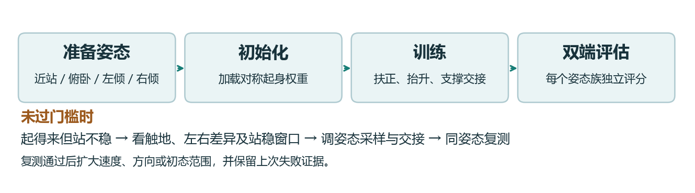
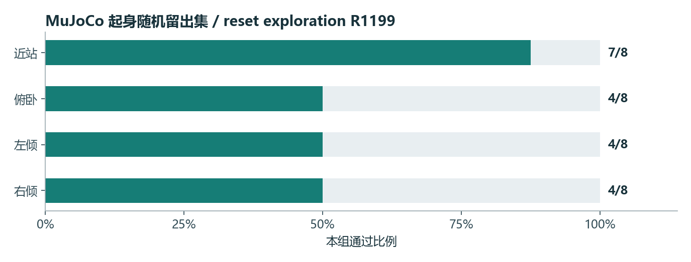

# AS2-W 起身训练与仿真验收手册

2026-11-12 · Rob2Nav Studio · 项目接手版

> **阅读顺序**：先对照任务和门槛，再跑冒烟及单场景。需要解释训练行为时读奖惩表，需要接着修时读实验链。命令、参数和验收报告应使用同一候选的契约。

## 1. 任务、配置与通过条件

机器人从近站、俯卧、左倾或右倾开始。先把机身扶正并抬高，逐步让轮子接住重量，再交给固定站姿控制器。起身是否成功取决于交接之后能否持续站稳。起身时允许按恢复阶段的接触规则短暂借力，进入直立阶段后检查非法触地。

### 训练与迭代流程



训练从已有对称起身权重开始，姿态库提供多种初始接触方式。评估使用留出库。查看结果时按姿态族拆开，避免近站表现盖住侧倾或俯卧失败。

### 配置速查

| 参数 | 调的是什么 | 正式值 |
| --- | --- | --- |
| `--init-checkpoint` | 续训起点 | `getup-symmetric-formal/model_1199.pt` |
| `--num-envs`、`--iterations`、`--seed` | 并行环境数、更新预算和随机种子 | 384、1200、301 |
| `--pose-bank`、`--side-pose-bank` | 基础初始姿态与侧倾专用样本 | `supported-getup-poses.json`、`getup-training-mixed-side.json` |
| `--side-pose-probability .65` | 在侧倾族内选用侧倾姿态库的概率 | 65% |
| `--staged-rise`、`--rise-gain 85` | 分阶段抬升及腿位置控制刚度 | 开启、85 |
| `--support-handoff`、`--low-support-handoff`、`--fixed-stand-integral` | 约束从策略动作交接到固定站姿的过程 | 开启 |
| `--recovery-symmetry`、`--predictive-guard` | 覆盖左右差异、提前约束不安全的目标 | 开启 |
| `--packet-loss` | 模拟观测掉帧 | 2% |

主奖励优先鼓励扶正和抬升，随后才给轮支撑、标准姿态和低速度加分。后续候选使用的 `--settled-stand-reward` 更集中地奖励交接后的四轮支撑和低速度，当前正式配方未打开该项。

### 验收门槛

| 阶段 | 检查什么 |
| --- | --- |
| 复位 | 把近站、俯卧、左倾、右倾分别记录，保留实际初始承重方式 |
| 起身 | 记录首次进入固定站姿的时间，区分允许的恢复接触和直立后触地 |
| 保持 | 以 0.02 s 控制周期连续站稳 100 步，即 2 s。记录任何站稳中断 |
| 推扰 | 从规定的最后一次推扰重新计时，检查能否恢复并维持站稳窗口 |
| 安全 | 角度、力矩、倾覆、膝部净空、直立后的非轮触地逐项检查 |
| 双端验收 | 同一权重分别跑两端，逐族报告通过数和失败原因 |



这张图使用 `getup-reset-exploration-formal/model_1199.pt` 的随机留出评估。近站为 7/8，其他三族都是 4/8。快入侧倾和推扰后观测的诊断组合曾在另一候选的左右侧倾各做到 7/8，完整验收仍需要俯卧、近站与两侧结果。

## 2. 第一次复现

在服务器的 Bash 中执行。先跑冒烟任务，确认 Isaac Sim、GPU、模型和依赖可以启动，再按需要跑正式训练。两条命令各自创建独立输出目录。训练前先检查 GPU 是否有空间。

~~~bash
cd /root/gpufree-data/Rob2Nav-main-live/training/as2w-backup
nvidia-smi
RUN=$(mktemp -d /tmp/as2w-recovery.XXXXXX)
AS2W_NUM_ENVS=8 AS2W_ITERATIONS=3 bash train.sh recovery "$RUN/smoke"
bash train.sh recovery "$RUN/formal"
~~~

训练输出中，`command.sh` 给出实际执行的参数，`input-sha256.txt` 记录输入版本，`contract.json` 记录策略与仿真配置，`model_*.pt` 是可冻结评估的检查点。冒烟成功说明链路能运行。要验收能力，使用正式或指定候选的检查点，另开评估目录。网页作业的 `trained` 也只表示训练进程结束。

**同一权重跨仿真器**的意思是，在两个后端载入同一份 `.pt`，分别记录场景、种子、控制周期、PD 参数和结果。先做一个小范围复跑，确认读到了同一权重，再扩大试次。下文给出两端入口。

### 手柄场景如何复现

起身用 MuJoCo 的 `--family prone`、`--family left` 等选择初始姿态。起身策略根据本体状态生成动作。交互触发应由外层控制状态机决定何时进入起身，再检查固定站姿交接。

当前 AS2-W 工作台没有核实到机器人控制键位。仿真评估入口使用程序生成的命令。如果后续接入键盘，需把按下和松开都映射到连续杆量或状态机事件，并验证失焦归零、死区、限速及停稳。每个测试记录操控时间序列与机器人响应。

## 3. 同一权重在两个仿真器复跑

以下命令在服务器 Bash 执行。工作目录选运行快照，因为历史脚本依赖其同级的 MuJoCo venv 和运行资源。每次用新的输出目录。为保证两端比较有效，两个入口共用同一个 `ckpt`，保留 `sha256sum "$ckpt"` 和两端契约。

```bash
cd /root/gpufree-data/Rob2Nav-runtime/as2w-current
R=runs/r290-three-skills
out=$(mktemp -d /tmp/as2w-eval.XXXXXX)
usd="$PWD/runs/r280-isaac-flat-preflight/kit3-as2w.usd/as2w/as2w.usda"
urdf="$PWD/../dependencies/unitree_ros_as2w/robots/as2w_description/as2w.urdf"
dep="$PWD/../as2w-r284-release/deliveries/as2w-deploy"
mp="$PWD/code:$dep/flat-r284-500-preview/runtime:$dep/omni-blind-stairs-r152/runtime:$dep"
lp="$(printf '%s:' /workspace/isaaclab/source/isaaclab*)/opt/isaaclab-venv/lib/python3.12/site-packages"
```

```bash
ckpt="$R/getup-symmetric-formal/model_1199.pt"
bank="$R/supported-getup-holdout.json"
mkdir "$out/mj" "$out/lab"
PYTHONPATH="$mp" ../mujoco-venv/bin/python code/eval_as2w_mujoco_recovery.py \
  assets/r237-train-root "$ckpt" "$bank" "$out/mj" --seed 7297 \
  --low-support-handoff --paired-tilt --packet-loss .02 --predictive-guard
PYTHONPATH="$lp" /isaac-sim/python.sh code/train_as2w_isaac_getup.py \
  --viz none --device cuda:0 --usd "$usd" --urdf "$urdf" --num-envs 64 \
  --iterations 1 --out "$out/lab" --eval-checkpoint "$ckpt" --seed 7297 \
  --pose-bank "$bank" --staged-rise --rise-gain 85 --support-handoff \
  --fixed-stand-integral --low-support-handoff --recovery-symmetry \
  --packet-loss .02 --predictive-guard
```

## 4. 每项奖励、惩罚和生效条件

每个控制步取各项原值乘配置权重，求和后再乘控制步长。训练回报用于学习。验收通过数由独立的场景与安全检查得出。

### 起身奖励逐项拆解

定义 `u` 为投影重力 Z 取反，越接近 1 越直立。 `h` 为机身高度，`qerr` 为 12 个腿关节相对默认角的均方误差。 `v`、`ω` 分别为机体系线速度和角速度范数。 `s` 是竖直力 >2 N 的轮子占比。主项 `getup` 权重 **+1.0**，一个控制步内由下列四部分组成。

| 子项 | 原值 | 阶段作用 |
| --- | --- | --- |
| 扶正 | `U = clamp((u−0.25)/0.72, 0, 1)` | 侧倾状态先获得明确的扶正梯度 |
| 抬升 | `2 × clamp((h−0.14)/0.22, 0, 1) × U` | 只奖励与扶正配合的抬升 |
| 轮支撑 | `0.70 × s`，仅 `h >0.22 m` | 机身抬起后把负载移回轮子 |
| 对准站姿与制动 | `exp(−3 × qerr) −0.6 × min(v,1) −0.15 × min(ω,2)`，仅 `h >0.30 m` | 到站立高度后才要求腿角准、机身速度小 |

| 其他项 | 权重 | 具体效果 |
| --- | ---: | --- |
| `dof_torques_l2` | −0.0002 | 所选关节施加力矩平方和，减少高力矩策略偏好 |
| `action_rate_l2` | −0.005 | 当前动作和上一动作之差的平方和，抑制突变 |
| `dof_pos_limits` | 0 | 软限位距离代价配置保留，优化时跳过。角度硬保护继续执行 |
| `settled_stand` | +0.85，仅候选 | 以 `clamp((u−.85)/.10)`、`clamp((h−.26)/.05)`、四轮接触比例平方和高斯拟合相乘。拟合使用最大腿角误差 / 0.18、速度 / 0.06、角速度 / 0.12 的平方和。四项一起满足时分数才高。 |

其他继承的跟踪、接触、姿态等训练奖励在起身配置中清空。例子：机器已到 0.25 m，三轮承重，则轮支撑子项给 0.525，站姿与制动子项仍为 0。若起身失败发生在 0.22 m 以下，应查早期支撑、侧倾方向和扶正子项，调站稳项通常改变不了这段。

## 5. 历史失败、改动与下一次验证


统计顺序为近站 / 俯卧 / 左倾 / 右倾。目录都在 `runs/r290-three-skills/`，先读各自的 `contract.json` 再比较。

| 候选或探针 | 当时在验证什么 | 结果与局限 |
| --- | --- | --- |
| `getup-symmetric-predictive-mujoco-1199` | 从支撑姿态训练到对称增强与预测保护，确认能否完成交接 | 28/32，左右各 7/8。更换留出库后须重新评估 |
| `getup-symmetric-side-holdout-mujoco-1199` | 用深侧倾留出挑战已有候选 | 左倾 5/8、右倾 6/8。出现翻倒，说明浅姿态成绩不能覆盖深侧倾 |
| `getup-settled-stand-mujoco-1199-side` | 加站稳整形后，观察站姿和四轮承重 | 8/8、4/8、5/8、6/8。Isaac Lab 同候选侧倾留出左 8/17、右 9/10，应单独查左倾 |
| `getup-settled-stand-paired-{raw,mirror}-mujoco-1199` | 镜像同一组深侧倾样本，区分初态不对称与策略不对称 | 两组均 23/32，左右各 6/8。该对照未观察到总体通过数提升 |
| `getup-settled-stand-wheel-anchor-mujoco-1199` | 交接时锚定轮角是否消除剩余失败 | 23/32、左右各 6/8。仍见翻倒保护，继续看早期旋转 |
| `getup-settled-stand-post-push-observation-mujoco-1199` | 推扰靠近回合结束时，是否还剩足够观察时间 | 保留原推扰时序、追加 3 s 观察，结果 8/8、8/8、7/8、7/8。观察协议改变，不能把 30/32 解释成模型变强 |
| `getup-settled-stand-{roll-brace,fast-side-entry}-post-push-mujoco-1199` | 在追加观察协议下测试侧倾支撑和更快切入 | 两个探针都是左右各 7/8，仍记录翻倒，覆盖范围仅两种侧倾 |
| `getup-reset-exploration-formal-mujoco-1199-side` | 用另一个探索起点续训，验证左右是否趋于一致 | 8/8、4/8、6/8、6/8。近站强，俯卧仍有明显缺口 |

> **接手第一题**：固定一对镜像深侧倾姿态，做无推扰与有推扰的配对复跑。把初始接触、首次直立、首次进入 fixed stand、最后一次推扰、重新达到连续 2 秒站稳分别打时间戳。若起身前已经翻倒，排查支撑和机身旋转。若能站起来但尾窗不足，单独复核推扰调度和观察窗口。

**可定位的失败样本**。追加观察的 30/32 回合中，仍有记录以 `overturned` 失败，尾部固定站姿为 0 s，且该条记录尚无推扰。对这一类先检查早期翻倒，延长尾窗不能修复它。

### 已有验收证据

运行区还有 `getup-reset-exploration-formal/model_1199.pt`。它从 `getup-reset-exploration-diagnostic/model_200.pt` 继续训练，256 环境、1200 次迭代、种子 306，打开 settled-stand 奖励。Isaac Lab 随机集按近站、俯卧、左倾、右倾依次为 15/17、15/18、4/10、13/19。MuJoCo 随机集按同顺序为 7/8、4/8、4/8、4/8。侧倾留出集在 MuJoCo 左右各 6/8，Isaac Lab 左倾 8/17、右倾 9/10。

另一条 `getup-settled-stand-formal/model_1199.pt` 支持快入侧倾和推扰后观测探针。该组合在 MuJoCo 左右各 7/8，覆盖范围是双侧倾诊断。起身验收仍需覆盖俯卧、近站和侧倾的完整留出矩阵。

## 6. 配方参数和策略接口

### 正式配方内容（recovery）

来自 `skills/as2w/recovery/recipes/formal.sh`：

- `trainer=train_as2w_isaac_getup.py`
- `count=384`
- `init="$d/getup-symmetric-formal/model_1199.pt"`
- `args=(--init-checkpoint "$init" --seed 301 --pose-bank "$d/supported-getup-poses.json" --side-pose-bank "$d/getup-training-mixed-side.json" --side-pose-probability .65 --staged-rise --rise-gain 85 --support-handoff --fixed-stand-integral --low-support-handoff --recovery-symmetry --packet-loss .02 --predictive-guard)`

等价完整命令：

```
/isaac-sim/python.sh code/train_as2w_isaac_getup.py --viz none --device cuda:0 \
  --usd runs/r280-isaac-flat-preflight/kit3-as2w.usd/as2w/as2w.usda \
  --urdf ../dependencies/unitree_ros_as2w/robots/as2w_description/as2w.urdf \
  --num-envs 384 --iterations 1200 --out "$RUN/formal" \
  --init-checkpoint runs/r290-three-skills/getup-symmetric-formal/model_1199.pt \
  --seed 301 \
  --pose-bank runs/r290-three-skills/supported-getup-poses.json \
  --side-pose-bank runs/r290-three-skills/getup-training-mixed-side.json \
  --side-pose-probability .65 --staged-rise --rise-gain 85 --support-handoff \
  --fixed-stand-integral --low-support-handoff --recovery-symmetry \
  --packet-loss .02 --predictive-guard
```

注意：正式配方**未**包含 `--settled-stand-reward`（该开关只出现在候选脚本 `getup-settled-stand-*` 中）。

### 关键配置

- 策略标识 `noninverted_getup`（不做倒立翻转，即「非倒置起身」）。
- 观测宽度 42，动作数 12。`RslRlVecEnvWrapper(env, clip_actions=2.)`。`step_dt_s = 0.02`。
- 观测内容 `pose(env)`：`root_ang_vel_b`(3) + `projected_gravity_b`(3) + 腿关节位置误差(12) + 腿关节速度(12) + 上一步动作(12) = 42，并经 `delayed_proprioception(env, sensor)` 注入观测时延（配合 `--packet-loss .02`）。
- 执行器：`--rise-gain 85` → 腿（hip/thigh/calf）`stiffness = 85`、`damping = 3.2`。轮 `stiffness = 25.`、`damping = 4.`（`cfg.actions.wheel_vel = None`，轮不作为动作通道）。
- 预测守卫：`cfg.as2w_predictive_target_margin = .06`。
- 动作限幅：`cfg.actions.joint_pos.clip = (low + .06, high - .06)`，即在 `simulation_safety.angle_rad` 上再内缩 0.06 rad。
- 终止项改写：
  - `cfg.terminations.base_contact = None`（恢复过程中允许非轮接触，即「supported nonwheel contact allowed during recovery only」）。
  - `as2w_stance_violation.func = upright_stance_guard`（仅在 `h > .29 and up > .85` 时检查姿态违规）。
  - `as2w_nonwheel_contact.func = upright_nonwheel_guard`（同上条件下检查非法接触）。
  - `as2w_knee_surface.func = upright_surface_guard`（仅 `--recovery-symmetry` 时启用）。
  - `as2w_overturned = as2w_angle_violation.replace(func=overturned)`，判据 `up < -.10`（真的翻过去才算翻倒）。
- 初始状态采样 `reset_posture`：按 `kind` 分四族——`near_stand`（kind 0）、`prone`（kind 1，配合 supported pose bank）、`left_tilt`（kind 2）、`right_tilt`（kind 3）。`down = kind != 0`。侧躺滚转 `roll = .18*(rnd1-.5) + side*side_sign*(.38+.58*rnd2)`。俯仰 `pitch = .20*(rnd3-.5) + (kind==1)*(.22+.24*rnd4)`。机身高度 `z += down*(-.125 + .15*|sin roll| + .10*|sin pitch|)`。关节 `q[4:8] += (.34+.12*rand)*down`、`q[8:12] -= (.58+.14*rand)*down`，再加 ±0.09 均匀扰动。supported pose bank 覆盖 kind 1，side bank 以 `--side-pose-probability`（正式配方 0.65）覆盖 kind 2/3。最后按 `angle_rad` 内缩 0.12 rad 夹紧。初始角速度为零。
- 安全限值 `simulation_safety`：与滚动/踏步同一套（`fraction 0.9`、髋 54 / 大腿 54 / 小腿 81 / 轮 13.5 Nm、轮速 98.47 rad/s、`min_knee_surface_m 0.015`、`source: simulation_urdf_not_hardware_calibration`）。

### 参数开关与安全约束

- **可选项**：`--settled-stand-reward`、`--roll-brace`、`--resume-checkpoint`、`--eval-checkpoint`（评估入口）、`--pose-bank` / `--side-pose-bank` / `--side-pose-probability`、`--packet-loss`、`--predictive-guard`、`--staged-rise`、`--support-handoff`、`--fixed-stand-integral`、`--low-support-handoff`、`--recovery-symmetry`、`--rise-gain`（非 55 时改写腿 PD）。
- **硬约束**：角度 90%、力矩 90%（`simulation_safety`）、`min_knee_surface_m 0.015`、动作限幅内缩 0.06 rad、恢复期外不得非轮触地、站起后 `up < -.10` 判翻倒终止。守则 §3 明确「仅用奖励惩罚不能替代硬限制」。

## 7. 模型输入、网络结构与 ONNX 部署

本节核对下表中的 R1199 仿真候选。当前训练配方重新生成的权重应重新校验 SHA-256、观测契约与延迟。

| 项目 | 已核对的实际值 |
| --- | --- |
| PyTorch 检查点 | `runs/r290-three-skills/getup-reset-exploration-formal/model_1199.pt` |
| ONNX 文件 | `runs/r290-three-skills/onnx-diagnostic/getup-reset-exploration-formal-1199/policy.onnx` |
| PyTorch 文件大小 | 965,557 字节（942.9 KiB），含 actor、critic、优化器与训练元数据 |
| ONNX 文件大小 | 161,459 字节（157.7 KiB），含 actor 前向图和权重 |
| 网络宽度 | `42 → 128 → 128 → 128 → 12`，三层 128 单元隐藏层、四层全连接。每个隐藏层后为 ELU，末层之后为 Clip |
| 部署 actor 参数 | 40,076 个 FP32 权重和偏置，每次前向约 39,680 次乘加，另有偏置、ELU 和裁剪 |
| 训练网络参数 | actor 40,088（含 12 个采样分布参数），critic 38,657，合计 78,745，不含优化器状态 |
| Critic 网络 | `42 → 128 → 128 → 128 → 1`，训练时估计状态价值 |
| ONNX 版本与精度 | opset 17。输入、输出、初始权重为 FP32，图中为 `Gemm → ELU` 叠加末端 `Clip`。当前图无 FP16 转换或 INT8 量化 |
| 部署张量 | `obs[1,42]` → `actions[1,12]`，固定 batch 1 |

### 输入索引与单位

索引从 0 开始。腿轴按**关节类型优先**排列。先是 FL、FR、RL、RR 的四个髋，再是同序四个大腿，再是四个小腿。需要四轮通道时才在后面附加 FL、FR、RL、RR 的轮轴。传感器读数必须先换成模型坐标和单位，再按表填入。目标机的电机槽位需要通过部署映射转换。

| 索引 | 维数 | 量与单位 |
| --- | ---: | --- |
| 0–2 | 3 | 机体系角速度 XYZ，rad/s。 |
| 3–5 | 3 | 机体系投影重力 XYZ，无量纲。 |
| 6–17 | 12 | 腿部关节相对默认角，rad。 |
| 18–29 | 12 | 同序腿关节角速度，rad/s。 |
| 30–41 | 12 | 上一控制步动作历史，策略尺度。 |

观测源码在 `train_as2w_isaac_getup.pose`。前 30 维经过 `delayed_proprioception`，之后拼上动作历史。没有速度杆量、机身线速度、轮角或轮速输入。部署 README 中旧的 58 维模型和 55 维学生属于不同接口。它们的 ONNX 与本章的 42 维候选不能互换。

**输出**为 12 轴腿动作，ONNX 内裁剪到 [−2, 2]。外层控制以 0.35 rad 尺度把相对腿角与动作联系起来，并按起身阶段加入蹲姿先验、低支撑交接及固定站姿积分。四轮行为由外层控制决定。复位时要同步重置动作历史、初始姿态参考、计时器与交接状态。

### 导出与部署顺序

1. **固定版本**。记录 PyTorch 与 ONNX 的 SHA-256。对新权重使用下方导出入口，把实际仿真录下的观测作为逐帧对照。
2. **进程启动时加载一次**。用 ONNX Runtime 创建 CPU session，确认输入输出名、形状、FP32 和模型哈希。先预热再进入实时循环。
3. **20 ms 控制循环**。先检查传感器时间戳与有限值，按索引表拼出连续内存的 `np.float32` 输入。调用 actor 后更新动作历史，再把动作交给任务的目标变换、姿态状态机和安全约束。
4. **验证端到端**。用相同记录观测比较 PyTorch 和 ONNX 动作，再在闭环检查观测拼接、目标缩放、单位、复位首帧、限位和推理超时。实机还需独立的只读影子验证。单次 actor 调用通过不代表闭环通过。

~~~bash
cd /root/gpufree-data/Rob2Nav-runtime/as2w-current
PT="runs/r290-three-skills/getup-reset-exploration-formal/model_1199.pt"
ONNX="runs/r290-three-skills/onnx-diagnostic/getup-reset-exploration-formal-1199/policy.onnx"
OBS="runs/r290-three-skills/getup-reset-exploration-formal-mujoco-1199-random/policy-observations.npy"
sha256sum "$PT" "$ONNX"
EXPORT=$(mktemp -d /tmp/as2w-onnx.XXXXXX)
../mujoco-venv/bin/python code/export_as2w_candidate_onnx.py \
  "$PT" "$EXPORT" --clip 2 --observations "$OBS"
~~~

导出器将确定性 actor 和末端裁剪写入 `policy.onnx`，写出 `onnx-parity.json`，并检查最大动作绝对误差是否 ≤1e−4。此次用服务器现有 ONNX 和 **1,351 帧实际观测**重新比较，误差最大 **8.34e-07**。

- PT SHA-256 `f2e69c9f6e553f9eb3303e4e90d2c5a2578a193fecf572d38068719dcee8e8c4`
- ONNX SHA-256 `3b127316c9950a039e940d99532a6dbe38fe9e2dfb68172d7e0cc9ae72159ee9`

### 服务器单帧推理实测

| 指标 | 耗时（µs） |
| --- | ---: |
| P50 中位数 | 11.206 |
| P95 | 11.446 |
| P99 | 11.894 |
| 本轮最大 | 30.710 |

测量条件为 Linux x86-64、Intel Xeon Platinum 8358 @ 2.60 GHz、ONNX Runtime 1.23.2、`CPUExecutionProvider`、单线程、batch 1。按循环复用前 256 帧真实仿真观测，先预热 500 次，再计时 10,000 次。时钟包住 Python 的 `session.run`，输入数组已准备好。结果包含运行时调用与输出返回，不含读传感器、观测拼接、控制保护、通讯、会话初始化或控制循环调用之前的等待。调用期间的系统抖动会计入。P99 表示约 99% 的本轮调用不超过该值。部署机应在实际负载下另测完整控制周期的 P99、最大值与超时次数。

~~~python
# 将本段保存为 bench_onnx.py 后运行
# ../mujoco-venv/bin/python bench_onnx.py "$ONNX" "$OBS"
import sys
import time
import numpy as np
import onnxruntime as ort

model_path, observation_path = sys.argv[1:]
opt = ort.SessionOptions()
opt.intra_op_num_threads = opt.inter_op_num_threads = 1
opt.execution_mode = ort.ExecutionMode.ORT_SEQUENTIAL
session = ort.InferenceSession(model_path, sess_options=opt,
                               providers=["CPUExecutionProvider"])
rows = np.ascontiguousarray(np.load(observation_path, allow_pickle=False),
                            dtype=np.float32)
assert rows.ndim == 2 and rows.shape[1] == 42
assert len(rows) and np.isfinite(rows).all()
feeds = [{"obs": row[None, :]} for row in rows[:256]]
for i in range(500):
    session.run(["actions"], feeds[i % len(feeds)])
samples = []
for i in range(10_000):
    feed = feeds[i % len(feeds)]
    start = time.perf_counter_ns()
    actions = session.run(["actions"], feed)[0]
    samples.append((time.perf_counter_ns() - start) / 1000)
assert actions.shape == (1, 12) and np.isfinite(actions).all()
print(np.percentile(samples, [50, 95, 99, 100]))
~~~

## 8. 接手检查、证据归档与交付

- [ ] 能找到训练配方、初始化权重、机器人描述、仿真资产和历史报告。
- [ ] 用新输出目录跑通冒烟，记录实际命令、依赖版本和输入哈希。
- [ ] 冻结一个候选权重，在 MuJoCo 与 Isaac Lab 各跑一个小工况，确认动作、单位和接触口径。
- [ ] 选一个已有失败，保存首个失败前后的观测、动作、目标关节角、实际力矩和接触。
- [ ] 只改一项假设相关的配置，使用同一权重、初态、种子和命令重放。最后才换留出种子。
- [ ] 两端完整矩阵通过后，执行 ONNX 逐帧对齐与切换评估，再评估交付状态。

> **接手验证**：新人至少应能重现一个已知失败并解释它属于命令、策略、执行器还是验收窗口。本手册提供步骤和历史对照。本次没有安排新人实操或重新运行仿真。

### 到哪里找什么

| 位置 | 内容 | 先看什么 |
| --- | --- | --- |
| `Rob2Nav-main-live/skills/as2w/<任务>/recipes/formal.sh` | 工作台当前正式配方 | trainer、初始权重、课程开关 |
| `Rob2Nav-main-live/training/as2w-backup/train.sh` | 可迁移的训练入口 | 环境变量、输出目录要求、输入哈希 |
| `Rob2Nav-runtime/as2w-current/code/` | 历史运行使用的训练、评估及控制源码 | 当前候选的合同和调用链 |
| `Rob2Nav-runtime/as2w-current/runs/r290-three-skills/` | 模型、实验、留出结果 | `contract.json`、`job.log`、`model_*.pt` 和评估 JSON |
| `as2w-current/AGENTS.md` | 硬保护、仿真验收、切换与交付要求 | 第 3 至 6 节 |
| `as2w-current/runs/AS2W-remediation.md`、`AS2W-goal-supplement.md` | 当前修复优先级和独立验收目标 | 本任务首轮验证顺序 |
| `Rob2Nav-main-live/deliveries/as2w-deploy/README.md` | 旧版部署策略及 C++/ONNX 对照 | 模型与接口的适用范围 |

### 看懂三类参数

**训练参数**决定策略怎样学，例如初始化、学习率、并行环境数和课程。**控制参数**决定动作怎样变成电机目标，例如 PD 增益、滤波、限幅和驻停控制。**验收参数**决定怎样判通过，例如留出种子、推扰安排和连续站稳时长。比较两个结果前，先逐项核对这三类。用同一个种子启动不同仿真器也可能产生不同的随机序列。要逐帧比较，应保存并重放实际初态、指令、延迟和推扰序列。

### 每轮迭代记录模板

~~~text
实验 ID / 日期 / 任务：
上一个可复现候选 / 本次权重 SHA-256：
训练配方 / 实际命令 / 仿真器与版本：
对照工况 / 初态、种子、指令、延迟、推扰：
本次唯一改动 / 希望改善的阶段 / 预先登记的门槛：
首个失败时间（含物理子步） / 部位 / 触发项：
当时的观测、策略动作、关节目标、实际角度和总力矩：
各奖励原值 / 权重 / 加权贡献 / 是否落在奖励生效条件内：
通过数与总数 / 最坏样本 / 回退点 / 下一次单项验证：
~~~

奖励逐步累加按 `r = dt × Σ(w × f)`，其中 `f` 是每个函数在该控制步的原值，`w` 是配置权重。比如一项权重为 −2，原值为 0.25，控制步为 0.02 s，本步贡献 −0.01。复盘时要看加权值和生效条件。奖惩变化可以帮助定位学习信号，是否触发硬保护仍需单独读取终止项。

### 放行与回退

1. **仿真通过**。同一权重在两端完成独立留出矩阵。常规控制从 fixed stand 起步，停稳后回站。跨策略切换额外记录目标连续性与接管后首 0.5 s 的角度、速度和力矩。
2. **模型交付**。导出 ONNX，保留权重 SHA-256、opset、输入输出形状与类型、20 ms 控制周期、动作裁剪和复位语义。用两端记录的观测逐帧比对 actor 输出。逐轴核对电机槽位、符号、零位、单位、总力矩和轮角回绕。
3. **可回退**。保留旧模型、旧配方和原评估结果。切换到旧模型后按旧契约复跑一组基准。实机接入还需要真实 LowState 和手柄的只读影子回放，以及独立的失联与急停保护。
