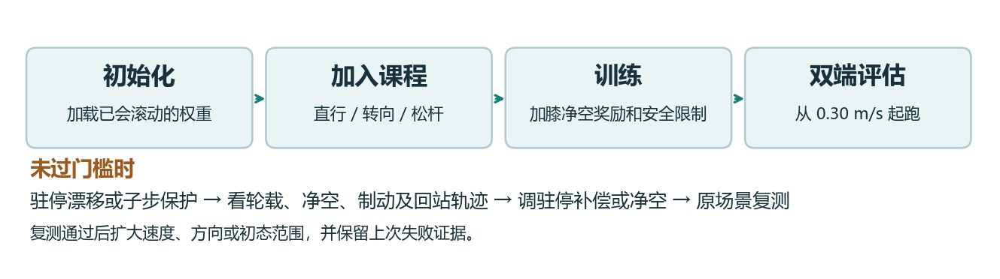
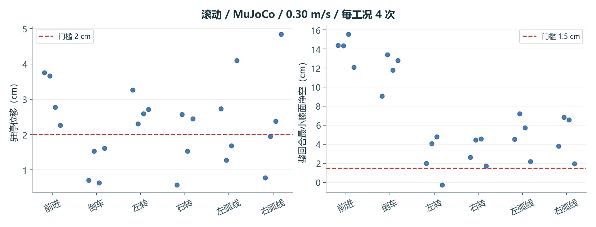

# AS2-W 滚动训练与仿真验收手册

2026-11-12 · Rob2Nav Studio · 项目接手版

> **阅读顺序**：先对照任务和门槛，再跑冒烟及单场景。需要解释训练行为时读奖惩表，需要接着修时读实验链。命令、参数和验收报告应使用同一候选的契约。

## 1. 任务、配置与通过条件

你给机器人一个前后速度或转向指令。四个轮子尽量贴地，机身不碰地。松杆后先减速，再回到 **fixed stand（固定站姿）** 并保持不漂移。本任务练前进、倒车、左右原地转和低速弧线。

**从哪里开始**：用 0.30 m/s 跑同一权重的两套仿真。当前在这个速度档，两端的总门和安全门都未通过。正式训练里的 `--speed-cap 1` 是课程上限，当前验收进度仍在 0.30 m/s。

### 训练与迭代流程



先从已会做滚动动作的权重开始，用速度课程练起步、运动和回站。每次训练都保存权重与运行契约。评估冻结权重，分别用 MuJoCo 和 Isaac Lab 执行相同类别的任务。某一档失败时，按失败阶段查日志，再回到同一档、同一场景验证改动。

### 配置速查

| 看哪个参数 | 对初学者意味着什么 | 正式值 |
| --- | --- | --- |
| `--checkpoint` | 训练从哪一版策略开始 | `rolling-maneuvers-formal/model_1199.pt` |
| `--num-envs`、`--iterations` | 同时跑多少个机器人、优化器更新多少轮 | 384、1200 |
| `--seed`、`--learning-rate` | 随机序列编号、每次学习更新的步幅 | 303、0.00010 |
| `--speed-cap`、`--rolling-maneuvers` | 课程速度范围、是否练机动与回站 | 1 m/s、开启 |
| `--rolling-fixed-exit`、`--rolling-wheel-hold` | 松杆时如何制动、退出后如何 稳住轮子 | 开启 |
| `--park-precalibrated`、`--park-continuous-bias`、`--park-straight-bias` | 驻停参考和补偿的控制开关 | 开启 |
| `--rolling-knee-margin`、`--safety` | 前者让策略倾向于保留净空，后者执行保护 | 开启 |

把奖励理解成训练时的加减分。速度跟对有加分，姿态晃、动作抖、机身过低和非轮接触会扣分。膝部净空的 **训练余量** 为 0.10 m，MuJoCo 对膝面净空的 **验收硬线** 是 0.015 m。两项定义、用途和读数都不同。逐项权重见后文。

### 验收门槛

| 阶段 | 0.30 m/s 的 MuJoCo 检查 | 失败先查 |
| --- | --- | --- |
| 起步 | fixed stand 持续 ≥0.40 s | 姿态、四轮承重、首帧动作 |
| 运动 | 场景方向与速度跟踪通过。轮离地 ≤0.06 s。膝面净空 ≥1.5 cm。膝心净空 ≥4.5 cm。同时检查非轮触地和角度、力矩 | 首个违规子步、侧滑、后腿净空 |
| 松杆制动 | 这档最多 2.5 s、0.1625 m | `stop_s` 和 `brake_distance_m` |
| 驻停与回站 | 驻停窗口看位移 ≤2 cm、偏航 ≤3°、速度 P95 ≤2 cm/s。结束 fixed stand ≥2 s | `hold_displacement_m`、轮载和最后站姿 |
| 速度升级 | 两个仿真器各自总门和安全门通过，才进入下一档 | 先复现失败的一端和失败工况 |



每个圆点是一回合。左图点在红线以上表示驻停漂移超标。右图点在红线以下表示膝面净空不足。通过其中一项仍需检查跟踪、制动及其他安全条件。图来自 `rolling-knee-margin-fixed-exit-trace-1199/mujoco-rolling-diagnostic.json`。P95 表示窗口内约 95% 的读数不超过该值。

## 2. 第一次复现

在服务器的 Bash 中执行。先跑冒烟任务，确认 Isaac Sim、GPU、模型和依赖可以启动，再按需要跑正式训练。两条命令各自创建独立输出目录。训练前先检查 GPU 是否有空间。

~~~bash
cd /root/gpufree-data/Rob2Nav-main-live/training/as2w-backup
nvidia-smi
RUN=$(mktemp -d /tmp/as2w-rolling.XXXXXX)
AS2W_NUM_ENVS=8 AS2W_ITERATIONS=3 bash train.sh rolling "$RUN/smoke"
bash train.sh rolling "$RUN/formal"
~~~

训练输出中，`command.sh` 给出实际执行的参数，`input-sha256.txt` 记录输入版本，`contract.json` 记录策略与仿真配置，`model_*.pt` 是可冻结评估的检查点。冒烟成功说明链路能运行。要验收能力，使用正式或指定候选的检查点，另开评估目录。网页作业的 `trained` 也只表示训练进程结束。

**同一权重跨仿真器**的意思是，在两个后端载入同一份 `.pt`，分别记录场景、种子、控制周期、PD 参数和结果。先做一个小范围复跑，确认读到了同一权重，再扩大试次。下文给出两端入口。

### 手柄场景如何复现

滚动先用脚本化的前进、倒车、原地转、弧线与松杆场景。想复现松杆，读同一回合的运动、制动和驻停窗口。连续杆量应在控制周期中送入速度指令通道，零杆触发制动和回站。

当前 AS2-W 工作台没有核实到机器人控制键位。仿真评估入口使用程序生成的命令。如果后续接入键盘，需把按下和松开都映射到连续杆量或状态机事件，并验证失焦归零、死区、限速及停稳。每个测试记录操控时间序列与机器人响应。

## 3. 同一权重在两个仿真器复跑

以下命令在服务器 Bash 执行。工作目录选运行快照，因为历史脚本依赖其同级的 MuJoCo venv 和运行资源。每次用新的输出目录。为保证两端比较有效，两个入口共用同一个 `ckpt`，保留 `sha256sum "$ckpt"` 和两端契约。

```bash
cd /root/gpufree-data/Rob2Nav-runtime/as2w-current
R=runs/r290-three-skills
out=$(mktemp -d /tmp/as2w-eval.XXXXXX)
usd="$PWD/runs/r280-isaac-flat-preflight/kit3-as2w.usd/as2w/as2w.usda"
urdf="$PWD/../dependencies/unitree_ros_as2w/robots/as2w_description/as2w.urdf"
dep="$PWD/../as2w-r284-release/deliveries/as2w-deploy"
mp="$PWD/code:$dep/flat-r284-500-preview/runtime:$dep/omni-blind-stairs-r152/runtime:$dep"
lp="$(printf '%s:' /workspace/isaaclab/source/isaaclab*)/opt/isaaclab-venv/lib/python3.12/site-packages"
```

```bash
ckpt="$R/rolling-knee-margin-formal/model_1199.pt"
flags=(--rolling-fixed-exit --rolling-stand-compensation --rolling-wheel-hold
       --park-precalibrated --park-continuous-bias --park-straight-bias)
mkdir "$out/mj" "$out/lab"
PYTHONPATH="$mp" ../mujoco-venv/bin/python code/eval_as2w_mujoco_rolling.py \
  assets/r237-train-root "$ckpt" "$out/mj" --speed .30 "${flags[@]}" \
  --native-pd --substep-safety --acceptance --packet-loss .02 --trials 4
PYTHONPATH="$lp" /isaac-sim/python.sh code/train_as2w_isaac_robust.py \
  --viz none --device cuda:0 --usd "$usd" --urdf "$urdf" --num-envs 8 \
  --iterations 1 --out "$out/lab" --checkpoint "$ckpt" --profile expanded \
  --speed-cap .30 --speed-rolling "${flags[@]}" --safety --evaluate --seed 7303
```

## 4. 每项奖励、惩罚和生效条件

每个控制步取各项原值乘配置权重，求和后再乘控制步长。训练回报用于学习。验收通过数由独立的场景与安全检查得出。

### 共享奖惩的具体计算

| 项目 | 原值与含义 | 滚动 / 踏步的权重 |
| --- | --- | --- |
| 平面速度跟踪 `track_lin_vel_xy_exp` | 指令与机体系实测 XY 速度差的平方和记作 E，得分 `exp(-E / 0.07²)`。指令完全跟上时为 1。 | +1.5 / +1.5 |
| 偏航跟踪 `track_ang_vel_z_exp` | 用偏航角速度误差平方作 E，得分 `exp(-E / 0.18²)`。角速度单位 rad/s。 | +0.75 / +0.75 |
| 带符号跟踪 `signed_tracking` | 平移先算速度在指令方向的投影，按目标速度归一化并裁到 [−1, 1]，再扣一半归一化误差，误差裁到 3。目标速度 ≤0.02 m/s 时平移分为 0。转向同理，按指令偏航方向计分，目标幅值 ≤0.05 rad/s 时转向分为 0。倒车或转反方向会扣分。 | +0.5 / +1.0 |
| 竖直速度 `lin_vel_z_l2` | 机体系 Z 速度平方，抑制上下弹跳。 | −2 / −2 |
| 横滚、俯仰速度 `ang_vel_xy_l2` | 机体系 X/Y 角速度平方和，抑制快速晃动。 | −0.05 / −0.05 |
| 水平姿态 `flat_orientation_l2` | 机体系投影重力的 X/Y 分量平方和，机身平正时接近 0。 | −2.5 / −2.5 |
| 力矩 `dof_torques_l2` | 对所选关节取施加力矩平方和。它会让优化器偏好较小力矩。安全门另查实际总力矩。 | −0.0002 / −0.0002 |
| 加速度 `dof_acc_l2` | 关节加速度平方和，抑制突然加速。 | −2.5e−7 / −2.5e−7 |
| 动作变化 `action_rate_l2` | 当前动作减上一帧动作，再取平方和。 | −0.005 / −0.005 |
| 机身高度 `base_height_l2` | 机身 Z 与 0.37 m 目标的平方误差。踏步的楼梯配置移除这项。 | −3 / 关闭 |
| 后腿标称姿态 `rear_posture` | 后两腿髋、股、胫相对默认角的平方误差均值，共六轴。 | −0.8 / 关闭 |
| 零指令运动 `zero_motion` | 三个命令分量同时为 0 才生效。原值为平面速度 / 0.05 + 偏航角速度绝对值 / 0.10。静止组第 1 秒后再加 `min(位移 / 0.02, 2)`。 | −0.4 / −0.4 |
| 非期望接触 `undesired_contacts` | 统计传感器窗口中接触力范数超过 4 N 的非足端刚体数量。 | −1 / −1 |
| 关节位置软限位 `dof_pos_limits` | 计算超出软限位的距离。权重为 0，不参与优化，关节仍由安全链监测。 | 0 / 0 |
| Go2 腾空时间 `feet_air_time` | 基础 Go2 奖励项在 AS2-W 环境移除。踏步另有显式接触和净空奖励。 | 关闭 / 关闭 |

源码按 `Isaac Lab velocity RewardsCfg → Go2 rough → Go2 flat → as2w_isaac_flat_env_all.configuration → 任务 trainer` 追踪。踏步还经过 `as2w_blind_stair_gait.stair_config`，该层明确移除机身高度和后腿标称姿态项。

### 速度课程对奖励表的覆写

`configure_speed` 先调用 `configure_teleop(cfg, "b")`，随后覆写轴误差并添加转向、轮支撑和制动项。下表与共享奖励、膝净空奖励共同构成该正式配方的学习信号。

| 项 | 权重 | 原值与生效条件 |
| --- | ---: | --- |
| `teleop_axis_error` | −0.65 | 目标平移速度 >0.10 m/s 时，计算归一化平面误差、反向分量及半权重偏航绝对值，各项分别裁到 3、2、2。低速使用 `axis_error`，惩罚横向偏差与反方向转动。 |
| `teleop_park_error` | −0.24 | 回合超过 100 步且指令全零才生效。连续零指令前 1 s 更新驻停参考，随后按 2 cm 位移、3° 航向与 2 cm/s 速度归一化，裁剪后求和，速度项乘 0.4。 |
| `teleop_target_rate` | −0.12 | 每个动作通道变化量绝对值超过 0.18 的部分平方，再取通道均值。 |
| `rolling_turn_error` | −0.90 | 当目标偏航角速度幅值 ≥0.04 rad/s 时，平面速度误差范数除以 0.08，偏航速度误差绝对值除以 0.20，各裁到 3 再相加。 |
| `rolling_wheel_support` | −0.65 | 超过回合第 100 步时，统计竖直轮载 <2 N 的轮数占比。 |
| `rolling_brake_error` | −0.42 | 只在课程制动组且过起步/驻停门控时刻后生效。平面速度与过滤命令之差的范数除以 0.05 并裁到 4，加上偏航速度绝对值除以 0.12 并裁到 3。 |

相关实现见 `as2w_isaac_speed_range.py` 与 `as2w_isaac_teleop.py`。

### 滚动独有项与逐帧例子

`rolling_knee_margin` 权重 **−3.0**。从碰撞包络求四腿膝部表面到地形的距离 (c)，逐腿算 `max(0, 0.10 − c) / 0.10` 的平方，再取四腿均值。一条腿为 5 cm、另外三条至少 10 cm 时，原值是 0.0625，20 ms 内贡献 −0.00375。这个时刻膝面仍高于 1.5 cm 硬线，所以可以出现**奖励扣分但回合继续**。如某子步触发碰撞或超限，应从安全日志查该子步，不从奖励曲线反推终止时刻。

一次松杆会经历两个不同的零速阶段。制动期间速度仍大，`zero_motion` 会扣分。锁轮并交给 fixed stand 后，再看驻停位移和偏航。若速度已收敛而位移超标，优先查轮角参考捕获时刻与轮载，调高速度跟踪权重未必能解决驻停问题。驻停补偿、轮角保持和 fixed stand 交接都属于控制链。

## 5. 历史失败、改动与下一次验证


下表以 `runs/r290-three-skills/` 为根。完整通过、跟踪通过、驻停通过是不同列。同一行的分项计数不能相加，因为同一回合可通过多项。

| 阶段与证据目录 | 当时在查什么 | 观察结果 | 如何接着做 |
| --- | --- | --- | --- |
| `rolling-maneuvers-mujoco-1199-.30` | 加入机动课程后，能否完成从运动到停车的完整回合 | 120 回合中 91 跟踪通过、42 驻停通过、3 完整通过 | 保留这版为对照，把跟踪和退出拆开看 |
| `rolling-fixed-exit-mujoco-1199-.30` | 用固定退出把减速、站稳和站姿交接做成独立阶段 | 110/120 跟踪、28/120 驻停，完整通过 1/120 | 跟踪改善与驻停恶化可以并存。两版有配方差异，不能归因给一个开关 |
| `rolling-knee-margin-fixed-exit-trace-1199` | 给膝净空额外余量，检查回站和制动的细节 | 24 回合中 22 安全稳定、16 跟踪、8 驻停，0 完整通过。左转至少有一回合的膝面净空低于硬线 | 从首个违规子步检查膝面、膝心、轮载和侧滑 |
| `rolling-knee-margin-park-half-gain-mujoco-1199` 与 `rolling-knee-margin-park-odometry-mujoco-1199` | 对照驻停补偿力度和里程计估计 | 两者各 0/24 完整通过、0/24 驻停通过 | 先回退到已有停车基准。保留这两组负对照 |
| `rolling-knee-margin-park-settle-wheel-angle-{mujoco,isaac}-1199` | 站姿稳定后锁定轮角是否改善漂移 | MuJoCo 2/24 驻停、0/24 完整通过，两端总门与安全门均失败 | 锁轮前后分别记录轨迹，再决定是先改锁定时机还是负载补偿 |

> **接手第一题**：在 0.30 m/s 的前进工况里，对照同一初态的无推扰和驻停推扰。切出松杆、制动、低速、锁定、交接、10 秒保持六段。每段记录参考轮角、实际轮角、四轮载荷、漂移和首个保护。先确认第一次分歧发生在哪一段。

| 看到的症状 | 首查 |
| --- | --- |
| 目标一发就触地 | 初态净空、动作历史重置、首帧腿目标和子步接触 |
| 转向正确但出弧或倒车 | 检查有效偏航、纵向与横向速度，以及杆量过滤后的指令 |
| 制动已过但驻停失败 | 对齐松杆、首次低速、轮角捕获与站姿交接时间 |
| 单端通过另一端失败 | 同一权重、姿态、指令、PD 与子步，比较目标和实际力矩的首处分歧 |

**可定位的失败样本**。MuJoCo 左转种子 47002 的最小膝面净空是 −2.97 mm，低于 +15 mm 门槛。该行 `first_nonwheel_contact` 为空，说明净空读数与接触事件是两套证据。对这条记录先查几何包络和首个低净空子步，再查为何没有接触事件。

### 已有验收证据

用 `skills/as2w/rolling/compare_reports.py` 对照 `rolling-knee-margin-formal/model_1199.pt` 的 0.30 m/s 固定退出 trace。权重 SHA-256 为 `bb5c9735b5bd37ef4bdd2bd13f9d45395d8dc9b4c888c36955de1a345d55776d`。MuJoCo 的前进、倒车、两侧原地转和两侧弧线均为 0/4。Isaac Lab 的前进完整跟踪、制动和驻停为 0/4，倒车为 1/4，两侧原地转各 0/2。两端的总门和安全门均为 false。后续 park-settle-wheel-angle 对照也未通过两端的总门或安全门。保留 0.30 m/s 失败证据，下一档仍待解锁。

## 6. 配方参数和策略接口

### 正式配方内容（rolling）

来自 `skills/as2w/rolling/recipes/formal.sh`：

- `trainer=train_as2w_isaac_robust.py`
- `count=384`（默认并行环境数）
- `init="$d/rolling-maneuvers-formal/model_1199.pt"`（初始化权重。证据中其 sha256 为 `81cdea1e65d6631a2118d83eed5c52cd6acc91de0a81bb0d7409c471a4cc644a`）
- `args=(--checkpoint "$init" --profile expanded --speed-cap 1 --speed-rolling --rolling-fixed-exit --rolling-stand-compensation --rolling-wheel-hold --park-precalibrated --park-continuous-bias --park-straight-bias --rolling-maneuvers --rolling-knee-margin --safety --learning-rate .00010 --seed 303)`

因此完整训练命令等价于：

```
/isaac-sim/python.sh code/train_as2w_isaac_robust.py --viz none --device cuda:0 \
  --usd runs/r280-isaac-flat-preflight/kit3-as2w.usd/as2w/as2w.usda \
  --urdf ../dependencies/unitree_ros_as2w/robots/as2w_description/as2w.urdf \
  --num-envs 384 --iterations 1200 --out "$RUN/formal" \
  --checkpoint runs/r290-three-skills/rolling-maneuvers-formal/model_1199.pt \
  --profile expanded --speed-cap 1 --speed-rolling --rolling-fixed-exit \
  --rolling-stand-compensation --rolling-wheel-hold --park-precalibrated \
  --park-continuous-bias --park-straight-bias --rolling-maneuvers \
  --rolling-knee-margin --safety --learning-rate .00010 --seed 303
```

`--viz none` 由 `train.sh` 固定注入。

### PPO 关键配置（来自 trainer 源码与 contract）

`code/train_as2w_isaac_robust.py`：

- 观测宽度 65，动作数 16。若不匹配直接 `RuntimeError("R284 policy shape changed")`。
- `RslRlVecEnvWrapper(env, clip_actions=6.)`。
- 策略步长 `policy_step_s=0.02`，物理步长 `physics_step_s=0.005`（`SimulationCfg(dt=.005)`）。
- `runner_cfg = UnitreeGo2FlatPPORunnerCfg()`。`seed=args.seed`。`device=args.device`。`max_iterations=args.iterations`。`save_interval=min(25, args.iterations)`。`algorithm.learning_rate=args.learning_rate`。
- `--rolling-maneuvers` 时启用镜像对称增强：`RslRlSymmetryCfg(data_augmentation_func=mirror_flat, use_data_augmentation=True, use_mirror_loss=True, mirror_loss_coeff=.15)`。
- `runner.load(checkpoint, load_cfg={"actor": True, "critic": True})`，即从 `--checkpoint` 续训 actor+critic。
- 训练调用 `runner.learn(num_learning_iterations=args.iterations, init_at_random_ep_len=False)`。结束打印 `AS2W_ROBUST_COMPLETE <profile>`。
- `--rolling-maneuvers` 时课程参数改写：`as2w_motion_start_s=4.`、`as2w_park_until_s=7.`、`episode_length_s=23.`。
- 评估模式：`episode_length_s = 26. if teleop_evaluate or speed_cap else 18.`。
- `args.command_stage="all"`、`args.direction_focus=True`、`args.zero_memory=True`、`args.zero_focus=False`、`args.physics="isaacsim_physx"`。

正式配方实际产出（`runs/r290-three-skills/rolling-knee-margin-formal/contract.json`）：

- checkpoint：`runs/r290-three-skills/rolling-knee-margin-formal/model_1199.pt`
- checkpoint_sha256：`bb5c9735b5bd37ef4bdd2bd13f9d45395d8dc9b4c888c36955de1a345d55776d`
- profile `expanded`。speed_cap_m_s 1.0。seed 303。num_envs 384。iterations 1200。learning_rate 0.0001
- `rolling_maneuvers: true`，`rolling_knee_margin_m: 0.1`，`rolling_fixed_exit/stand_compensation/wheel_hold/park_precalibrated/park_continuous_bias/park_straight_bias` 均为 true
- `park_loaded_stance: false`、`park_odometry: false`、`park_settle_joints: false`、`mirror_rolling: false`、`pure_turn_common_scale: 1.0`、`turn_yaw_slew_rad_s2: 0.0`
- `motion_substep_audit: null`（训练态未开启子步审计）
- `pose_source: "simulation_proxy_no_raw_lowstate"`

### 硬约束参数（`--safety` 生效，`apply_safety` 写入 contract）

`simulation_safety`：

- `fraction: 0.9`（角度/力矩 90% 规则）
- `source: "simulation_urdf_not_hardware_calibration"`（仿真 URDF 推得，非实机标定）
- `min_knee_surface_m: 0.015`
- 角度限位（rad）：髋 `[-0.7065, 0.7065]`。FL/FR 大腿 `[-1.72, 3.2228]`。RL/RR 大腿 `[-1.09, 3.851]`。小腿 `[-2.65093, -0.89197]`
- 力矩上限（Nm）：髋 54、大腿 54、小腿 81、轮 13.5。轮速上限 `98.47 rad/s`

### 参数开关与安全约束

- **可选项（配方中可选开关）**：`--rolling-loaded-stance`、`--park-odometry`、`--park-settle-joints`、`--suppress-pure-turn-common`/`--pure-turn-common-scale`、`--turn-yaw-slew`、`--mirror-rolling`、`--teleop a|b`、`--teleop-evaluate`、`--evaluate`。参数校验给出的依赖关系：pure-turn common scale 需 fixed-exit。turn yaw slew 仅评估且 `--speed-rolling` 时可用且上限 3 rad/s²。`--speed-cap` 取 0 或 0.10–3 m/s。`--speed-cap` 与 `--teleop` 互斥。`--rolling-maneuvers` 需 `--speed-rolling` + `--park-straight-bias` 且非评估。
- **硬约束**：角度 90%、力矩 90%、非轮触地与净空、摔倒即失败（守则 §3）。`--safety` 生成的限幅与终止不可关闭。90% 规则只靠奖励惩罚不可替代。

## 7. 模型输入、网络结构与 ONNX 部署

本节核对下表中的 R1199 仿真候选。当前训练配方重新生成的权重应重新校验 SHA-256、观测契约与延迟。

| 项目 | 已核对的实际值 |
| --- | --- |
| PyTorch 检查点 | `runs/r290-three-skills/rolling-knee-margin-formal/model_1199.pt` |
| ONNX 文件 | `runs/r290-three-skills/onnx-diagnostic/rolling-knee-margin-1199-.30/policy.onnx` |
| PyTorch 文件大小 | 1,042,741 字节（1018.3 KiB），含 actor、critic、优化器与训练元数据 |
| ONNX 文件大小 | 175,299 字节（171.2 KiB），含 actor 前向图和权重 |
| 网络宽度 | `65 → 128 → 128 → 128 → 16`，三层 128 单元隐藏层、四层全连接。每个隐藏层后为 ELU，末层之后为 Clip |
| 部署 actor 参数 | 43,536 个 FP32 权重和偏置，每次前向约 43,136 次乘加，另有偏置、ELU 和裁剪 |
| 训练网络参数 | actor 43,552（含 16 个采样分布参数），critic 41,601，合计 85,153，不含优化器状态 |
| Critic 网络 | `65 → 128 → 128 → 128 → 1`，训练时估计状态价值 |
| ONNX 版本与精度 | opset 17。输入、输出、初始权重为 FP32，图中为 `Gemm → ELU` 叠加末端 `Clip`。当前图无 FP16 转换或 INT8 量化 |
| 部署张量 | `obs[1,65]` → `actions[1,16]`，固定 batch 1 |

### 输入索引与单位

索引从 0 开始。腿轴按**关节类型优先**排列。先是 FL、FR、RL、RR 的四个髋，再是同序四个大腿，再是四个小腿。需要四轮通道时才在后面附加 FL、FR、RL、RR 的轮轴。传感器读数必须先换成模型坐标和单位，再按表填入。目标机的电机槽位需要通过部署映射转换。

| 索引 | 维数 | 量与单位 |
| --- | ---: | --- |
| 0–2 | 3 | 有效机体系速度指令 `[vx − 0.4, vy, wz]`，单位 m/s、m/s、rad/s。纯滚动控制清掉横移指令。 |
| 3–5 | 3 | 机体系角速度 XYZ，rad/s。 |
| 6–8 | 3 | 机体系投影重力 XYZ，无量纲。 |
| 9 | 1 | 训练保留的常量 `0.4`。 |
| 10–25 | 16 | 相对默认关节角，rad。腿 12 轴后接四轮。轮角按 4π 周期回绕到 [−2π, 2π)。 |
| 26–41 | 16 | 相同顺序的关节角速度，rad/s。 |
| 42–57 | 16 | 上一控制步的动作历史。当前 expanded 运行由 `policy_action` 槽填充，按评估器的更新和复位顺序处理。 |
| 58–59 | 2 | 控制时钟的 `sin`、`cos`，周期 0.62 s。 |
| 60–63 | 4 | 零指令驻停轮角误差。取相对捕获参考的回绕差，除以 0.20 rad 并裁到 [−3, 3]。有运动指令时清零。 |
| 64 | 1 | 三个速度命令全为零的标记，0 或 1。 |

观测源码在 `as2w_isaac_flat_env_all.observation` 和 `as2w_isaac_robust_env.robust_observation`。expanded 仿真中传感分组经历偏置、延迟和整帧保持，部署时应以时间戳和最新有效数据实现同一输入契约。机身线速度虽然用于奖励与评估，未直接进入这 65 个输入。

**输出**按同一轴序为 12 个腿部通道和 4 个轮通道，ONNX 内裁剪到 [−6, 6]。腿位置基础缩放为 0.35 rad，轮速基础缩放为 16 rad/s。正式固定退出控制还融合滚动先验、制动和驻停，并施加限幅。不要把 ONNX 动作直接当关节弧度、轮速或力矩下发。

### 导出与部署顺序

1. **固定版本**。记录 PyTorch 与 ONNX 的 SHA-256。对新权重使用下方导出入口，把实际仿真录下的观测作为逐帧对照。
2. **进程启动时加载一次**。用 ONNX Runtime 创建 CPU session，确认输入输出名、形状、FP32 和模型哈希。先预热再进入实时循环。
3. **20 ms 控制循环**。先检查传感器时间戳与有限值，按索引表拼出连续内存的 `np.float32` 输入。调用 actor 后更新动作历史，再把动作交给任务的目标变换、姿态状态机和安全约束。
4. **验证端到端**。用相同记录观测比较 PyTorch 和 ONNX 动作，再在闭环检查观测拼接、目标缩放、单位、复位首帧、限位和推理超时。实机还需独立的只读影子验证。单次 actor 调用通过不代表闭环通过。

~~~bash
cd /root/gpufree-data/Rob2Nav-runtime/as2w-current
PT="runs/r290-three-skills/rolling-knee-margin-formal/model_1199.pt"
ONNX="runs/r290-three-skills/onnx-diagnostic/rolling-knee-margin-1199-.30/policy.onnx"
OBS="runs/r290-three-skills/rolling-knee-margin-mujoco-1199-.30/policy-observations.npy"
sha256sum "$PT" "$ONNX"
EXPORT=$(mktemp -d /tmp/as2w-onnx.XXXXXX)
../mujoco-venv/bin/python code/export_as2w_candidate_onnx.py \
  "$PT" "$EXPORT" --clip 6 --observations "$OBS"
~~~

导出器将确定性 actor 和末端裁剪写入 `policy.onnx`，写出 `onnx-parity.json`，并检查最大动作绝对误差是否 ≤1e−4。此次用服务器现有 ONNX 和 **7,560 帧实际观测**重新比较，误差最大 **8.58e-06**。

- PT SHA-256 `bb5c9735b5bd37ef4bdd2bd13f9d45395d8dc9b4c888c36955de1a345d55776d`
- ONNX SHA-256 `df1f2db98efe32ad4a8b767c34b7ca4235c717f80e5778d59552a522b6fc7f23`

### 服务器单帧推理实测

| 指标 | 耗时（µs） |
| --- | ---: |
| P50 中位数 | 11.228 |
| P95 | 11.506 |
| P99 | 14.737 |
| 本轮最大 | 22.054 |

测量条件为 Linux x86-64、Intel Xeon Platinum 8358 @ 2.60 GHz、ONNX Runtime 1.23.2、`CPUExecutionProvider`、单线程、batch 1。按循环复用前 256 帧真实仿真观测，先预热 500 次，再计时 10,000 次。时钟包住 Python 的 `session.run`，输入数组已准备好。结果包含运行时调用与输出返回，不含读传感器、观测拼接、控制保护、通讯、会话初始化或控制循环调用之前的等待。调用期间的系统抖动会计入。P99 表示约 99% 的本轮调用不超过该值。部署机应在实际负载下另测完整控制周期的 P99、最大值与超时次数。

~~~python
# 将本段保存为 bench_onnx.py 后运行
# ../mujoco-venv/bin/python bench_onnx.py "$ONNX" "$OBS"
import sys
import time
import numpy as np
import onnxruntime as ort

model_path, observation_path = sys.argv[1:]
opt = ort.SessionOptions()
opt.intra_op_num_threads = opt.inter_op_num_threads = 1
opt.execution_mode = ort.ExecutionMode.ORT_SEQUENTIAL
session = ort.InferenceSession(model_path, sess_options=opt,
                               providers=["CPUExecutionProvider"])
rows = np.ascontiguousarray(np.load(observation_path, allow_pickle=False),
                            dtype=np.float32)
assert rows.ndim == 2 and rows.shape[1] == 65
assert len(rows) and np.isfinite(rows).all()
feeds = [{"obs": row[None, :]} for row in rows[:256]]
for i in range(500):
    session.run(["actions"], feeds[i % len(feeds)])
samples = []
for i in range(10_000):
    feed = feeds[i % len(feeds)]
    start = time.perf_counter_ns()
    actions = session.run(["actions"], feed)[0]
    samples.append((time.perf_counter_ns() - start) / 1000)
assert actions.shape == (1, 16) and np.isfinite(actions).all()
print(np.percentile(samples, [50, 95, 99, 100]))
~~~

## 8. 接手检查、证据归档与交付

- [ ] 能找到训练配方、初始化权重、机器人描述、仿真资产和历史报告。
- [ ] 用新输出目录跑通冒烟，记录实际命令、依赖版本和输入哈希。
- [ ] 冻结一个候选权重，在 MuJoCo 与 Isaac Lab 各跑一个小工况，确认动作、单位和接触口径。
- [ ] 选一个已有失败，保存首个失败前后的观测、动作、目标关节角、实际力矩和接触。
- [ ] 只改一项假设相关的配置，使用同一权重、初态、种子和命令重放。最后才换留出种子。
- [ ] 两端完整矩阵通过后，执行 ONNX 逐帧对齐与切换评估，再评估交付状态。

> **接手验证**：新人至少应能重现一个已知失败并解释它属于命令、策略、执行器还是验收窗口。本手册提供步骤和历史对照。本次没有安排新人实操或重新运行仿真。

### 到哪里找什么

| 位置 | 内容 | 先看什么 |
| --- | --- | --- |
| `Rob2Nav-main-live/skills/as2w/<任务>/recipes/formal.sh` | 工作台当前正式配方 | trainer、初始权重、课程开关 |
| `Rob2Nav-main-live/training/as2w-backup/train.sh` | 可迁移的训练入口 | 环境变量、输出目录要求、输入哈希 |
| `Rob2Nav-runtime/as2w-current/code/` | 历史运行使用的训练、评估及控制源码 | 当前候选的合同和调用链 |
| `Rob2Nav-runtime/as2w-current/runs/r290-three-skills/` | 模型、实验、留出结果 | `contract.json`、`job.log`、`model_*.pt` 和评估 JSON |
| `as2w-current/AGENTS.md` | 硬保护、仿真验收、切换与交付要求 | 第 3 至 6 节 |
| `as2w-current/runs/AS2W-remediation.md`、`AS2W-goal-supplement.md` | 当前修复优先级和独立验收目标 | 本任务首轮验证顺序 |
| `Rob2Nav-main-live/deliveries/as2w-deploy/README.md` | 旧版部署策略及 C++/ONNX 对照 | 模型与接口的适用范围 |

### 看懂三类参数

**训练参数**决定策略怎样学，例如初始化、学习率、并行环境数和课程。**控制参数**决定动作怎样变成电机目标，例如 PD 增益、滤波、限幅和驻停控制。**验收参数**决定怎样判通过，例如留出种子、推扰安排和连续站稳时长。比较两个结果前，先逐项核对这三类。用同一个种子启动不同仿真器也可能产生不同的随机序列。要逐帧比较，应保存并重放实际初态、指令、延迟和推扰序列。

### 每轮迭代记录模板

~~~text
实验 ID / 日期 / 任务：
上一个可复现候选 / 本次权重 SHA-256：
训练配方 / 实际命令 / 仿真器与版本：
对照工况 / 初态、种子、指令、延迟、推扰：
本次唯一改动 / 希望改善的阶段 / 预先登记的门槛：
首个失败时间（含物理子步） / 部位 / 触发项：
当时的观测、策略动作、关节目标、实际角度和总力矩：
各奖励原值 / 权重 / 加权贡献 / 是否落在奖励生效条件内：
通过数与总数 / 最坏样本 / 回退点 / 下一次单项验证：
~~~

奖励逐步累加按 `r = dt × Σ(w × f)`，其中 `f` 是每个函数在该控制步的原值，`w` 是配置权重。比如一项权重为 −2，原值为 0.25，控制步为 0.02 s，本步贡献 −0.01。复盘时要看加权值和生效条件。奖惩变化可以帮助定位学习信号，是否触发硬保护仍需单独读取终止项。

### 放行与回退

1. **仿真通过**。同一权重在两端完成独立留出矩阵。常规控制从 fixed stand 起步，停稳后回站。跨策略切换额外记录目标连续性与接管后首 0.5 s 的角度、速度和力矩。
2. **模型交付**。导出 ONNX，保留权重 SHA-256、opset、输入输出形状与类型、20 ms 控制周期、动作裁剪和复位语义。用两端记录的观测逐帧比对 actor 输出。逐轴核对电机槽位、符号、零位、单位、总力矩和轮角回绕。
3. **可回退**。保留旧模型、旧配方和原评估结果。切换到旧模型后按旧契约复跑一组基准。实机接入还需要真实 LowState 和手柄的只读影子回放，以及独立的失联与急停保护。
