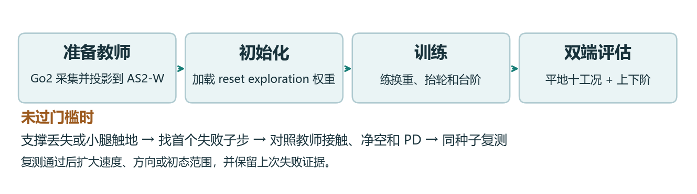
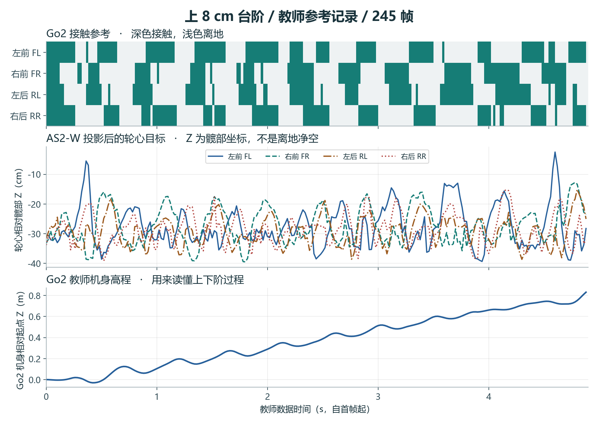
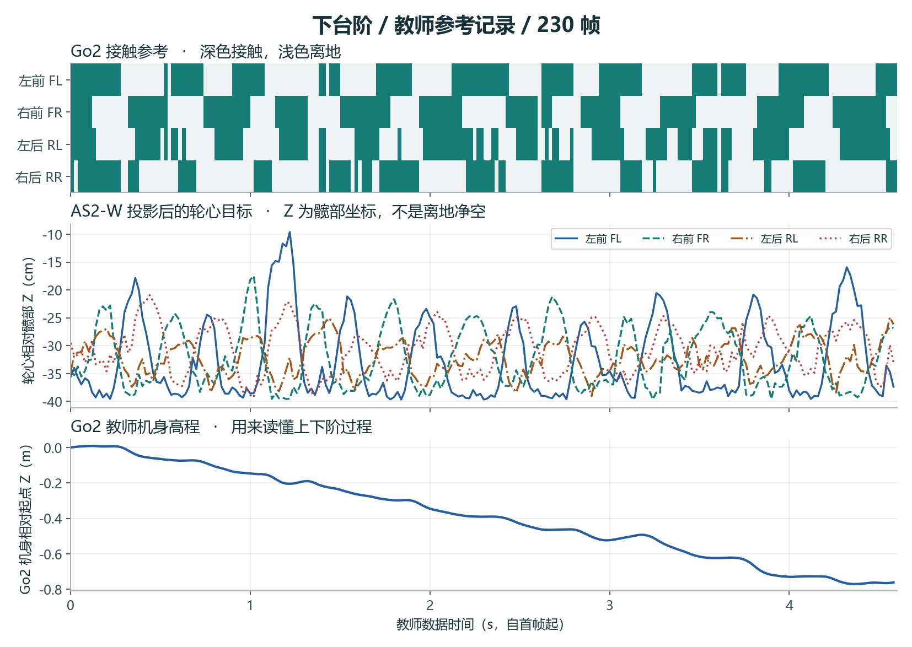
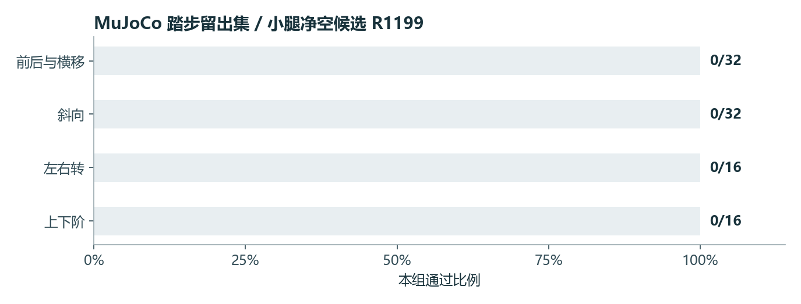

# AS2-W 踏步训练与仿真验收手册

2026-11-12 · Rob2Nav Studio · 项目接手版

> **阅读顺序**：先对照任务和门槛，再跑冒烟及单场景。需要解释训练行为时读奖惩表，需要接着修时读实验链。命令、参数和验收报告应使用同一候选的契约。

## 1. 任务、配置与通过条件

踏步时，AS2-W 需要先把重量移到承重侧，再抬另一侧的轮子，跨过台阶边缘，落轮后接住重量。平地验收包括八方向和左右转，台阶验收分别测上行和下行。初学者先看轮子何时承重，再看轮心轨迹，最后对照仿真里首个失败的子步。

### 训练与迭代流程



配置同时包含三部分。**课程**决定让机器人练什么。**奖励**给做对的动作加分。**安全保护**在姿态、接触或力矩违规时阻止这一回合继续得出通过结果。教师参考只覆盖定向楼梯课程中的符合条件帧。

### 教师参考轨迹





从上往下读三层图。

1. **四轮接触条带**。深色表示 Go2 参考的该足接触地面，浅色表示离地。训练用 `go2_contact` 给 AS2-W 提供换重和落轮时序参考。
2. **四条轮心目标曲线**。Go2 足端相对其标称站姿的位移被映射到 AS2-W，再把关节目标投影到角度和后腿姿态范围内，计算出轮心位置。图里画的是 `as2w_wheel_hip_m` 的 Z 轴，坐标原点在各自髋部，读数不能直接当作离台阶多高。
3. **教师机身高程**。最后一条线来自 Go2 自己的世界坐标高程，减去首帧高度。可用来定位上阶和下阶的过程。

| 数据 | 帧数 | 投影前同时满足角度与后腿姿态 | 投影后 | 轮心位置误差 P95 |
| --- | ---: | ---: | ---: | ---: |
| 上 8 cm 台阶 `stairs_up8cm.npz` | 245 | 145 | 245 | 6.64 cm |
| 下台阶 `stairs_down.npz` | 230 | 132 | 230 | 1.80 cm |

训练从回合第 2 秒开始按 25 帧/秒的索引读取接触参考，对当前帧及前后 2 帧取均值。仅当处于对应楼梯地形列、前进命令大于 0.04 m/s 且索引在参考范围内时计分。四轮实际接触与期望越接近，`go2_support_reference` 得分越高，权重 +0.35。轮心曲线供投影和几何诊断，奖励函数直接读取的是接触条带。两张图来自 `runs/r290-three-skills/go2-as2w-wheel-teacher-projected`，显示参考数据时间戳。投影合规是离线几何检查，跨阶成败仍要看两个仿真器。

### 配置速查

| 参数 | 调的是什么 | 正式值 |
| --- | --- | --- |
| `--init-checkpoint` | 起点权重 | `stepping-go2-reset-exploration-init/model.pt` |
| `--num-envs`、`--iterations`、`--seed` | 并行机器人、训练更新预算、随机种子 | 256、1200、305 |
| `--curriculum`、`--directed-stair-curriculum` | 场景生成及上下阶定向课程 | `stairs-sequence-guarded`、开启 |
| `--sequence-period`、`--sequence-stride` | 参考序列周期和步幅增益，后者是倍率 | 8 s、0.35 |
| `--target-margin`、`--predictive-guard` | 目标角度保留余量并进行预测保护 | 0.05 rad、开启 |
| `--sequence-shaped-reward`、`--stance-margin-reward` | 给序列抬轮、站姿和膝部净空提供学习信号 | 开启 |
| `--privileged-stair-critic` | 训练时让价值估计器读取地形特征 | 开启 |
| `--go2-support-reference` | 教师接触数据目录 | `go2-as2w-wheel-teacher-projected` |
| `--packet-loss` | 模拟观测整帧丢失的概率 | 2% |

### 验收门槛

| 检查 | 应看到什么 |
| --- | --- |
| 起步和退出 | MuJoCo 起步前 fixed stand ≥0.40 s，结束 fixed stand ≥2 s |
| 步态 | 每轮至少两次有效抬升，且达到该工况位移要求 |
| 台阶 | 分别检查上行与下行，追踪接近、首阶、连续换重和退出 |
| 安全 | 角度和力矩按仿真限值 90% 保护，碰撞模型膝面净空 ≥1.5 cm，非轮触地或摔倒判失败 |
| 双端复测 | 同一检查点、明确场景与种子，单独报告两个后端 |



图中数据是带额外小腿净空奖励的历史 R1199 候选。96 回合均未过完整门槛。看失败顺序时，先定位触地或保护触发的子步，再叠对教师时序和 AS2-W 实际承重。训练配方和这条候选的区别见后文。

## 2. 第一次复现

在服务器的 Bash 中执行。先跑冒烟任务，确认 Isaac Sim、GPU、模型和依赖可以启动，再按需要跑正式训练。两条命令各自创建独立输出目录。训练前先检查 GPU 是否有空间。

~~~bash
cd /root/gpufree-data/Rob2Nav-main-live/training/as2w-backup
nvidia-smi
RUN=$(mktemp -d /tmp/as2w-stepping.XXXXXX)
AS2W_NUM_ENVS=8 AS2W_ITERATIONS=3 bash train.sh stepping "$RUN/smoke"
bash train.sh stepping "$RUN/formal"
~~~

训练输出中，`command.sh` 给出实际执行的参数，`input-sha256.txt` 记录输入版本，`contract.json` 记录策略与仿真配置，`model_*.pt` 是可冻结评估的检查点。冒烟成功说明链路能运行。要验收能力，使用正式或指定候选的检查点，另开评估目录。网页作业的 `trained` 也只表示训练进程结束。

**同一权重跨仿真器**的意思是，在两个后端载入同一份 `.pt`，分别记录场景、种子、控制周期、PD 参数和结果。先做一个小范围复跑，确认读到了同一权重，再扩大试次。下文给出两端入口。

### 手柄场景如何复现

踏步用 MuJoCo 的 `--case forward`、`--case left`、`--case turn_right` 或 `--case up` 单独复现相应工况。台阶需要真实台阶场景，前进指令本身不能代替台阶测试。Isaac Lab 使用下文的平地和楼梯课程入口。

当前 AS2-W 工作台没有核实到机器人控制键位。仿真评估入口使用程序生成的命令。如果后续接入键盘，需把按下和松开都映射到连续杆量或状态机事件，并验证失焦归零、死区、限速及停稳。每个测试记录操控时间序列与机器人响应。

## 3. 同一权重在两个仿真器复跑

以下命令在服务器 Bash 执行。工作目录选运行快照，因为历史脚本依赖其同级的 MuJoCo venv 和运行资源。每次用新的输出目录。为保证两端比较有效，两个入口共用同一个 `ckpt`，保留 `sha256sum "$ckpt"` 和两端契约。

```bash
cd /root/gpufree-data/Rob2Nav-runtime/as2w-current
R=runs/r290-three-skills
out=$(mktemp -d /tmp/as2w-eval.XXXXXX)
usd="$PWD/runs/r280-isaac-flat-preflight/kit3-as2w.usd/as2w/as2w.usda"
urdf="$PWD/../dependencies/unitree_ros_as2w/robots/as2w_description/as2w.urdf"
dep="$PWD/../as2w-r284-release/deliveries/as2w-deploy"
mp="$PWD/code:$dep/flat-r284-500-preview/runtime:$dep/omni-blind-stairs-r152/runtime:$dep"
lp="$(printf '%s:' /workspace/isaaclab/source/isaaclab*)/opt/isaaclab-venv/lib/python3.12/site-packages"
```

```bash
ckpt="$R/stepping-calf-clearance-formal/model_1199.pt"
flags=(--sequence-period 8 --sequence-stride .35 --packet-loss .02
       --target-margin .05 --sequence-attitude --predictive-guard)
mkdir "$out/mj" "$out/flat" "$out/stairs"
PYTHONPATH="$mp" ../mujoco-venv/bin/python code/eval_as2w_mujoco_stepping.py \
  assets/r237-train-root "$ckpt" "$out/mj" --seed 8302 --trials 8 --native-pd \
  --leg-pd 55 2 --calf-mesh-diagnostic --down-approach .55 "${flags[@]}"
for mode in flat stairs; do
  extra=()
  if [ "$mode" = stairs ]; then extra+=(--directed-stair-curriculum); fi
  PYTHONPATH="$lp" /isaac-sim/python.sh code/train_as2w_isaac_stepping.py \
    --viz none --device cuda:0 --usd "$usd" --urdf "$urdf" --num-envs 40 \
    --iterations 1 --out "$out/$mode" --eval-checkpoint "$ckpt" --eval-leg-pd 55 2 \
    --curriculum "$mode-sequence-guarded" --sequence-shaped-reward --seed 6302 \
    "${flags[@]}" "${extra[@]}"
done
```

## 4. 每项奖励、惩罚和生效条件

每个控制步取各项原值乘配置权重，求和后再乘控制步长。训练回报用于学习。验收通过数由独立的场景与安全检查得出。

### 共享奖惩的具体计算

| 项目 | 原值与含义 | 滚动 / 踏步的权重 |
| --- | --- | --- |
| 平面速度跟踪 `track_lin_vel_xy_exp` | 指令与机体系实测 XY 速度差的平方和记作 E，得分 `exp(-E / 0.07²)`。指令完全跟上时为 1。 | +1.5 / +1.5 |
| 偏航跟踪 `track_ang_vel_z_exp` | 用偏航角速度误差平方作 E，得分 `exp(-E / 0.18²)`。角速度单位 rad/s。 | +0.75 / +0.75 |
| 带符号跟踪 `signed_tracking` | 平移先算速度在指令方向的投影，按目标速度归一化并裁到 [−1, 1]，再扣一半归一化误差，误差裁到 3。目标速度 ≤0.02 m/s 时平移分为 0。转向同理，按指令偏航方向计分，目标幅值 ≤0.05 rad/s 时转向分为 0。倒车或转反方向会扣分。 | +0.5 / +1.0 |
| 竖直速度 `lin_vel_z_l2` | 机体系 Z 速度平方，抑制上下弹跳。 | −2 / −2 |
| 横滚、俯仰速度 `ang_vel_xy_l2` | 机体系 X/Y 角速度平方和，抑制快速晃动。 | −0.05 / −0.05 |
| 水平姿态 `flat_orientation_l2` | 机体系投影重力的 X/Y 分量平方和，机身平正时接近 0。 | −2.5 / −2.5 |
| 力矩 `dof_torques_l2` | 对所选关节取施加力矩平方和。它会让优化器偏好较小力矩。安全门另查实际总力矩。 | −0.0002 / −0.0002 |
| 加速度 `dof_acc_l2` | 关节加速度平方和，抑制突然加速。 | −2.5e−7 / −2.5e−7 |
| 动作变化 `action_rate_l2` | 当前动作减上一帧动作，再取平方和。 | −0.005 / −0.005 |
| 机身高度 `base_height_l2` | 机身 Z 与 0.37 m 目标的平方误差。踏步的楼梯配置移除这项。 | −3 / 关闭 |
| 后腿标称姿态 `rear_posture` | 后两腿髋、股、胫相对默认角的平方误差均值，共六轴。 | −0.8 / 关闭 |
| 零指令运动 `zero_motion` | 三个命令分量同时为 0 才生效。原值为平面速度 / 0.05 + 偏航角速度绝对值 / 0.10。静止组第 1 秒后再加 `min(位移 / 0.02, 2)`。 | −0.4 / −0.4 |
| 非期望接触 `undesired_contacts` | 统计传感器窗口中接触力范数超过 4 N 的非足端刚体数量。 | −1 / −1 |
| 关节位置软限位 `dof_pos_limits` | 计算超出软限位的距离。权重为 0，不参与优化，关节仍由安全链监测。 | 0 / 0 |
| Go2 腾空时间 `feet_air_time` | 基础 Go2 奖励项在 AS2-W 环境移除。踏步另有显式接触和净空奖励。 | 关闭 / 关闭 |

源码按 `Isaac Lab velocity RewardsCfg → Go2 rough → Go2 flat → as2w_isaac_flat_env_all.configuration → 任务 trainer` 追踪。踏步还经过 `as2w_blind_stair_gait.stair_config`，该层明确移除机身高度和后腿标称姿态项。

### 踏步任务项逐个拆解

| 名称与权重 | 具体怎么算 | 它在教什么 |
| --- | --- | --- |
| `gait_contact` +1.0 | 四轮实际接触以竖直力 >4 N 判定。序列时钟从回合第 2 秒起算，`lift ≤0.05` 时该轮应该接触。命令最大分量 ≤0.015 时四轮都应接触。得分是四个布尔匹配的均值。 | 让抬轮和落轮与计划相位对齐。3 轮匹配时原值 0.75。 |
| `swing_clearance` +1.4 | 轮心距地形高度扣掉轮半径得到轮缘净空。目标为 `0.050 × lift` 米，得分 `exp(-((净空−目标)/0.025)²)`。只累计 `lift >0.15`、当前离地且有运动命令的轮子。 | 只在该抬轮的阶段学抬多高。 |
| `stance_slip` −2.0 | 对四轮取世界系 XY 速度平方和，乘接触掩码，再除以四。 | 惩罚正在承重的轮子滑移。 |
| `stair_course_progress` +1.6 | 按上、下阶方向给地表高度增益取符号。逐轮将正增益裁到 0–0.25 m，乘承重掩码，对四轮求均值再除以 0.10。只在楼梯地形列、前向命令 >0.04 m/s、直立量 >0.90 时得分。 | 给真正落在更高或更低一级的承重轮加分。 |
| `go2_support_reference` +0.35 | 三点平滑后的教师接触为四个 0–1 值，原值为 `1 − mean(abs(实际接触 − 教师接触))`。按第 2 秒、地形列、命令和参考长度门控。 | 对齐 Go2 示范的承重时序。不会按教师关节角逐帧纠偏。 |
| `stepping_stance_margin` −0.5 | 轮间距小于 0.10 m 的缺口以 0.04 m 归一化后平方求均值。后大腿角低于 0.28 或高于 1.30 rad 的差分别以 0.10 rad 归一化、平方、求均值，再与轮间距项相加。 | 在轮交叉或后腿过伸之前就产生学习信号。 |
| `stepping_knee_margin` −2.0 | 四腿各算 `(max(0, 0.08−膝面净空) / 0.08)²`，再取均值。 | 让膝盖提前远离地形。 |
| `stepping_calf_clearance` −2.0，历史候选 | 将碰撞网格凸包探点变换到世界系，求每条小腿最低净空。2.5 cm 以下产生缺口，裁到 0–5 cm 后除以 2.5 cm 并平方，取最差一腿。 | 抓住仅看膝面时漏掉的小腿触地。当前正式配方未启用。 |
| `support_aware_swing` +1.4，实验开关 | 摆动轮离地且其余三轮接触时，按抬升相位和归一化净空给分。 | 探索先承重再抬轮。当前正式配方未启用。 |

**一个实际读数例子**：如果抬升系数是 0.8，则轮缘净空目标是 4 cm。此时只抬到 1.5 cm，净空误差恰好 2.5 cm，净空原值约 0.368。哪怕四轮相位匹配得满分，这条腿也可能触地或违反角度保护。看日志时把接触匹配、净空和真实保护放在同一条时间轴。

## 5. 历史失败、改动与下一次验证


| 实验与问题 | 处理办法 | MuJoCo 留出结果 | 下一步如何验证 |
| --- | --- | --- | --- |
| `stepping-shaped-final-mujoco-holdout-1199`，仅有形状奖励的序列仍可能碰膝 | 用相位控制抬轮并显式奖励净空 | 0/48，记录膝面保护 12 次 | 保存首个低净空帧和对应地形高度 |
| `stepping-terrain-critic-mujoco-holdout-1199`，价值估计难区分地形下的好坏动作 | 给 critic 特权地形信息，actor 仍用运行观测 | 0/96，非轮触地和站姿各 22 次 | 用相同地形和种子对照，避免把训练回报提升当成仿真能力 |
| `stepping-go2-support-mujoco-holdout-1199`，抬轮和换重时序不理想 | 加教师接触参考 | 0/96，站姿保护 38 次 | 把接触时序与实际承重及后腿角度对齐 |
| `stepping-projected-teacher-replay-{up,down,half-up,half-down}`，先检查参考自身能不能闭环 | 回放投影教师，按全速和半速对照 | 四组各 0/4。全速上行 4 次倾斜，下行 4 次站姿。半速上行 3 站姿、1 倾斜，下行 4 次膝面保护 | 从单步换重测起，记录残差来源与回放开关。确认参考可行后再扩大策略训练 |
| `stepping-go2-reset-exploration-mujoco-holdout-200` | 重置探索起点后做 200 检查点诊断 | 0/48，记录 15 次站姿、9 次非轮触地、8 次膝面保护 | 早期结果只用来筛故障，不选正式模型 |
| `stepping-stance-margin-v2-mujoco-holdout-1199` | 给轮间距、后腿姿态及膝面留余量 | 0/96，记录 31 次站姿、17 次膝面、17 次非轮触地 | 区分目标太激进和实际关节跟不上 |
| `stepping-calf-clearance-mujoco-holdout-1199` | 加小腿凸包净空惩罚 | 0/96，膝面保护 6 次，非轮触地 34 次，站姿 31 次，关节角 24 次 | 净空类错误减少的同时仍有别的失败。先做同种子 A/B，检查碰撞部位与 PD |
| `stepping-calf-clearance-symmetric-support-mujoco-1199` | 对四个场景测对称前支撑 | 0/16，非轮触地 10 次 | 不能只靠对称假设掩盖后腿承重和首阶碰撞 |

> **接手第一题**：先选一个上阶试次，标注首阶前的承重轮、摆动轮、后腿角和小腿离地净空。比较教师回放与带策略残差的两次结果。若参考自身在第一次换重就触发保护，先修参考与几何，再评价 PPO。

**可定位的失败样本**。小腿净空候选的留出种子 8302 有一条记录在 3.5225 s 因倾斜触发保护，此前记录的膝面最小净空约 11.5 cm。这一回合优先看重心和承重轮，单独加膝面余量无法解释倾斜。

### 已有验收证据

正式入口增加了 `--stance-margin-reward`，因此运行目录中 `stepping-go2-reset-exploration-stairs-formal/model_200.pt` 对应的是 201 次迭代、尚未启用该开关的历史对照。该对照的 MuJoCo 十二工况各 0/4，常见首个失败为 stance、nonwheel_contact、knee_surface。Isaac Lab 上下阶各 0/10。

后续 `stepping-calf-clearance-formal/model_1199.pt` 在站姿余量配方上加 `--calf-clearance-reward`。MuJoCo 留出十二工况各 0/8，96 条记录的失败统计为非轮触地 34、站姿 31、关节角 24、膝面净空 6、倾斜 1。对称前支撑探针的四个工况也各 0/4。Isaac Lab 上下阶各 0/10。保留首个失败的子步、动作、腿部 PD 和台阶几何，作为站姿、净空及目标限幅的联合诊断输入。

## 6. 配方参数和策略接口

### 正式配方内容（stepping）

来自 `skills/as2w/stepping/recipes/formal.sh`：

- `trainer=train_as2w_isaac_stepping.py`
- `count=256`
- `init="$d/stepping-go2-reset-exploration-init/model.pt"`
- `args=(--init-checkpoint "$init" --curriculum stairs-sequence-guarded --sequence-period 8 --sequence-stride .35 --sequence-shaped-reward --directed-stair-curriculum --packet-loss .02 --target-margin .05 --stance-margin-reward --sequence-attitude --predictive-guard --privileged-stair-critic --go2-support-reference "$d/go2-as2w-wheel-teacher-projected" --seed 305)`

等价完整命令：

```
/isaac-sim/python.sh code/train_as2w_isaac_stepping.py --viz none --device cuda:0 \
  --usd runs/r280-isaac-flat-preflight/kit3-as2w.usd/as2w/as2w.usda \
  --urdf ../dependencies/unitree_ros_as2w/robots/as2w_description/as2w.urdf \
  --num-envs 256 --iterations 1200 --out "$RUN/formal" \
  --init-checkpoint runs/r290-three-skills/stepping-go2-reset-exploration-init/model.pt \
  --curriculum stairs-sequence-guarded --sequence-period 8 --sequence-stride .35 \
  --sequence-shaped-reward --directed-stair-curriculum --packet-loss .02 \
  --target-margin .05 --stance-margin-reward --sequence-attitude --predictive-guard \
  --privileged-stair-critic \
  --go2-support-reference runs/r290-three-skills/go2-as2w-wheel-teacher-projected \
  --seed 305
```

### 关键配置（来自 trainer 源码与 contract）

- 动作空间：`cfg.actions.wheel_vel = None`（轮不参与动作，仅作承重与制动，位置目标恒为 0，源码断言轮目标绝对值 ≤ 1e-6，否则 `RuntimeError("Wheel brake target is not zero")`）。
- 腿动作：`cfg.actions.joint_pos.scale = .30`。动作裁剪 `clip_actions=2.`。动作维度 12。
- 执行器：轮 `stiffness=45.`、`damping=4.`（contract 中记为 `wheel_kp: 45.`、`wheel_kd: 4.`）。
- 观测：策略宽度 47，观测项为 `command`、`body_gyro`、`gravity`、`leg_q`、`leg_dq`、`previous_leg_action`、`phase_sin_cos`。`SteppingObservations` 与 `TerrainValueObservations`（仅在 `--privileged-stair-critic` 下挂载 `terrain_value` 观测组，**该组只服务 critic**，contract 明示 `actor_terrain_inputs: false`）。
- 步态：`diagonal_trot`，相位偏移 `[0., .5, .5, 0.]`，`period_s = 8.0`，`stance_fraction = 0.62`，`clearance_m = 0.064`（`legacy` 课程为 0.04。`three_support_crawl` 时相位偏移改为 `[0,.5,.25,.75]`、净空 0.082）。
- 指令集合 `GOALS` 含八方向与上下楼（contract `commands` 字段从 `[0.1, 0.0, 0.0]`、`[-0.1, ...]` 起列出）。
- 评估期：`--eval-checkpoint` 且 `cfg.as2w_sequence` 时 `as2w_motion_end_s = 27.`、`episode_length_s = 32.`。
- 诊断开关 `--probe-dynamics` / `--probe-single-lift` 会关闭 `cfg.events.bounded_push` 并开启 `cfg.as2w_guard_diagnostics = True`。
- 观测丢包：`--packet-loss .02`（contract `observation_packet_loss: 0.02`）。
- `cfg.actions.joint_pos.scale = .30`。`cfg.events.reset_robot_joints.params["asset_cfg"]` 限定为前 12 个腿关节（`JOINTS[:12]`）。

初始化链（证据中可追溯）：`stepping-go2-reset-exploration-init` 的 `initial_checkpoint` 为 `runs/r290-three-skills/stepping-attitude-stairs-formal/model_400.pt`，seed 304，num_envs 256，iterations 1200。

历史 Go2 教师候选（`runs/r290-three-skills/stepping-go2-support-stairs-formal/contract.json`）：

- `initial_checkpoint`: `runs/r290-three-skills/stepping-terrain-critic-stairs-formal/model_1199.pt`
- seed 305。num_envs 256。iteration_budget 1200。step_dt 0.02
- `curriculum: stairs-sequence-guarded`、`calibrated_sequence: true`、`sequence_stride_gain: 0.35`、`sequence_shaped_reward: true`、`directed_stair_curriculum: true`、`sequence_attitude: true`、`predictive_guard: true`、`privileged_stair_critic: true`
- 当前正式配方启用 `--stance-margin-reward`，未启用 `--calf-clearance-reward`。该历史候选的开关以自身契约为准。
- `observation_packet_loss: 0.02`、`target_margin_rad: 0.05`
- `simulation_safety`：与滚动同一套限值（`fraction 0.9`、髋 54/大腿 54/小腿 81/轮 13.5 Nm、轮速 98.47 rad/s、`min_knee_surface_m 0.015`、`target_margin_rad 0.05`、`source: simulation_urdf_not_hardware_calibration`）
- `motion_substep_audit: null`（训练态）

### 参数开关与安全约束

- **可选项**：`--calf-clearance-reward`、`--stance-margin-reward`、`--privileged-stair-critic`（仅加 critic 侧地形价值观测）、`--go2-support-reference`、`--directed-stair-curriculum`、`--sequence-shaped-reward`、`--sequence-attitude`、`--predictive-guard`、`--eval-leg-pd`（可覆盖 `hip/thigh/calf` 执行器刚度阻尼，或只覆盖某一组）、`--probe-dynamics`、`--probe-single-lift`、`--eval-body-raise-m`。
- **硬约束**：角度/力矩 90%（`simulation_safety.fraction = 0.9`）、`min_knee_surface_m 0.015`、`target_margin_rad 0.05`（预测守卫）、非轮触地与摔倒即失败（守则 §3）。踏步的「前小腿净空、承重轮、单步换重」按清单以碰撞模型校验，属硬约束而非仅奖励。

## 7. 模型输入、网络结构与 ONNX 部署

本节核对下表中的 R1199 仿真候选。当前训练配方重新生成的权重应重新校验 SHA-256、观测契约与延迟。

| 项目 | 已核对的实际值 |
| --- | --- |
| PyTorch 检查点 | `runs/r290-three-skills/stepping-calf-clearance-formal/model_1199.pt` |
| ONNX 文件 | `runs/r290-three-skills/onnx-diagnostic/stepping-calf-clearance-1199/policy.onnx` |
| PyTorch 文件大小 | 1,003,957 字节（980.4 KiB），含 actor、critic、优化器与训练元数据 |
| ONNX 文件大小 | 164,019 字节（160.2 KiB），含 actor 前向图和权重 |
| 网络宽度 | `47 → 128 → 128 → 128 → 12`，三层 128 单元隐藏层、四层全连接。每个隐藏层后为 ELU，末层之后为 Clip |
| 部署 actor 参数 | 40,716 个 FP32 权重和偏置，每次前向约 40,320 次乘加，另有偏置、ELU 和裁剪 |
| 训练网络参数 | actor 40,728（含 12 个采样分布参数），critic 41,217，合计 81,945，不含优化器状态 |
| Critic 网络 | `62 → 128 → 128 → 128 → 1`，训练时估计状态价值 |
| ONNX 版本与精度 | opset 17。输入、输出、初始权重为 FP32，图中为 `Gemm → ELU` 叠加末端 `Clip`。当前图无 FP16 转换或 INT8 量化 |
| 部署张量 | `obs[1,47]` → `actions[1,12]`，固定 batch 1 |

### 输入索引与单位

索引从 0 开始。腿轴按**关节类型优先**排列。先是 FL、FR、RL、RR 的四个髋，再是同序四个大腿，再是四个小腿。需要四轮通道时才在后面附加 FL、FR、RL、RR 的轮轴。传感器读数必须先换成模型坐标和单位，再按表填入。目标机的电机槽位需要通过部署映射转换。

| 索引 | 维数 | 量与单位 |
| --- | ---: | --- |
| 0–2 | 3 | 机体系速度命令 `[vx, vy, wz]`，单位 m/s、m/s、rad/s。 |
| 3–5 | 3 | 机体系角速度 XYZ，rad/s。 |
| 6–8 | 3 | 机体系投影重力 XYZ，无量纲。 |
| 9–20 | 12 | 腿部关节相对默认角，rad。 |
| 21–32 | 12 | 同序腿关节角速度，rad/s。 |
| 33–44 | 12 | 上一控制步动作历史，策略尺度。 |
| 45–46 | 2 | 步态时钟的 `sin`、`cos`。守卫序列从回合第 2 秒起算，配方周期 8 s。 |

观测源码在 `train_as2w_isaac_stepping.observe`，角速度、重力、关节角和角速度 30 维经过 `delayed_proprioception`，命令、动作历史和时钟在外层拼接。训练 critic 的 62 维等于 actor 47 维加 15 个地形采样值。部署 actor 只需要前述 47 维，教师接触和地形 critic 观测不进入 ONNX。

**输出**为 12 轴腿动作，ONNX 内裁剪到 [−2, 2]。腿位置配置的尺度为 0.30 rad，仍需执行序列目标融合、关节目标限幅及预测守卫。四轮由外层控制设置，本 actor 无轮速输出。

### 导出与部署顺序

1. **固定版本**。记录 PyTorch 与 ONNX 的 SHA-256。对新权重使用下方导出入口，把实际仿真录下的观测作为逐帧对照。
2. **进程启动时加载一次**。用 ONNX Runtime 创建 CPU session，确认输入输出名、形状、FP32 和模型哈希。先预热再进入实时循环。
3. **20 ms 控制循环**。先检查传感器时间戳与有限值，按索引表拼出连续内存的 `np.float32` 输入。调用 actor 后更新动作历史，再把动作交给任务的目标变换、姿态状态机和安全约束。
4. **验证端到端**。用相同记录观测比较 PyTorch 和 ONNX 动作，再在闭环检查观测拼接、目标缩放、单位、复位首帧、限位和推理超时。实机还需独立的只读影子验证。单次 actor 调用通过不代表闭环通过。

~~~bash
cd /root/gpufree-data/Rob2Nav-runtime/as2w-current
PT="runs/r290-three-skills/stepping-calf-clearance-formal/model_1199.pt"
ONNX="runs/r290-three-skills/onnx-diagnostic/stepping-calf-clearance-1199/policy.onnx"
OBS="runs/r290-three-skills/stepping-calf-clearance-mujoco-holdout-1199/policy-observations.npy"
sha256sum "$PT" "$ONNX"
EXPORT=$(mktemp -d /tmp/as2w-onnx.XXXXXX)
../mujoco-venv/bin/python code/export_as2w_candidate_onnx.py \
  "$PT" "$EXPORT" --clip 2 --observations "$OBS"
~~~

导出器将确定性 actor 和末端裁剪写入 `policy.onnx`，写出 `onnx-parity.json`，并检查最大动作绝对误差是否 ≤1e−4。此次用服务器现有 ONNX 和 **1,969 帧实际观测**重新比较，误差最大 **3.07e-06**。

- PT SHA-256 `70fd4a10f01863f7bf7583f0e6c89dd01664857ca88f38804af30a62a48f1c09`
- ONNX SHA-256 `c098a613252106d4f382a24c39255c6f21bad77da2b57ad164725103ef5538c1`

### 服务器单帧推理实测

| 指标 | 耗时（µs） |
| --- | ---: |
| P50 中位数 | 11.209 |
| P95 | 11.431 |
| P99 | 11.505 |
| 本轮最大 | 30.759 |

测量条件为 Linux x86-64、Intel Xeon Platinum 8358 @ 2.60 GHz、ONNX Runtime 1.23.2、`CPUExecutionProvider`、单线程、batch 1。按循环复用前 256 帧真实仿真观测，先预热 500 次，再计时 10,000 次。时钟包住 Python 的 `session.run`，输入数组已准备好。结果包含运行时调用与输出返回，不含读传感器、观测拼接、控制保护、通讯、会话初始化或控制循环调用之前的等待。调用期间的系统抖动会计入。P99 表示约 99% 的本轮调用不超过该值。部署机应在实际负载下另测完整控制周期的 P99、最大值与超时次数。

~~~python
# 将本段保存为 bench_onnx.py 后运行
# ../mujoco-venv/bin/python bench_onnx.py "$ONNX" "$OBS"
import sys
import time
import numpy as np
import onnxruntime as ort

model_path, observation_path = sys.argv[1:]
opt = ort.SessionOptions()
opt.intra_op_num_threads = opt.inter_op_num_threads = 1
opt.execution_mode = ort.ExecutionMode.ORT_SEQUENTIAL
session = ort.InferenceSession(model_path, sess_options=opt,
                               providers=["CPUExecutionProvider"])
rows = np.ascontiguousarray(np.load(observation_path, allow_pickle=False),
                            dtype=np.float32)
assert rows.ndim == 2 and rows.shape[1] == 47
assert len(rows) and np.isfinite(rows).all()
feeds = [{"obs": row[None, :]} for row in rows[:256]]
for i in range(500):
    session.run(["actions"], feeds[i % len(feeds)])
samples = []
for i in range(10_000):
    feed = feeds[i % len(feeds)]
    start = time.perf_counter_ns()
    actions = session.run(["actions"], feed)[0]
    samples.append((time.perf_counter_ns() - start) / 1000)
assert actions.shape == (1, 12) and np.isfinite(actions).all()
print(np.percentile(samples, [50, 95, 99, 100]))
~~~

## 8. 接手检查、证据归档与交付

- [ ] 能找到训练配方、初始化权重、机器人描述、仿真资产和历史报告。
- [ ] 用新输出目录跑通冒烟，记录实际命令、依赖版本和输入哈希。
- [ ] 冻结一个候选权重，在 MuJoCo 与 Isaac Lab 各跑一个小工况，确认动作、单位和接触口径。
- [ ] 选一个已有失败，保存首个失败前后的观测、动作、目标关节角、实际力矩和接触。
- [ ] 只改一项假设相关的配置，使用同一权重、初态、种子和命令重放。最后才换留出种子。
- [ ] 两端完整矩阵通过后，执行 ONNX 逐帧对齐与切换评估，再评估交付状态。

> **接手验证**：新人至少应能重现一个已知失败并解释它属于命令、策略、执行器还是验收窗口。本手册提供步骤和历史对照。本次没有安排新人实操或重新运行仿真。

### 到哪里找什么

| 位置 | 内容 | 先看什么 |
| --- | --- | --- |
| `Rob2Nav-main-live/skills/as2w/<任务>/recipes/formal.sh` | 工作台当前正式配方 | trainer、初始权重、课程开关 |
| `Rob2Nav-main-live/training/as2w-backup/train.sh` | 可迁移的训练入口 | 环境变量、输出目录要求、输入哈希 |
| `Rob2Nav-runtime/as2w-current/code/` | 历史运行使用的训练、评估及控制源码 | 当前候选的合同和调用链 |
| `Rob2Nav-runtime/as2w-current/runs/r290-three-skills/` | 模型、实验、留出结果 | `contract.json`、`job.log`、`model_*.pt` 和评估 JSON |
| `as2w-current/AGENTS.md` | 硬保护、仿真验收、切换与交付要求 | 第 3 至 6 节 |
| `as2w-current/runs/AS2W-remediation.md`、`AS2W-goal-supplement.md` | 当前修复优先级和独立验收目标 | 本任务首轮验证顺序 |
| `Rob2Nav-main-live/deliveries/as2w-deploy/README.md` | 旧版部署策略及 C++/ONNX 对照 | 模型与接口的适用范围 |

### 看懂三类参数

**训练参数**决定策略怎样学，例如初始化、学习率、并行环境数和课程。**控制参数**决定动作怎样变成电机目标，例如 PD 增益、滤波、限幅和驻停控制。**验收参数**决定怎样判通过，例如留出种子、推扰安排和连续站稳时长。比较两个结果前，先逐项核对这三类。用同一个种子启动不同仿真器也可能产生不同的随机序列。要逐帧比较，应保存并重放实际初态、指令、延迟和推扰序列。

### 每轮迭代记录模板

~~~text
实验 ID / 日期 / 任务：
上一个可复现候选 / 本次权重 SHA-256：
训练配方 / 实际命令 / 仿真器与版本：
对照工况 / 初态、种子、指令、延迟、推扰：
本次唯一改动 / 希望改善的阶段 / 预先登记的门槛：
首个失败时间（含物理子步） / 部位 / 触发项：
当时的观测、策略动作、关节目标、实际角度和总力矩：
各奖励原值 / 权重 / 加权贡献 / 是否落在奖励生效条件内：
通过数与总数 / 最坏样本 / 回退点 / 下一次单项验证：
~~~

奖励逐步累加按 `r = dt × Σ(w × f)`，其中 `f` 是每个函数在该控制步的原值，`w` 是配置权重。比如一项权重为 −2，原值为 0.25，控制步为 0.02 s，本步贡献 −0.01。复盘时要看加权值和生效条件。奖惩变化可以帮助定位学习信号，是否触发硬保护仍需单独读取终止项。

### 放行与回退

1. **仿真通过**。同一权重在两端完成独立留出矩阵。常规控制从 fixed stand 起步，停稳后回站。跨策略切换额外记录目标连续性与接管后首 0.5 s 的角度、速度和力矩。
2. **模型交付**。导出 ONNX，保留权重 SHA-256、opset、输入输出形状与类型、20 ms 控制周期、动作裁剪和复位语义。用两端记录的观测逐帧比对 actor 输出。逐轴核对电机槽位、符号、零位、单位、总力矩和轮角回绕。
3. **可回退**。保留旧模型、旧配方和原评估结果。切换到旧模型后按旧契约复跑一组基准。实机接入还需要真实 LowState 和手柄的只读影子回放，以及独立的失联与急停保护。
