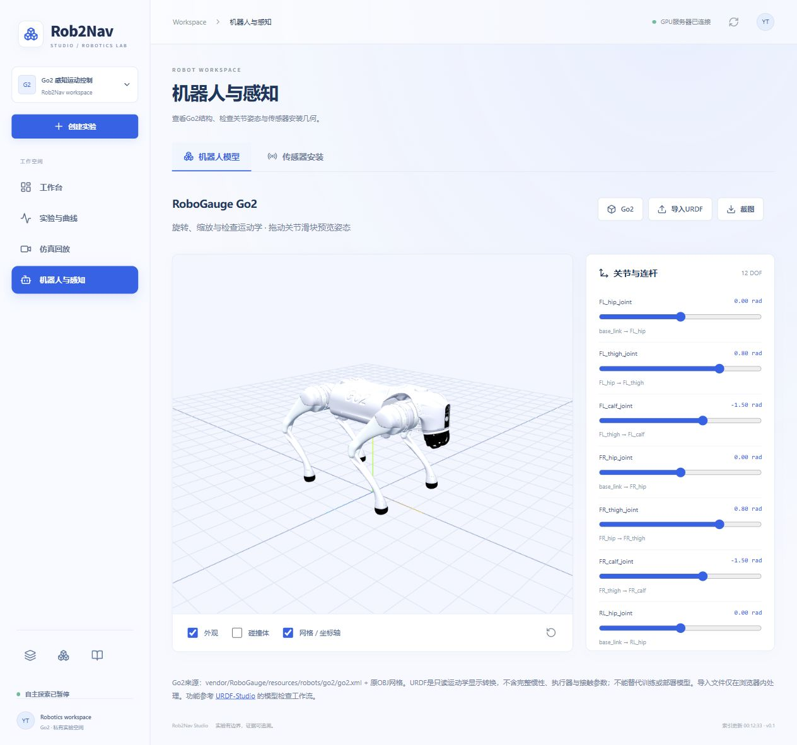
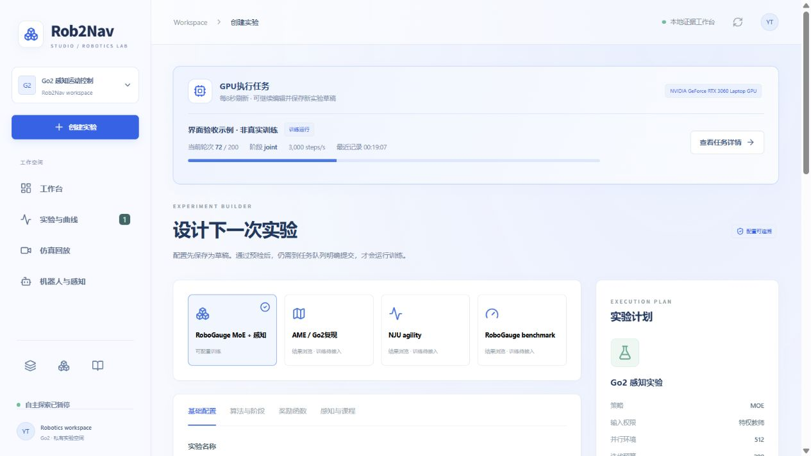

# Rob2Nav Studio

自托管的Go2训练、仿真与实验证据工作台。网页与Python/GPU运行环境分离，不恢复此前已暂停的机器人探索自动化。

## 当前可用

- 实验索引：JSONL、TensorBoard标量、首回合评估、失败原因、来源配置、原始权重。
- 图表：loss、奖励与分项奖励、吞吐率、标准差、课程分布，以及实际记录的其他标量。缺失指标不生成示意数据。
- 配置器：MoE训练预算、PPO参数/分组学习率、冻结阶段、奖励覆盖、教师/学生、课程、传感器安装预设、可信权重初始化/恢复。
- 持久任务队列：草稿、显式提交、串行GPU槽、阶段日志、完成校验、停止/取消。不凭进程退出码0判定成功。
- MuJoCo仿真草稿：场景、目标点、深度/雷达模式、台阶/坑宽、MoE行走或NJU冻结跳跃技能，完成后录制视频并纳入索引。
- 回放：视频、已有机身轨迹、动作前地图、足端接触力、失败项。历史缺失状态明确标注；不会伪造点云或完整三维动作。
- 对比：角色、原几何/前置、诊断标签、通过率及按回合计算的Wilson区间，原始数据导出。
- 报告原文、图片、视频链接与模型下载；相机安装的可交互几何预览与候选参数导出。

AME原训练控制适配器和独立RoboGauge评估提交适配器尚未开放；当前可看已有历史证据。NJU接入的是已有冻结技能的MuJoCo推理，不是原项目完整训练复现。传感器页面是平地几何示意，不是完整RealSense/Mid360物理模型。高帧率直播、任意关节三维回放、多用户权限和自动超参数搜索尚未实现。

## 启动

从Rob2Nav仓库根目录：

```bash
python -m pip install -r studio/requirements.txt
cd studio/frontend
npm ci
npm run build
cd ../..
python -m studio.api --port 8765
```

打开 http://127.0.0.1:8765 。默认可以浏览和保存草稿，但不能执行训练或仿真。

GPU服务器启动（使用独立Web虚拟环境，不修改Isaac环境）：

```bash
/root/gpufree-data/envs/rob2nav-studio/bin/python -m studio.api \
  --root /root/gpufree-data/Rob2Nav --port 8765 --allow-training \
  --sim-python /root/isaacsim/python.sh \
  --mujoco-python /root/gpufree-data/envs/go2-mapless/bin/python
```

`--allow-training`只开放显式任务提交；不会启动任何实验。当前版本训练适配器仅支持MoE。该选项必须绑定loopback。不要直接把可执行服务暴露到公网。

本机通过SSH隧道访问服务器：

```bash
ssh -N -o ExitOnForwardFailure=yes -o ServerAliveInterval=30 \
  -L 127.0.0.1:8766:127.0.0.1:8765 -p 30249 root@120.209.70.195
```

输入已有SSH凭据；密码不写入任何配置。浏览 http://127.0.0.1:8766 。重启电脑或隧道断开后需重新建立隧道，服务器网页服务需单独保持运行。

首次启动会索引项目`artifacts/`、`outputs/`和相邻`MoE-runs/`。索引30秒缓存；页面刷新按钮会强制重建。历史副本与服务器运行目录可能重复，界面保留各自路径，不把索引条数当作独立实验数量或混合计算成绩。

## 训练操作语义

1. 编辑参数 → 环境预检 → 保存草稿，不消耗GPU。
2. 任务队列点击提交，再确认实际执行。
3. 后端使用参数数组调用固定模块，不接受任意shell、Python表达式或任意目录的权重。
4. MoE网页参数通过`--studio-config`应用到实际奖励与PPO。已解析配置、SHA256、启动源码、训练参数均会保留。
5. 改变奖励/PPO覆盖后不能沿用原训练恢复；使用“仅权重初始化”创建新实验。完整恢复还须满足原训练参数检查，不包含仿真物理状态。
6. 停止训练时，worker写取消标记；MoE在下一rollout边界保存原子`studio_stop.pt`及`stopped.json`后退出。45秒无响应则强制退出，不能声称未保存更新已保留。该新边界停止接口已通过代码/控制测试，尚未执行真实GPU训练停止回合验收。
7. 最终评估要求completed存在、failed不存在、迭代预算匹配、最终checkpoint存在且ZIP完整。否则阻止评估。
8. worker崩溃后的在途任务标为unknown并阻止新GPU任务。管理员须先检查`outputs/studio/jobs/<id>/process.json`、真实进程与日志后人工核对，不可自动重跑。

数据库、日志、任务目录、取消标记在`outputs/studio/`，不会提交Git。单GPU锁使用Linux flock。浏览器/API关闭不终止独立worker；当前不提供系统重启后自动续跑。

## API

- `GET /api/catalog`, `/api/resources`, `/api/schema`, `/api/health`
- `GET /api/runs/{id}/series`, `/api/runs/{id}/scalars?tag=Train/mean_reward`
- `GET /api/evaluations/{id}`, `/api/reports/{id}`, `/api/files/{relative_path}`
- `POST /api/preflight`, `POST /api/jobs`
- `GET /api/jobs`, `GET /api/jobs/{id}/log`
- `POST /api/jobs/{id}/submit`, `POST /api/jobs/{id}/stop`
- `GET /api/events`（SSE状态流）

修改请求需要同源及`X-Studio-Request: 1`。前端已处理。可交互API文档在`/docs`。

## 测试

```bash
python -m pytest studio/tests -q
cd studio/frontend && npm run build
```

后端测试覆盖配置/路径边界、旧版MuJoCo格式、JSONL半行、TensorBoard真实事件格式、草稿不执行、跨站修改拒绝、队列去重、unknown资源阻断、退出码0不等于完成、最终权重检查及带假模拟器的完整worker流程。

网页验收应包括奖励覆盖→保存草稿→取消、真实曲线、报告与视频播放、Range请求、刷新不触发训练。服务器端已运行2秒MuJoCo回合验收，执行完成、产生MP4与评估JSON；回合超时未到目标不代表导航通过。没有为验收启动策略训练。

## 工程边界

当前是可使用的单用户研究工作台，不是多租户公网训练平台。预检只做明确可验证的解释器、配置、文件与接口检查，不保证显存足够或训练收敛；耗时不在缺少同配置实测时编造。自定义传感器几何候选不会直接覆盖后端固定rig。曲线降采样仅影响展示，TensorBoard/JSONL原文件保留。

## 导航、机器人与地形（2026-10-18）

主导航收敛为工作台、实验与曲线、仿真回放、机器人与感知；创建实验为独立主按钮。任务队列并入实验页签。研究中心统一承载基准、模型/权重证据与报告，入口为左下角三个带提示的图标，同一中心内可切换页签；基准仍可跳转到具体仿真。URL hash可定位页面并支持浏览器前进/后退。视觉参考本地 AI4-Loc 的 Aurora 浅蓝工作空间，保留本项目身份和数据。

机器人页支持真实Go2 OBJ外观、碰撞几何、12个关节限位滑块、连杆选择、旋转/缩放、重置及PNG截图；安装几何页签保留原传感器工具。默认显示URDF由 `studio/visuals.py` 从 `vendor/RoboGauge/resources/robots/go2/go2.xml` 只读转换，保留运动学/显示几何，不转换完整惯性、执行器或接触语义，不能用作动力学/部署模型。接口 `/api/robot/go2.urdf` 与受限OBJ资产接口不开放任意服务器文件。参考 [URDF-Studio](https://github.com/OpenLegged/URDF-Studio) 的检查工作流；实际使用 Three.js + urdf-loader 独立实现，未复制其编辑器或宣称完整编辑能力。

可选本地 `.urdf` 加其全部 `.obj`/`.stl` 多文件导入；浏览器本地解析，不上传服务器，不从外部URL取网格。DAE、纹理包、URDF写回与完整装配编辑暂不支持；同名不同目录网格宜改为唯一文件名。导入包100MB、URDF5MB上限。内置Go2及其训练模型不受导入/滑块影响。

创建实验的基础配置增加地形俯视图与可旋转三维几何，混合课程可查看五类子地形。`/api/terrain-preview` 直接调用共享生成器：`geometry.lane_boxes` 使用当前MoE训练的8×8米tile；两类AME调用 `ame_terrain` 或 `sparse_course`。预览难度仅用于检查，不改写自动课程或指定训练起点；original页展示严格原几何，不把可能的浅坑前置课程包装成严格场景。wide_deep最终difficulty=1与原AME生成结果完全一致；布局随机高度使用生成器固定seed42，训练重置seed并非此布局seed。SVG为实际几何俯视图，不是渲染成功视频。为独立Web环境加载稀疏几何，torch改为只在控制/课程函数内延迟导入，训练算法未改。

新增验证：模型12关节限位与网格完整性、两种窄桩最终课程逐几何一致、资产路径边界、非法难度/类型拒绝。完整后台17项测试通过；Web构建通过。浏览器检查三维Go2、关节/碰撞切换、20cm窄桩预览、研究中心跳转与本地URDF导入。自主探索与策略训练继续暂停。



## 创建实验页的GPU占用提示

当队列存在预检、运行或评估中的任务时，创建实验页顶部显示任务名、阶段、轮次、吞吐、最近日志时间与详情跳转，每8秒更新。训练轮次对零基日志加1展示；恢复训练分开展示全局轮次和本次迭代预算，不混算进度百分比。严格评估显示已经写完的场景summary计数（九项）；仿真显示单回合与最长时长，不编造训练轮次。任务完成后提示消失，草稿仍可继续编辑。详情入口直接定位并打开对应任务日志。

`/api/resources`补充nvidia-smi计算进程PID、程序名和显存；如检测到GPU占用但没有关联Studio执行任务，提示“未关联任务”，轮次无法确认并提供实验页入口。不启动额外训练来演示提示，UI验收使用隔离目录、明确标识的样例记录。




在线权重推理、三维拖动回放、任务多指标遥测和权重候选选择见 [在线仿真说明](../docs/ONLINE_SIMULATION.md)。

### 仿真与队列入口（2026-10-20）
仿真页面默认打开在线仿真；点击运行新仿真，在弹窗中依次选择已有训练任务、该任务检查点、地形/几何/难度、时长和种子。队列最佳候选按钮会预选对应任务和权重，不自动提交；最佳候选不代表已验证全局最优。在线三维状态与历史视频/评估分为两个页签，历史证据链接自动进入历史回放。任务队列合并实时任务详情、TensorBoard曲线和可展开的历史训练记录；旧experiments和jobs路由均可访问同一队列。能力与方案位于左侧栏底部图标。
