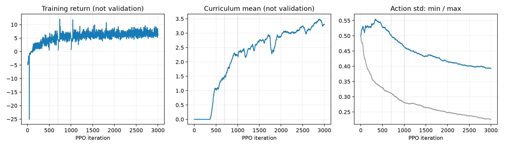
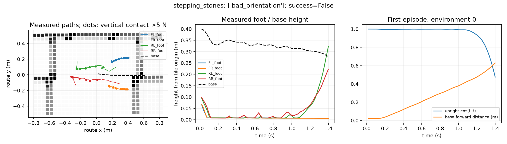

> 历史记录：运行状态属于记录当时，不是安装或当前任务状态。新用户先读[新手复现总览](docs/新手复现总览.md)；执行命令前按[环境准备](docs/环境准备与路径约定.md)设置变量。原始日志中的机器位置保留于归档，不直接用于新环境。

# 原项目 Go2 AME 过桩复现进展

**尚未复现成功过桩。** 原始 Go2 网络已完成第一阶段 3000 轮有效 PPO 更新；第二阶段尚未训练。这里记录实测结果，不把启动成功、无跌倒或训练奖励视为过桩成功。

上游固定为 [criticaldamped/AME_Locomotion，15d02c8](https://github.com/criticaldamped/AME_Locomotion/tree/15d02c891273d3f4c9b55c9afe3073bcd2d9152f)。原始跟踪文件保持不变，使用其 Go2 网络、奖励、动作、观测和两阶段地形。actor 使用理想 XYZ 地形扫描，是教师策略；没有输入真实相机或雷达可见点。

## 中间检查点独立评估

Stage1、level 0、命令 0.5 m/s、seed 801，额外加入 XY ±3 cm 和 yaw ±0.04 rad 的初始位姿扰动。每项只统计 32 个环境的首回合；所有环境共享固定地形生成器种子，不能作为 32 种地形的泛化验证。

首批 1000 轮使用 `model_999.pt`；“第 N 检查点”指 `model_N.pt`，其内部下一轮编号为 N+1。

| 地形 | 第 1000 轮 | 第 1500 检查点 | 第 2000 检查点 |
|---|---:|---:|---:|
| rough | 1/32 | 26/32 | 22/32 |
| stepping_stones | 0/32 | 0/32 | 0/32 |
| stairs_up | 7/32 | 23/32 | 22/32 |

完整通过要求前进超过 3.5 m、无失败终止、结束时直立且至少两足支撑。未结束或超时不会计为成功。该组结果不足以进入 Stage2，继续基础阶段训练。

较早的第 700 轮在原 Play 零扰动踏石条件下为 0/32，主要停留在出生平台；这些重复环境具有相同轨迹，不是独立随机试验。[完整 20 秒诊断视频](artifacts/critical_ame/evaluation/stage1_700_stones_l0/episode_0.mp4)。

第 2000 检查点零样本测试 Stage2 `double_stakes`，level 0、5 均为 **0/32**。没有据此宣称完成第二阶段训练。

## 第 3000 轮最终分类检查

`model_2999.pt`，Stage1 level 2，仍采用上面的 32 环境首回合、重置扰动和通过标准：

| 地形 | 含末态支撑的完整通过 | 位移达标 | 失败终止 |
|---|---:|---:|---:|
| stairs_down | 2/32 | 5/32 | 27/32 |
| stairs_up | 27/32 | 30/32 | 2/32 |
| slope_down | 19/32 | 32/32 | 0/32 |
| slope_up | 32/32 | 32/32 | 0/32 |
| boxes | 12/32 | 17/32 | 15/32 |
| rough | 28/32 | 32/32 | 0/32 |
| stepping_stones | 0/32 | 0/32 | 32/32 |
| gaps | 0/32 | 0/32 | 32/32 |

末态两足支撑条件较保守：例如下坡全部达到位移且无失败，但终点恰逢支撑相位使完整通过计数较低。这些情况不能称为跌倒。踏石与沟隙则全部出现真实失败，不是末态条件筛掉了成功路线。

八类均达到 80% 完整通过且失败率不超过 5% 的审查门槛没有通过，因此没有宣称完成基础阶段能力验证、也没有进入标准 Stage2 训练。这个门槛是本次实验的审查准则，不是论文报告的固定指标。

同一最终权重零样本测试 Stage2 的双列桩、交错桩，level 0、5 **四项均为 0/32**。四个完整首回合视频和数值终止记录一起保留，不是只截取好的片段。

## 稀疏落脚停滞诊断

按训练时真实环境列分组读取第 1000、1500、2000、2200 检查点的课程状态：`stepping_stones`、`gaps` 两类各自 64 个环境始终为 level 0；其他类别逐步升高。平均课程等级不能反映这两类的失败。

第 2200 轮踏石仍为 0/32。环境 0 在约 1.4 秒、前进约 0.63 米后触发 `bad_orientation`。足端与接触记录显示这条轨迹中前足长时间支撑，机身继续前移后前倾，未形成可靠跨隙落脚。

已有 MLP 教师在同一原生控制器、rough level 0 上完成 32/32，在 double_stakes level 0 上为 0/32。它是外部诊断对照，不计入 AME 成绩。该结果不能证明全部接口正确，也不能将宽地形能力外推为窄桩能力。

另开[外部教师基础步态初始化对照](docs/AME步态初始化说明.md)，保留原版训练。这一分支明确偏离原版从零初始化，须单独报告。

## 原始运行失败与修正

最初长训练在第 705 轮附近触发 `height scanner world hits (missed ray)` 非有限值错误，最后检查点为 `model_700.pt`。恢复诊断再次捕获方块地形上的单条未命中：机器人当时直立，且在通道范围内。

精确重建了失败位姿、地形原点和射线。原起点 x=-1.97500002 m 位于方块接缝；加高起点 5 m 仍未命中，但 x 平移 ±0.00005 m 均返回真实交点。

运行时修正仅对未命中的射线依次在 ±x、±y 50 微米内重查询真实网格，原有效返回不变。集成检查确认原有效返回逐值一致、唯一无效返回得到真实交点；不能恢复的射线仍报错，不补零、不合成高度，也不修改物理地形或机器人动作。这是相对于原始运行的明确改动。

修正后已完成恢复链至第 1000 轮。训练中的重查询计数和样例、原失败日志及几何定点探针保存在 `artifacts/critical_ame`。

## 复现材料与边界

- [运行说明](docs/原始AME训练复现手册.md)：固定版本、训练、续训、评估和修正开关。
- [归档清单](artifacts/critical_ame/manifest.json)：每个运行是否完成、选取检查点及 SHA256。进行中的运行只提供当时已原子保存的检查点，不能视为已完成。
- [上游源码指纹和环境](artifacts/critical_ame/upstream_manifest.json)。后续训练/评估另存包装器启动时源码快照；早期原始运行未声称具备该快照。
- `python -m critical_ame.verify` 校验已归档权重、现有包装器源码快照和完整视频帧数。

第一阶段保留的 3000 轮 PPO 更新对应 36,864,000 次交互；失败后丢弃的更新和未完成 rollout 不包含在该数值中。零样本 Stage2 测试与 Stage2 训练严格区分。本实验也尚未验证 MuJoCo 或实机部署。
